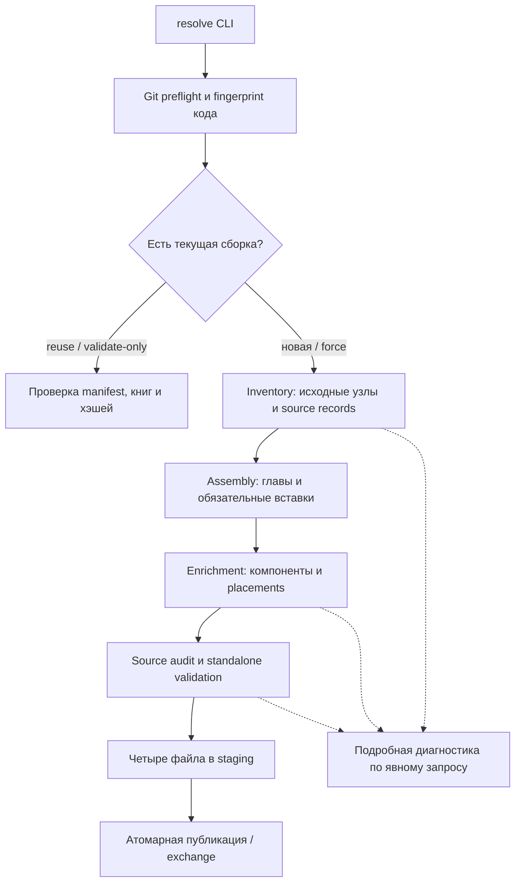

# Архитектура сборщика книг

Сборщик получает XPHB, XDMG и XMM из закреплённого локального snapshot 5e.tools и создаёт по одному самодостаточному JSON на книгу. Код расположен в `src/dnd_rag/ingestion/book_assembly`; пользовательский запуск описан в [README ingestion](../../src/dnd_rag/ingestion/README.md).

## Границы компонентов

Основной `dnd-rag` остаётся Python-проектом. Node используется для текущего извлечения, поскольку native loaders, UID/hash builders, inheritance и item templates upstream написаны на JavaScript. Его зависимости изолированы в `tools/ingestion`; Python-пакеты для сборки не устанавливаются.

`external/5etools-src` — источник данных и штатных алгоритмов загрузки. Сборщик читает существующий submodule, проверяет его состояние и не изменяет tracked-файлы, checkout, gitlink или зависимости сайта. Отсутствующие изображения не скачиваются. Остальные источники, SRD API и публичный сайт не используются.

`ingestion/dev` содержит явно запускаемые инструменты диагностики. Они не являются обязательной частью обычного `resolve`. Отдельный [markdown_export](../../src/dnd_rag/ingestion/markdown_export/README.md) читает готовые JSON независимо от upstream runtime. Чанкинг, embeddings, retrieval, RAG и API/MCP сейчас не реализованы.

## Поток выполнения

Промежуточные inventory/assembled/enriched-файлы при обычной сборке находятся в рабочем каталоге системного tmp. `resolve` удаляет его в `finally` при успехе и ошибке. Существующая проверенная финальная сборка читается без этих файлов. `--diagnostics-root` сохраняет входы и подробные отчёты вне финального датасета.

## Карта исходников

Все пути в таблице отсчитываются от [book_assembly](../../src/dnd_rag/ingestion/book_assembly/README.md).

| Компонент | Основные модули | Ответственность |
| --- | --- | --- |
| Общая инфраструктура | `common/book_schema.mjs`, `source_scan.mjs`, `tree.mjs`, `artifact_store.mjs`, `project_paths.mjs` | Строгий JSON, IDs/origins, обход дерева, безопасные пути, signatures и промежуточная публикация |
| Runtime | `runtime/preflight.mjs`, `upstream_runtime.mjs`, `inventory_runtime.mjs` | Чистый pinned checkout, native globals, локальный JSON-транспорт, UID/tag/lookup grammar |
| Инвентаризация | `inventory/inventory.mjs`, `inventory_books.mjs`, `inventory_sources.mjs` | Полный реестр позиций, refs, source-defined records и dependency evidence |
| Основная сборка | `assembly/assemble_books.mjs`, `assembly_content.mjs`, `assembly_inventory.mjs`, `assembly_schema.mjs` | Сохранение глав, раскрытие вставок, восстановление silent misses, origin и native derivation |
| Обогащение | `enrichment/enrich_books.mjs`, `enrichment_inputs.mjs`, `enrichment_plan.mjs`, `enrichment_content.mjs` | Конечный доменный граф, дочерние компоненты, canonical placement и shared fluff |
| Проверка исходников | `validation/validate_assembly.mjs`, `validate_enrichment.mjs` | Source round trip, полнота механик/компонентов, generated projections и все placement decisions |
| Финализация | `resolution/resolve_books.mjs`, `resolved_inputs.mjs` | Управление стадиями, повторная проверка входов и формирование результата |
| Контракт и хранение | `resolution/resolved_schema.mjs`, `resolved-book.schema.json`, `resolved_content.mjs`, `resolved_manifest.mjs`, `resolved_store.mjs`, `atomic_exchange.py` | Standalone validation, два хэша, manifest, locks и атомарная замена |

`tests/ingestion/book_assembly` повторяет это разделение: `unit`, `integration`, `smoke`, `helpers`. `tools/ingestion` содержит npm aliases, закреплённый Node, Ajv для тестов и runner. Подробная [модель данных](DATA_MODEL.md) отделена от [алгоритма сборки](PIPELINE.md) и [руководства разработчика](DEVELOPMENT.md).

## Основные группы upstream inputs

Пути ниже относятся к upstream, служат картой для разработки и не заменяют автоматический scan всех tracked JSON и native loader registry.

| Материал | Основные данные текущего snapshot |
| --- | --- |
| Каталог и главы | `data/books.json`, `data/book/book-xphb.json`, `book-xdmg.json`, `book-xmm.json` |
| Классы/подклассы/features/fluff | `data/class/index.json`, `class-*.json`, `fluff-index.json` и соответствующие fluff files; файлы содержат несколько редакций, нужен точный source |
| Spells | `data/spells/index.json`, `spells-xphb.json`, spell fluff и native generated source lookup |
| Monsters/lore/effects | `data/bestiary/index.json`, `bestiary-xphb.json`, `bestiary-xmm.json`, `fluff-index.json`, `fluff-bestiary-*.json`, `legendarygroups.json` |
| Species/backgrounds/feats/options | `data/races.json`, `backgrounds.json`, `feats.json`, `optionalfeatures.json` и companion fluff |
| Items/templates | `data/items.json`, `items-base.json`, `magicvariants.json`, связанные item properties/types/masteries и fluff |
| Правила и действия | `data/variantrules.json`, `data/generated/gendata-variantrules.json`, `actions.json`, `conditionsdiseases.json`, `senses.json`, `trapshazards.json` |
| Другие категории | `data/objects.json`, `rewards.json`, `bastions.json`, deck/card/vehicle, skill/language/deity/loot sources согласно фактическим props |

Generated данные уже присутствуют в проверенном clone. Их отсутствие в новом snapshot нужно диагностировать, не подменяя результат данными публичного сайта. Имена и число маршрутов могут измениться после upstream update.

## Native Node runtime

Прямой импорт подтверждён smoke- и интеграционными проверками локального snapshot. Поэтому HTTP-сервер, Chromium, Playwright, DOM-заглушки и сборка сайта не требуются. Импортируются штатные `parser.js`, `utils.js`, `utils-config.js`, `render.js`, `render-dice.js`, `hist.js`, `utils-dataloader.js`, затем `node/util.js → patchLoadJson()`.

Upstream-транспорт вызывает его же `DataUtil.pDoMetaMerge`; `_copy`, `_mod`, item enhancement и dereferencing остаются штатными. Наш guard разрешает `DataUtil.loadJSON/loadRawJSON` только для JSON внутри upstream с проверкой realpath и без URL-схем. Запрошенные runtime JSON сверяются с tracked inputs.

`render-dice.js` нужен item loader, `hist.js` — class hash helpers. Они добавлены по фактически наблюдаемым зависимостям. Homebrew/prerelease registries не регистрируются. При смене upstream пригодность интеграции проверяется заново.

Upstream хранит globals, расширения прототипов и кеши. Поэтому поддерживается один snapshot на процесс; стадии CLI запускаются дочерними процессами. `close()` возвращает cwd и транспорт, но не выгружает globals. Будущий Python-оркестратор должен вызывать CLI через subprocess.

## Воспроизводимость и область гарантий

Checkout обязан совпадать с gitlink из **HEAD** основного Git-репозитория. Проверка учитывает размещение `lab2` внутри более крупного репозитория и `.git` submodule как файл. Staged-only gitlink и изменённые tracked-файлы блокируют запуск независимо от `--strict`.

Результаты адресуются `<upstream_sha>/<assembler_signature>`. Содержимое книг, provenance и manifest детерминированы для этого build-id; время генерации и случайные имена tmp не сериализуются. Signature является digest идентичности сборки, а не электронной подписью издателя.

PASS относится к полноте доступных материалов закреплённого snapshot. Проверки не доказывают соответствие всех страниц печатного издания и не извлекают текст из пикселей. Наблюдаемые результаты и ограничения приведены в [VALIDATION.md](VALIDATION.md).
