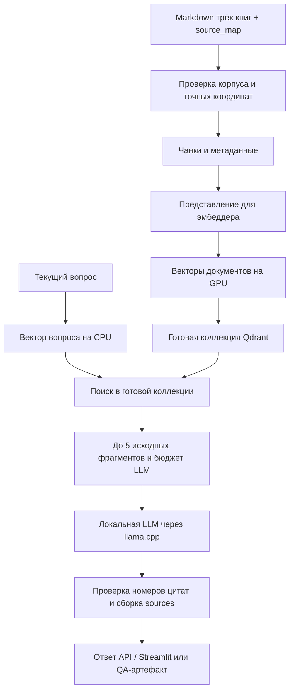

# Устройство D&D RAG

Система ищет правила в трёх подготовленных книгах D&D и передаёт найденные фрагменты локальной LLM для ответа с источниками. Это подход RAG: поиск добавляет к вопросу подходящий контекст. Книги используются как база знаний для поиска; дообучение LLM в этот pipeline не входит.

Документ объясняет поток данных и ключевые решения реализации. Команды запуска находятся в [CLI.md](CLI.md), поля YAML и программа G1–G5 — в [справочнике экспериментов](../../configs/experiments/README.md), фактические проверки и замеры — в [VALIDATION.md](../rag/VALIDATION.md).

- [Общая схема и сценарии](#общая-схема-и-сценарии)
- [Книги, чанки и координаты](#книги-чанки-и-координаты)
- [Представление текста и эмбеддинги](#представление-текста-и-эмбеддинги)
- [Индекс Qdrant и повторные запуски](#индекс-qdrant-и-повторные-запуски)
- [Путь одного вопроса](#путь-одного-вопроса)
- [Процессы, память и блокировки](#процессы-память-и-блокировки)
- [Оценка и воспроизводимость](#оценка-и-воспроизводимость)
- [Карта кода](#карта-кода)

## Общая схема и сценарии

У системы две основные части: подготовка поискового индекса и обработка вопросов по готовому индексу.



Для совместимого готового индекса подготовительная часть пропускается. Если коллекцию нужно строить, процесс документного эмбеддера полностью завершается до запуска LLM: обе модели не занимают GPU одновременно.

| Сценарий | Что выполняется | Результат |
| --- | --- | --- |
| Подготовка индекса | Корпус → чанки → векторы → Qdrant либо проверка готовой коллекции. | Поисковая коллекция, готовая к запросам. |
| Только поиск | Индекс → CPU-вектор вопроса → Qdrant. | Ранжированные исходные фрагменты, без LLM. |
| Ответ на вопрос | Поиск → упаковка контекста → LLM → цитаты. | Один ответ и использованные источники. |
| Retrieval-эксперимент | Поиск по 20 эталонным вопросам → расчёт метрик. | Выдача, метрики, времена и снимки условий. |
| QA-прогон | Ответы LLM на 20 вопросов выбранного профиля. | Ответы, фактически переданный контекст и таблица для смысловой оценки. |

CLI и FastAPI вызывают общее Python-ядро. Streamlit обращается к API по HTTP и показывает текущую пару вопрос–ответ. История предыдущих вопросов в prompt не передаётся; потоковой генерации, reranker и агентского цикла в этом MVP нет. Ответы рассчитаны на английский язык.

## Книги, чанки и координаты

### Готовые входы

Основной pipeline использует результаты уже выполненной [подготовки данных](../ingestion/ARCHITECTURE.md): `xphb.md`, `xdmg.md`, `xmm.md` и `source_map.jsonl`. Это Player’s Handbook (2024), Dungeon Master’s Guide (2024) и Monster Manual (2025). Карта описывает вложенные разделы и сведения об их печатных страницах; раздел карты и поисковый чанк — разные объекты.

При чтении от книги отделяются YAML front matter и ровно одна пустая строка после него. Оставшийся текст — **canonical body**. Он сохраняется побуквенно с окончаниями строк LF.

### Контракт чанка

Чанк — один непрерывный непустой срез одной книги. Общий тип `Chunk` содержит:

| Часть | Содержание |
| --- | --- |
| `page_content` | Точный исходный текст фрагмента. |
| Происхождение | Файл, книга, название, система источника, upstream revision и хэш body. |
| Координаты | `start_char` / `end_char`, `line_start` / `line_end`. |
| Разделы | Список реально затронутых `sections` с путями заголовков и атрибуцией страниц. |
| Идентификация | `chunk_id`, `index_id`, версия схемы; также число токенов исходного текста. |

Позиции символов — Unicode code points, диапазон `[start_char, end_char)`; строки body нумеруются с 1, обе границы включены. YAML и пустой разделитель в эти координаты не входят. Последняя строка определяется последним символом среза: завершающий LF не добавляет следующую строку к цитате.

Собственное содержание раздела определяется его интервалом за вычетом дочерних разделов. В metadata попадают затронутые собственные участки в порядке первого пересечения. Все предки повторно не добавляются; их названия уже содержатся в полном `heading_path`. Одинаковые пути с разными координатами сохраняются как отдельные записи.

### Три стратегии чанкинга

| Стратегия | Как разбивается текст |
| --- | --- |
| `markdown` | `MarkdownTextSplitter` по целой книге с Markdown-разделителями как ориентирами. |
| `recursive` | `RecursiveCharacterTextSplitter` по целой книге со стандартными разделителями. |
| `source_map_recursive` | Сначала участки по началам заголовков до выбранной глубины, затем Recursive отдельно внутри каждого участка. Baseline глубины — H4. |

Размер и перекрытие задаются в токенах **эмбеддера**, без служебных токенов на каждой подстроке. В custom-стратегии текст до первого заголовка и введения родителей сохраняются; введения не копируются в дочерние разделы, overlap действует внутри участка. Специального ремонта таблиц или statblocks нет.

Адаптер координат проверяет исходный срез, включая пробелы и разделители, локальные смещения и повторяющийся текст. Потеря текста или неоднозначное сопоставление завершают сборку диагностикой. Вымышленные координаты не сохраняются.

### Что означают печатные страницы

`printed_pages` и `page_attribution` относятся к разделу источника. `explicit`, `partial`, `inherited_section_start` и `unknown` сохраняют исходную степень точности. Например, унаследованная страница начала раздела не доказывает точную страницу всего чанка. Страницы не вычисляются по размеру текста и не подменяют координаты body.

## Представление текста и эмбеддинги

### Два представления одного фрагмента

| Представление | Назначение | Что может изменяться |
| --- | --- | --- |
| `page_content` | Цитаты, BM25, оценка retrieval, полный текст источника в UI. | Всегда остаётся исходным срезом. |
| `embedding_text` | Временный вход модели эмбеддингов. | Добавление title и удаление исходных Markdown-заголовков согласно пресету. |

Вход документа имеет формат `title: {title} | text: {content}`. При `include_title=true` title содержит книгу и полные пути затронутых разделов; одинаковые строки путей перечисляются один раз. При `false` используется буквальное `title: none`.

Независимый флаг `strip_markdown_headings` удаляет из content только пересечения с настоящими H1–H6 исходного текста, в том числе частично разрезанными заголовками. Символы `#` в коде или обычном тексте не удаляются. Эти настройки меняют вход эмбеддера, сохраняя исходный чанк и координаты.

### Где вычисляются векторы

Используется EmbeddingGemma 2 с закреплённой ревизией модели и токенайзера; компоненты изображений и звука отключены. `DocumentEncoder` считает документы на CUDA GPU в явно выбранном BF16 или FP32. `QueryEncoder` загружается один раз на процесс, работает на CPU в FP32 и использует те же ревизию и размерность.

Документ получает ровно один описанный префикс, без повторного автоматического добавления. Вопрос передаётся со штатным `prompt_name` модели, например `QuestionAnswering`. Весь реальный вход со специальными токенами проверяется до encode; слишком длинный текст отклоняется без скрытого усечения.

Поддерживаются размерности 128/256/512/768. Библиотечное сокращение размерности сохраняет нормализацию; проверяются форма вектора и конечность значений. В Qdrant сохраняются исходные векторы float32 с косинусной метрикой.

### Зачем два токенайзера

| Токенайзер | Что считает |
| --- | --- |
| Эмбеддера | Размер чанка, overlap и полный вход модели эмбеддингов. |
| LLM | Весь chat prompt: system, вопрос, источники, маркеры, шаблон чата и служебные токены. |

Например, 512 токенов чанка не означают 512 токенов LLM. Расход `raw_tokens` в retrieval-метриках характеризует объём найденного текста; для допуска генерации используется отдельный точный подсчёт LLM.

## Индекс Qdrant и повторные запуски

Локальный Qdrant закреплён в `compose.yaml` на версии 1.20.0. Его `/qdrant/storage` подключён к `data/qdrant/` внутри проекта через bind mount; каталог исключён из Git и сохраняется при пересоздании контейнера. Данные требуют POSIX-совместимой файловой системы. Готовность коллекции и её идентификаторы проверяются независимо от физического расположения хранилища.

### Что хранится в коллекции

Qdrant Server работает в Docker с постоянным томом. Одна коллекция соответствует полному варианту индекса. Один чанк — одна точка с именованным вектором `dense` и payload из исходного текста и metadata. Для `hybrid` в той же коллекции дополнительно строится нативный полнотекстовый индекс BM25 по `page_content`; в плотной коллекции его нет.

За готовность отвечают метаданные самой коллекции: `owner`, `build_spec`, `index_id`, `build_id`, `expected_points`, состояние `building` или `ready`. Готовность выставляется после загрузки и проверки схемы, payload, числа точек и завершения нужных оптимизаций. Повторный upsert тех же ID не создаёт дубликаты. HNSW и параметры планировщика закреплены так, чтобы поисковые структуры реально строились; условия и пробы описаны в [TECHNICAL_PROBES.md](../rag/TECHNICAL_PROBES.md).

Квантование Qdrant поддерживает `none`, `scalar_int8`, `turboquant_4bit`. Исходные float32 сохраняются, поиск по квантованному представлению явно использует `rescore=false` / `ignore=false`. Это отдельная настройка от размерности эмбеддингов и квантования GGUF отвечающей модели.

### Идентификаторы и совместимость

| Идентификатор | Для чего нужен |
| --- | --- |
| `config_id` | Хэш эффективной конфигурации эксперимента в `run.json`, включая настройки запроса. Несколько конфигураций поиска могут использовать один индекс. |
| `index_id` | SHA-256 канонического JSON эффективного `build_spec`; определяет совместимость индекса. Коллекция называется `rag_<полный index_id>`. |
| `build_id` | Уникальный идентификатор конкретной полной сборки. При rebuild того же варианта меняется. |
| `chunk_id` | Детерминированный UUIDv5 от индекса, файла и диапазона символов; разные места с одинаковым текстом не склеиваются. |

В `build_spec` входят хэши корпуса и карты, metadata книг, настройки чанкинга и embedding input, ревизии, document dtype, размерность, параметры построения HNSW, квантование, режим поиска, активная обработка текста BM25, версии алгоритмов и влияющих библиотек.

Параметры запроса (`ef_search`, query prompt, BM25 `k1`/`b`, RRF), размер пакета документов, путь к кэшу/эталонам и имя запуска `index_id` не меняют. Эффективные defaults раскрываются до вычисления хэша; форматирование YAML на него не влияет.

### Политика `ensure_index`

| Состояние | Действие |
| --- | --- |
| Полная совместимая коллекция `ready` | Проверить паспорт, схему и содержимое; использовать без split/embed/upload. |
| Коллекции нет | Выполнить полную подготовку. |
| Собственная сборка неполна или передан `--rebuild` | Пересобрать полный вариант с документными эмбеддингами. |
| Сеть недоступна или владение не доказано | Вернуть техническую ошибку; автоматическое удаление не выполняется. |

Кэшей промежуточных чанков/векторов и переноса dense-векторов в hybrid нет. Готовую коллекцию можно использовать целиком; для другого build-варианта нужна новая полная подготовка. После перезапуска Qdrant состояние `grey` проверенной готовой коллекции может требовать возобновления optimizer; это восстановление сервиса с сохранением `build_id`, описанное в технических пробах.

`reset-index` — отдельная операция. По конфигурации вычисляется текущий вариант; по `index_id` адресуется конкретная прежняя коллекция без чтения корпуса и загрузки моделей. Удаляется только коллекция с подтверждённым владением. Результаты в `results/` и другие варианты сохраняются.

## Путь одного вопроса

### 1. Retrieval: вопрос → фрагменты

Общий интерфейс — `Retriever.retrieve(question, limit=None)`. Уже загруженный `QueryEncoder` вычисляет вектор на CPU, затем `QdrantStore.search` обращается к готовой коллекции. Книги, карта разделов, эталоны и отвечающая LLM для этого вызова не читаются.

| Режим | Запрос к Qdrant | Значение `score` |
| --- | --- | --- |
| `dense` | Поиск по `dense` с заданным `hnsw_ef`. | Косинусное сходство. |
| `hybrid` | В базовом профиле 20 dense и 20 BM25 кандидатов → штатный RRF с константой 2 и равными весами → до 10 результатов. | Оценка объединённых рангов RRF. |

Каждый hit содержит `rank`, `score`, `score_kind` и полный `Chunk`. Равные оценки сохраняют порядок сервера; повторные ID убираются без дополнительного поиска. Поиск не использует score threshold. Поэтому далёкий по смыслу вопрос обычно тоже получает ближайшие фрагменты; наличие выдачи не доказывает достаточность контекста.

### 2. Контекст: фрагменты → полный prompt

`RagService.ask` выполняет один retrieval. `pack_context` берёт первые максимум пять hits и собирает system, текущий вопрос и блоки исходных источников с номерами 1..N.

Бюджет фиксирован:

```text
полный вход + максимум ответа + запас <= окно LLM
input_tokens + 1536 + 256 <= 8192
input_tokens <= 6400
```

Если prompt не помещается, последний по рангу чанк удаляется целиком; сообщения и нумерация пересобираются, токены считаются снова. Чанк не обрезается и не заменяется результатом ниже первой пятёрки. Если не входит вопрос с первым фрагментом, возвращается `context_budget_exceeded` без генерации.

`LLMClient` считает тот же chat prompt, который будет отправлен в Chat Completions: native `/apply-template`, затем `/tokenize` с `add_special=true` / `parse_special=true`. Шаблон, thinking и служебные токены учитываются сервером. После генерации фактический input usage сравнивается с подсчётом; несовпадение считается ошибкой.

### 3. Генерация и реестр цитат

Локальная Nemotron работает в отдельном llama.cpp server. `ChatOpenAI` служит HTTP-клиентом. Профиль фиксирует окно, лимит ответа, sampling и размещение GPU/KV; thinking, автоматический fit, сдвиг контекста и повторное использование промпта выключены. Системная инструкция — ресурс пакета `rag/prompts/system.txt`.

Перед генерацией фиксируется **Citation Registry**: соответствие номера полному чанку, фактически вошедшему в prompt. Например, `[2]` означает второй переданный фрагмент этого вопроса. `extract_citations` распознаёт такие маркеры в Markdown, исключая code, escapes, настоящие links/images и их definitions.

Приложение собирает `sources` только по использованным допустимым номерам. Повторы убираются, исходная нумерация сохраняется. Неизвестный номер даёт `unknown_citation`, достижение лимита ответа — `answer_truncated`; текст сохраняется без скрытой повторной генерации. Превью источника — первые 400 Unicode-символов; UI также раскрывает полный исходный текст и честную атрибуцию страниц.

Эта проверка подтверждает связь номера с переданным источником. Поддерживает ли источник конкретное утверждение по смыслу, оценивается отдельно.

### 4. Успех, пустая выдача и ошибка

`RagService.ask` возвращает `AskTrace`: публичный `AskResult`, фактические сообщения, зафиксированный registry, retrieval и сырой ответ с расходом токенов и native timings.

При успешной пустой выдаче возвращается `status=no_context`, `sources=[]`, без обращения к LLM. Число входных токенов, причина завершения и время пропущенной генерации — `null`. Недоступность Qdrant или LLM остаётся технической ошибкой. Если фрагменты есть, но информации недостаточно, частичный ответ и пробелы должна объяснить LLM.

## Процессы, память и блокировки

### Порядок запуска

`runtime/application.py` подготавливает только зависимости выбранного режима. Для `demo` порядок такой:

1. Прочитать настройки, занять блокировку проекта, проверить Qdrant и нужную коллекцию.
2. При необходимости построить индекс отдельным GPU worker и дождаться его выхода.
3. Загрузить один `QueryEncoder` на CPU.
4. Запустить llama.cpp, дождаться готовности, затем поднять один API worker без reload.
5. После готовности API запустить Streamlit; разрешить вопросы при `qa_ready=true`.

`serve-retrieval` заканчивает подготовку запуском API без LLM/UI. Это альтернативный режим `demo`: одновременно они не запускаются. HTTP-запрос пользователя не запускает индексацию и не меняет профиль приложения.

### Runtime-lock и свои процессы

`RuntimeSession` держит неблокирующий OS lock на стабильном `.runtime/project.lock`. Это один «ключ» на весь активный локальный runtime: второй build/experiment/demo/QA/reset отказывает до тяжёлой работы. Постоянный Qdrant, чтение результатов и offline-summary этот ключ не удерживают.

Дети наследуют открытый lock descriptor через `pass_fds`. При аварийной смерти родителя живой ребёнок сохраняет защиту. При штатном выходе ожидается завершение своей группы даже после выхода wrapper; для оставшихся процессов наследование FLOCK проверяется через Linux `/proc/fdinfo`. Если TERM недостаточно, применяется KILL. Старый PGID или отдельное открытие того же lock-файла не доказывают владение чужой группой. При неподтверждённой остановке возвращается ошибка; lock-файл не удаляется.

Перед автоматическим запуском сервиса общий preflight отличает подтверждённый `ECONNREFUSED` от timeout/DNS/protocol/неопределённости. Только подтверждённое отсутствие разрешает запуск; занятый LLM endpoint даёт конфликт. Модель, полный профиль и токенный контракт чужого сервера автоматически не принимаются.

### HTTP и UI

FastAPI предоставляет `/retrieve`, `/ask` и `/health` поверх того же ядра. Входы строгие, ошибки имеют единый формат. Конфигурация фиксируется на старте. Готовность retrieval и QA сообщается отдельно.

Синхронные обработчики работают в пуле потоков. Внутри API есть отдельный QA gate: пока выполняется один QA-вызов, другой получает 429; `/retrieve` остаётся доступен. Это отдельное ограничение от общего runtime-lock.

Streamlit выполняет только HTTP-запросы и отображение. Он не загружает модели, показывает результат после завершения генерации и хранит одну текущую пару вопрос–ответ. Поля запросов/ответов, порты и ошибки перечислены в [HTTP-справочнике CLI](CLI.md).

## Оценка и воспроизводимость

### Эталонные вопросы

Для evaluation используется валидированный YAML: 20 основных ответимых вопросов и 3 дополнительных случая недостатка данных. `load_gold` сверяет корпус, хэш карты, точные срезы evidence и соответствующий `validation_report.json` со статусом PASS / written. Старый сохранённый gold после неуспешной валидации не принимается. Структурная валидность не заменяет смысловую проверку эталонов.

Факты вопроса нужны совместно, а альтернативы одного факта — разные достаточные подтверждения. Три insufficient-вопроса не входят в средние retrieval-метрик; в QA они подключаются опционально и получают отдельную сводку.

### Что измеряет retrieval

Для каждого вопроса заново по полному manifest определяется множество всех релевантных чанков `Rq`. Релевантность требует той же книги/версии и пересечения с evidence не менее 50% длины более короткого диапазона.

| Метрика | Смысл |
| --- | --- |
| Precision@k | Число релевантных уникальных результатов среди первых k, делённое на k, включая короткую выдачу. |
| Recall@k | Доля найденных чанков из полного `Rq`; при пустом `Rq` — 0 и отдельная отметка. |
| MRR@10 | Средний обратный ранг первого релевантного результата в первой десятке; если его нет — 0. |
| Evidence Coverage@k | Доля покрытия эталонных фактов объединением диапазонов top-k, с равным весом фактов и вопросов. |

Для Evidence Coverage сначала объединяются все диапазоны top-k без relevance-фильтра. Для каждой альтернативы считается дробное покрытие; для факта берётся максимум альтернатив. Части разных альтернатив не суммируются. Перекрывающиеся символы считаются в покрытии один раз, а в расходе `raw_tokens` — повторно как передаваемый текст.

P/R/EC считаются при k=1/5/10 до сокращения LLM-контекста. Смена геометрии чанков меняет `Rq`, поэтому chunk-level Recall разных разбиений нужно читать вместе с EC и объёмом. Эти метрики оценивают поиск доказательств; правильность сгенерированного ответа из них не следует.

### Сохранённые запуски и Study

`RunWriter` резервирует уникальный `results/<experiment_name>/` до тяжёлой работы, сохраняет снимки условий и завершает паспорт статусом `completed` или `failed`. Существующее имя не перезаписывается. Ошибка отдельного запроса сохраняется; частичный результат не выдаётся за успешное среднее по всем вопросам.

Retrieval-run хранит config/gold, полный manifest, `Rq`, ranked hits, покрытия фактов/альтернатив и времена. При reuse manifest считывается из коллекции через scroll. `recompute_saved_metrics` проверяет хэш gold и пересчитывает метрики по этим файлам без моделей и Qdrant, даже после reset коллекции.

QA-run сохраняет `AskTrace` каждого реального вызова напрямую: сообщения, registry, raw answer, результат, usage, finish reason и предупреждения. Для аудита повторный retrieval не выполняется. `qa_review.csv` создаётся со статусом `not_reviewed` и пустыми смысловыми оценками. Критерии correctness/completeness/citation_support предназначены отдельному рецензенту; встроенного LLM-as-judge нет.

Study связывает полные пресеты в группы и фиксирует выбранные базы, actual references и причины выбора. Runner проверяет совместимость и точные изменения; offline-summary проверяет сравнимость сохранённых runs и строит CSV. Карта не наследует параметры и не запускает группы автоматически. Определения полей и программа G1–G5 раскрыты в [README экспериментов](../../configs/experiments/README.md).

## Карта кода

| Зона | Основные файлы и интерфейсы | Ответственность |
| --- | --- | --- |
| Настройки и контракты | [config.py](../../src/dnd_rag/config.py): `load_experiment`, `load_settings`, `LLMProfile`; [contracts.py](../../src/dnd_rag/contracts.py): `Chunk`, `ReadyIndex`, `RetrievalResult`, `AskResult`. | Строгие схемы, явные пути, общие структуры и `RagError`; импорт не загружает модели. |
| Корпус и разбиение | [corpus.py](../../src/dnd_rag/indexing/corpus.py): `load_corpus`; [chunking.py](../../src/dnd_rag/indexing/chunking.py): `split_corpus`. | Canonical body, source_map, разделы и точные срезы. |
| Эмбеддинги | [embedding.py](../../src/dnd_rag/indexing/embedding.py): `prepare_embedding_text`, `DocumentEncoder`, `QueryEncoder`. | Два представления текста, проверка входа, GPU/CPU-векторизация. |
| Индекс | [identity.py](../../src/dnd_rag/indexing/identity.py): `make_identity`, `assign_ids`; [store.py](../../src/dnd_rag/indexing/store.py): `QdrantStore`. | Fingerprint/UUID, схема, payload, build/readiness/reset и native search. |
| Оркестрация | [application.py](../../src/dnd_rag/runtime/application.py): `ensure_index`, `serve_retrieval`, `run_demo`; [build.py](../../src/dnd_rag/indexing/build.py). | Порядок подготовки и отдельный worker; запуск API/UI. |
| Жизненный цикл | [preflight.py](../../src/dnd_rag/runtime/preflight.py), [lock.py](../../src/dnd_rag/runtime/lock.py), [processes.py](../../src/dnd_rag/runtime/processes.py): `RuntimeSession`; [llama.py](../../src/dnd_rag/runtime/llama.py): `start_llama`. | Проверки сервисов, один runtime, свои дети, argv/readiness/model/template provenance. |
| Поиск | [retrieval.py](../../src/dnd_rag/retrieval.py): `Retriever.retrieve`. | Общее ядро retrieval для API и аналитики. |
| QA | [context.py](../../src/dnd_rag/rag/context.py), [llm.py](../../src/dnd_rag/rag/llm.py), [service.py](../../src/dnd_rag/rag/service.py), [citations.py](../../src/dnd_rag/rag/citations.py). | Budget, ChatOpenAI/native count, `RagService.ask` и Citation Registry. |
| Оценка | [gold.py](../../src/dnd_rag/evaluation/gold.py), [metrics.py](../../src/dnd_rag/evaluation/metrics.py). | Проверка gold, релевантность и чистые формулы метрик. |
| Запуски и отчётные данные | [artifacts.py](../../src/dnd_rag/evaluation/artifacts.py), [retrieval_run.py](../../src/dnd_rag/evaluation/retrieval_run.py), [qa_run.py](../../src/dnd_rag/evaluation/qa_run.py), [study.py](../../src/dnd_rag/evaluation/study.py), [summary.py](../../src/dnd_rag/evaluation/summary.py). | `RunWriter`, experiment/QA runners, offline recompute и CSV. |
| Транспорт и интерфейс | [__main__.py](../../src/dnd_rag/__main__.py), [api.py](../../src/dnd_rag/api.py), [ui.py](../../src/dnd_rag/ui.py). | Тонкий CLI, HTTP-контракты и отображение текущего ответа. |

Навигация по пакетам: [indexing](../../src/dnd_rag/indexing/README.md), [runtime](../../src/dnd_rag/runtime/README.md), [rag](../../src/dnd_rag/rag/README.md), [evaluation](../../src/dnd_rag/evaluation/README.md). Фактические 10 retrieval-профилей, QA20, ограничения оценки и материалы для отчёта перечислены в [приёмке](../rag/VALIDATION.md).
