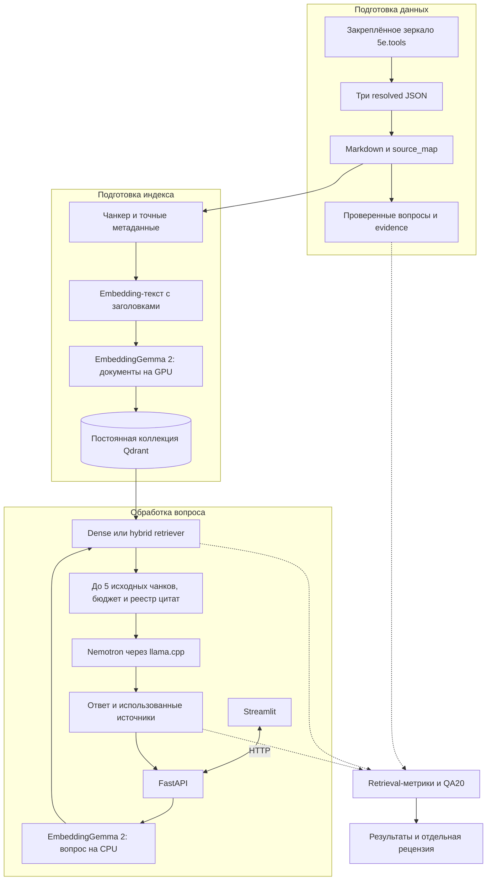
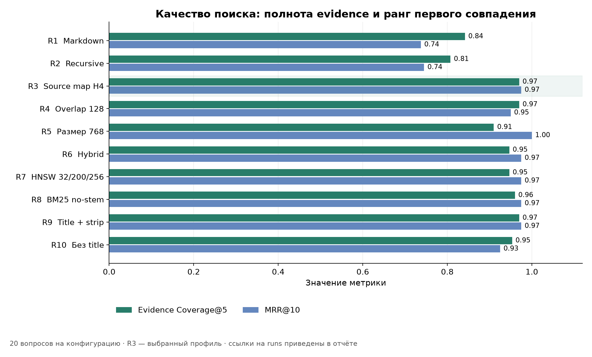
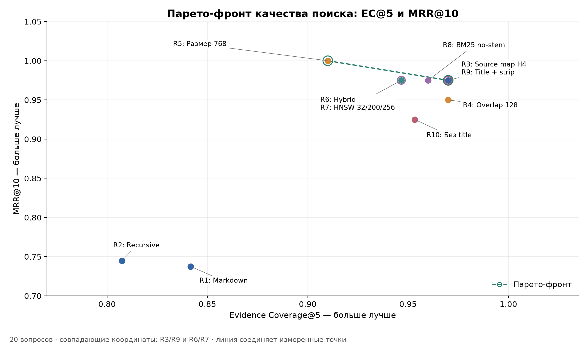
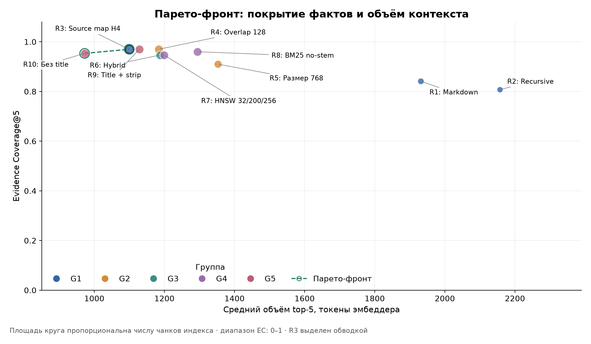
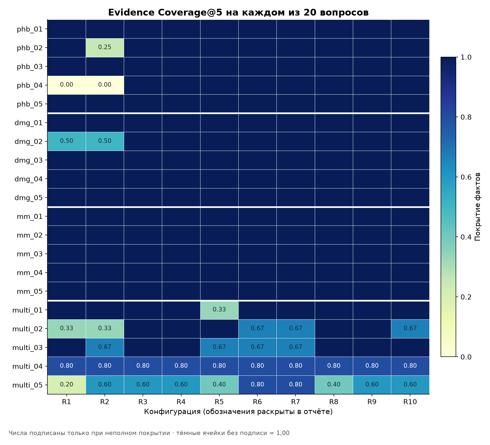
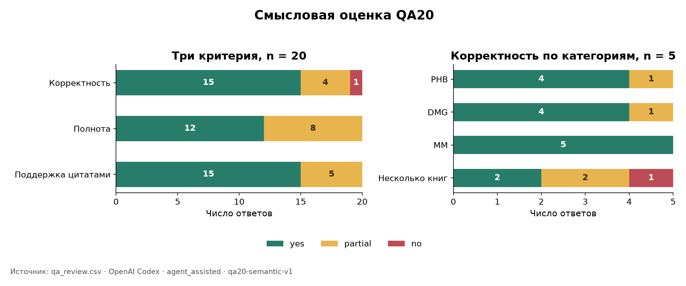
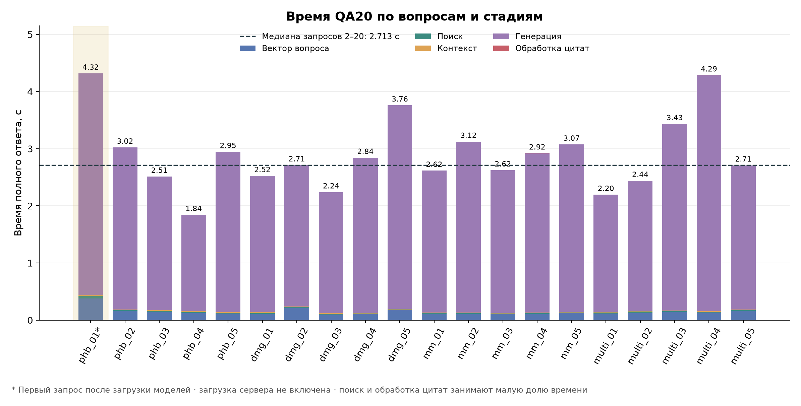

# Локальный RAG-ассистент по правилам Dungeons & Dragons

Отчёт по лабораторной работе № 2 «Построение RAG-агента по документации».

## 1. Постановка задачи

В лабораторной работе требовалось построить систему ответов по документам с использованием Retrieval-Augmented Generation (RAG). Необходимо было выбрать корпус объёмом не менее 50 страниц текста, преобразовать его в нормализованный Markdown, подготовить 10–20 репрезентативных вопросов и реализовать конфигурируемые разбиение, векторизацию и индексацию. Векторное хранилище должно поддерживать повторный запуск без ручной очистки, пересборку при изменении параметров и сброс выбранного индекса.

Качество поиска требовалось оценить с помощью Precision@k, Recall@k и MRR, сравнив не менее двух-трёх конфигураций. Завершающая часть — движок, который принимает вопрос, извлекает релевантные фрагменты, передаёт их LLM из первой лабораторной работы и возвращает ответ с источниками. В проекте эти требования дополнены сравнением десяти конфигураций, отдельной оценкой двадцати ответов и интерфейсом для демонстрации.

## 2. Идея проекта

Разработан локальный ассистент для игрока или ведущего Dungeons & Dragons. Его база знаний состоит из трёх пересмотренных основных книг: Player’s Handbook (2024, XPHB), Dungeon Master’s Guide (2024, XDMG) и Monster Manual (2025, XMM). Ассистент помогает находить условия правил, сравнивать характеристики и объединять сведения из разных книг. Например, вопрос о применении яда к голему требует одновременно правил яда и характеристик существа.

Реализован LLM+RAG: модель получает найденные фрагменты правил в контексте текущего вопроса. Дообучение на книгах и агентский цикл не используются. Вопросы и ответы в экспериментах — на английском. Приложение показывает один текущий ответ с цитатами и исходными фрагментами; история предыдущих вопросов в prompt не передаётся. Основные сценарии — подготовка и оценка поискового индекса, поиск без LLM и полный ответ через FastAPI/Streamlit. [Архитектура реализации](../docs/user_docs/ARCHITECTURE.md).

## 3. Подготовка данных

### 3.1. От 5e.tools к самодостаточным книгам

Источником машиночитаемого представления книг послужил 5e.tools — справочный ресурс по D&D с данными о правилах, заклинаниях, предметах и существах. В проект подключено его GitHub-зеркало `5etools-mirror-3/5etools-src` как submodule `external/5etools-src`. Использованы структурированные JSON из локального закреплённого снимка, без OCR PDF или распознавания иллюстраций.

Файлы глав не содержат всего материала: книжные вставки, характеристики и связанные компоненты распределены по отдельным справочникам. Поэтому первым этапом стал сборщик, создающий по одному самодостаточному `resolved JSON` на книгу. Он сохраняет порядок глав, раскрывает обязательные вставки, добавляет необходимые классовые особенности, характеристики и другие связанные данные. При этом обычное текстовое упоминание сущности не приводит к неограниченному включению внешних справочников.

Для раскрытия ссылок использован штатный JavaScript runtime 5e.tools: загрузчики и механизмы наследования выполняются через Node.js. Это позволяет сохранить семантику исходного формата без повторной реализации его разрешения на Python. Отдельно сохраняются место появления объекта в книге и его собственное происхождение. Manifest фиксирует версии, хэши и результаты проверки; дальнейший экспорт читает готовые книги без обращения к upstream. [Архитектура сборщика](../docs/ingestion/ARCHITECTURE.md), [pipeline подготовки](../docs/ingestion/PIPELINE.md).

Эксперименты выполнены на snapshot **`c3d53956346388b222aaaaf4637776f563e201b8`**, package version **2.39.1**. Manifest подтверждает совпадение checkout с закреплённым gitlink и успешную проверку сборки. Именно этот снимок используется для всех чисел ниже; ранняя версия корпуса `879075…` в них не включена. [Manifest сборки](../data/resolved/5etools/c3d53956346388b222aaaaf4637776f563e201b8/60d007f6a1c747e87aebb75bdb340996700e7e95e9af3ab8adb75b79413f3c81/manifest.json).

### 3.2. Экспорт в Markdown

Отдельный Python-экспортёр преобразует resolved-книги в три Markdown-файла и общую карту `source_map.jsonl`. В Markdown сохранены главы, смысловая вложенность, таблицы, списки и блоки характеристик монстров. Дополнительные данные размещаются в книжном контексте, а служебные поля upstream не попадают в текст для поиска.

Содержательная корректность экспорта оказалась важнее простого отсутствия ошибок формата. Например, при обработке тега масштабируемого урона нужно различать основной урон Fireball `8d6` и прирост `1d6` на уровень: их подмена изменила бы само правило. Другие исправления касались повторной печати уже представленных сущностей, избыточных заголовков и атрибуции страниц. Подтверждённые повторы исходной книги сохранялись; устранялись дубли, внесённые обходом экспортёра. Изображения не экспортировались, доступный текст всех частей книг сохранён. [Представление Markdown](../docs/ingestion/MARKDOWN_REPRESENTATION.md), [аудит исправлений](../docs/ingestion/MARKDOWN_EXPORT_CORRECTIONS_AUDIT.md), [проверка итогового Markdown](../docs/ingestion/MARKDOWN_EXPORT_VALIDATION.md).

Карта содержит разделы с путями заголовков, диапазонами символов и строк, а также доступными сведениями о печатных страницах. Координаты относятся к **body книги без YAML front matter и одного пустого разделителя**: символы — Unicode code points с полуинтервалом `[start_char, end_char)`, строки — с единицы, обе границы включены. Раздел карты не является готовым поисковым чанком.

**Таблица 1. Объём подготовленного корпуса.** Слова подсчитаны по whitespace-разбиению canonical body; число разделов — по карте.

<!-- BEGIN AUTO:corpus -->

| Книга | Назначение | Слов body | Разделов |
| --- | --- | --- | --- |
| Player's Handbook (2024) | Правила для игроков, классы, снаряжение и заклинания | 220009 | 2041 |
| Dungeon Master's Guide (2024) | Правила и инструменты ведущего, сокровища | 254408 | 1796 |
| Monster Manual (2025) | Характеристики и описания монстров | 213328 | 699 |
| **Всего** |  | 687745 | 4536 |

<!-- END AUTO:corpus -->

Общий объём — **687745 слов, 3869486 Unicode-символов и 4536 разделов**; он существенно превышает минимальный объём задания. В итоговой проверке также зафиксированы 1121 таблица и 572 statblocks. Точное число восстановленных физических страниц не вычислялось: известные номера и страницы начала разделов не доказывают постраничного покрытия печатной вёрстки. Неизвестные страницы остаются неизвестными. [Корпус и метод проверки](../docs/ingestion/MARKDOWN_EXPORT_VALIDATION.md).

### 3.3. Эталонные вопросы

Оценочный набор подготовлен до разработки основной RAG. Он содержит двадцать ответимых вопросов и три дополнительных случая недостатка данных.

| Категория | Вопросов | Что проверяется |
| --- | ---: | --- |
| `phb_01`–`phb_05` | 5 | Правила игроков, условия эффектов, применение правил |
| `dmg_01`–`dmg_05` | 5 | Правила ведущего, таблицы, окружение, предметы |
| `mm_01`–`mm_05` | 5 | Характеристики монстров, способности и ограничения |
| `multi_01`–`multi_05` | 5 | Объединение сведений из нескольких книг и вычисления |
| `insufficient_01`–`insufficient_03` | 3 | Недостающие обстоятельства или результаты случайных событий |

Каждый основной вопрос имеет эталонный ответ и список обязательных фактов. Для одного факта могут быть указаны альтернативные подтверждения: достаточно найти любое из них, но для полного ответа нужны все факты. Всего размечено **59 фактов и 78 альтернатив**. Цитаты привязаны к исходному Markdown, поэтому эталоны не зависят от ID чанков конкретного разбиения.

Валидатор проверяет структуру YAML, точное и однозначное совпадение цитат, вычисляет координаты и сохраняет хэши корпуса. Получен `PASS`, сопоставлены все 78 альтернатив. Этот результат означает корректность структуры и привязки; истинность эталонов и достаточность evidence проверялись отдельно в смысловой самопроверке Codex. Она относится к подготовке gold и не является оценкой ответов Nemotron. [Валидатор](../src/dnd_rag/ingestion/question_validation/README.md), [validated gold](../data/questions/validated/questions.yaml), [validation report](../data/questions/validated/validation_report.json), [самопроверка gold](../data/questions/audit/semantic_review.json).

В retrieval-средние включены только двадцать основных вопросов. Три `insufficient_*` подготовлены для отдельной проверки, но в финальном QA20 не запускались.

## 4. Архитектура и ключевые технические решения

### 4.1. Общая схема



*Рисунок 1. Поток данных. Готовая совместимая коллекция позволяет пропустить подготовку индекса. Документный GPU-worker завершается до запуска LLM. Gold используется для экспериментов; пользовательский вопрос обслуживается без обращения к эталонам. Смысловая рецензия выполняется отдельно по сохранённым ответам.*

Общее Python-ядро используется аналитическими командами и API. Компоненты подготовки корпуса, чанкинга, векторизации, хранения, поиска, генерации и оценки разделены по ответственности. Конфигурации экспериментов заданы полными YAML, локальные адреса и пути — окружением, параметры LLM — отдельным профилем. Это позволяет менять retrieval, сохраняя условия генерации. [Архитектура](../docs/user_docs/ARCHITECTURE.md), [справочник конфигов](../configs/experiments/README.md).

### 4.2. Чанкер: учёт структуры без изменения исходного текста

Сравнивались три стратегии на базе LangChain splitters:

| Стратегия | Принцип |
| --- | --- |
| `markdown` | `MarkdownTextSplitter` обрабатывает целую книгу; Markdown-разделители служат ориентирами разбиения. |
| `recursive` | `RecursiveCharacterTextSplitter` обрабатывает целую книгу со стандартными разделителями. |
| `source_map_recursive` | Сначала книга делится по началам заголовков до заданной глубины, затем Recursive применяется отдельно внутри каждого участка. |

Размер и перекрытие измеряются **токенайзером эмбеддера**, а не количеством символов. Базовые параметры — 512 токенов и overlap 64; для custom-стратегии глубина H4. Введения родителей сохраняются отдельными участками, без копирования в дочерние разделы. Перекрытие действует внутри участка. Специальный ремонт разрезанных таблиц или statblocks не выполняется: сравниваются именно выбранные стратегии.

Ключевой контракт — каждый чанк остаётся точным непрерывным срезом одной книги. Адаптер проверяет диапазоны, включая повторяющийся текст, Unicode и локальные смещения. Печатные страницы и пути затронутых разделов сохраняются в metadata. Это связывает найденный фрагмент с gold evidence и позволяет показать пользователю исходный текст. [Чанкер](../src/dnd_rag/indexing/chunking.py), [контракт корпуса](../docs/user_docs/ARCHITECTURE.md).

### 4.3. Векторизация: два представления и разделение CPU/GPU

Для каждого чанка используются два представления. `page_content` — неизменный исходный срез для LLM, цитат, BM25 и оценки. `embedding_text` — производная строка для модели эмбеддингов:

```text
title: <название книги и пути разделов> | text: <текст чанка>
```

Переключатели добавления title и удаления Markdown-заголовков независимы. При отключённом title передаётся `title: none`. Эти настройки меняют вход векторизатора, сохраняя текст и геометрию чанков; их влияние исследуется в G5.

Использована **`google/embeddinggemma-2`**, revision **`f9972ac22e696a105c482202646979e33e4b5a1e`**, в текстовом режиме. В основной серии размерность — **768**, векторы нормализуются и сохраняются в float32, метрика Qdrant — Cosine. Документы кодируются пакетами по 16 на GPU в BF16; вопросы — один раз загруженным CPU-энкодером в FP32. Одинаковые revision, токенайзер и размерность обеспечивают согласованность пространства.

Разделение устройств связано с ограничением GPU в 6 GiB: после индексации GPU-процесс эмбеддера завершается, затем память использует отвечающая LLM. Короткие вопросы векторизуются на CPU. Полный вход эмбеддера, включая task-префикс и специальные токены, проверяется по пределу 8192 без скрытого усечения. Поддержка 128/256/512/768 размерностей проверена технически; сравнительная серия использует только 768d. [Векторизатор](../src/dnd_rag/indexing/embedding.py), [технические пробы](../docs/rag/TECHNICAL_PROBES.md), [эффективная конфигурация R3](../results/g1_source_map_recursive/resolved_config.yaml).

### 4.4. Индексатор и постоянные коллекции Qdrant

Qdrant Server **1.20.0** развёрнут в Docker с постоянным томом. Одна коллекция соответствует варианту индекса, один point — чанку с dense-вектором и payload из исходного текста и метаданных. Для hybrid дополнительно строится нативный полнотекстовый BM25-индекс по `page_content`. Базовый HNSW: `m=16`, `ef_construction=100`; поиск — `ef_search=128`. Порог индексации 1 KB и порог планировщика полного перебора 10 KB закреплены в условиях, чтобы поисковые структуры действительно строились на данном корпусе. [Compose](../compose.yaml), [индексатор](../src/dnd_rag/indexing/store.py), [проверка native API](../docs/rag/TECHNICAL_PROBES.md).

Требование идемпотентности реализовано через паспорт и идентичность сборки:

| Идентификатор | Назначение |
| --- | --- |
| `config_id` | Хэш эффективной конфигурации эксперимента, включая параметры запроса. |
| `index_id` | SHA-256 эффективных параметров построения, хэшей корпуса/карты, revision и значимых версий. Определяет совместимую коллекцию. |
| `build_id` | Идентификатор конкретной полной сборки; меняется при пересборке. |
| `chunk_id` | Детерминированный UUIDv5 от индекса, файла и диапазона текста. Повторный upsert не создаёт дубликат. |

Новая коллекция проходит состояния `building → ready`. Готовность публикуется после загрузки, проверки содержимого и завершения необходимых оптимизаций. При повторном запуске полностью совместимая ready-коллекция используется без нового разбиения, эмбеддингов и загрузки. Изменение параметров построения создаёт другой вариант; `--rebuild` повторяет полную подготовку, `reset-index` удаляет выбранную собственную коллекцию. Параметры только поиска, например `ef_search`, не меняют `index_id`.

Принят простой компромисс: переиспользуется целая готовая коллекция, промежуточных кэшей стадий нет. Поэтому даже изменение build-параметров HNSW приводит к полной подготовке с перевекторизацией. Это свойство реализации и её измеренных затрат, а не необходимость алгоритма HNSW. Неполная сборка не принимается за готовую. [Идентичность](../src/dnd_rag/indexing/identity.py), [правила повторного запуска](../docs/user_docs/ARCHITECTURE.md).

Поддержаны также `scalar_int8` и `turboquant_4bit`, с сохранением исходных float32-векторов и без rescoring. Они проверены техническими пробами; **во всех десяти сравнительных конфигурациях Qdrant-квантование выключено**. Квантование GGUF отвечающей модели — отдельная настройка.

### 4.5. Retriever: dense и hybrid

Общий retriever сначала вычисляет CPU-вектор вопроса, затем обращается к готовой коллекции. В режиме dense возвращаются результаты по Cosine. В hybrid объединяются 20 dense и 20 BM25-кандидатов с помощью штатного Reciprocal Rank Fusion: константа 2, равные веса, итоговая выдача до 10 фрагментов. Здесь BM25 — нативный индекс Qdrant по текстовому payload; отдельные sparse-векторы не создаются.

Выдача содержит ранги, оценки и полные исходные чанки. Reranker и отсечение по score не используются. Поэтому ближайшие фрагменты могут быть найдены и при недостатке информации: наличие top-k не считается доказательством ответимости вопроса. Достаточность контекста должна учитывать LLM, формулируя подтверждённую часть ответа и обозначая пробелы. [Общее ядро поиска](../src/dnd_rag/retrieval.py), [режимы поиска](../configs/experiments/README.md).

### 4.6. Контекст, LLM и проверяемые цитаты

Отвечающая модель — **`NVIDIA-Nemotron-3.5-Bolt-E4B-UD-Q4_K_XL.gguf`**, запущенная локально через llama.cpp. `ChatOpenAI` используется как HTTP-клиент совместимого Chat Completions API. В QA-паспорте зафиксированы бинарник llama.cpp 0.4.1-dev, build 11046, model/template hashes и фактические параметры запуска. [Паспорт QA20](../results/qa_final/run.json).

| Параметр LLM | Значение |
| --- | --- |
| Контекстное окно | 8192 токена |
| Максимум ответа | 1536 токенов |
| Дополнительный запас | 256 токенов |
| Максимум источников | 5 первых чанков |
| Thinking | Выключен |
| Sampling | temperature 0, top_p 1, seed 42 |
| Размещение | gpu_layers 99; batch 512, ubatch 128; K/V q8_0, KV offload и Flash Attention включены |

Бюджет относится ко **всему chat prompt**, включая system, вопрос, тексты источников, их обозначения, шаблон чата и специальные токены:

```text
input_tokens + 1536 + 256 <= 8192
input_tokens <= 6400
```

Токенайзер эмбеддера служит для чанкинга; токенайзер LLM — для этого бюджета. Для точного подсчёта применяются native `/apply-template` и `/tokenize` того же сервера. Если первые пять чанков не помещаются, удаляется последний целиком, после чего prompt и номера пересобираются и проверяются снова. Чанк не обрезается и не заменяется результатом ниже первой пятёрки. Автоматический context shift и prompt cache выключены. [Профиль](../results/qa_final/resolved_llm_profile.yaml), [сборка контекста](../src/dnd_rag/rag/context.py).

Перед генерацией фиксируется реестр соответствий `[1]…[N]` фактически переданным чанкам. LLM отвечает по-английски на основе этих источников и ставит числовые маркеры. Программа распознаёт ссылки с учётом Markdown и возвращает только использованные допустимые источники, их координаты, превью и полный текст. Неизвестный номер или достижение лимита ответа сохраняются как предупреждения без скрытой повторной генерации.

При действительно пустой успешной выдаче LLM не вызывается. Если фрагменты есть, но не содержат всех необходимых правил, модель должна дать частичный ответ с указанием недостающих данных. Проверка номера цитаты подтверждает связь с переданным фрагментом; смысловая поддержка утверждения оценивается отдельно. [Инструкция модели](../results/qa_final/prompts/system.txt), [цитаты](../src/dnd_rag/rag/citations.py).

### 4.7. Интерфейс и сохранение результатов

FastAPI предоставляет поиск и полный QA поверх того же ядра, что используется в экспериментах. Streamlit обращается к API по HTTP, показывает текущий ответ и позволяет раскрыть исходные фрагменты. Приложение работает с одним активным runtime и одной генерацией одновременно. Документный GPU-worker запускается только при подготовке индекса и завершается до старта LLM; пользовательский HTTP-запрос индексацию не запускает. [API](../src/dnd_rag/api.py), [UI](../src/dnd_rag/ui.py), [управление запуском](../src/dnd_rag/runtime/application.py).

Для каждого эксперимента сохраняются конфиги, gold, manifest чанков, выдача по вопросам, метрики, времена и происхождение индекса. QA сохраняет фактические сообщения, реестр источников, сырой ответ, токены и времена того же вызова — без повторного retrieval для аудита. Это позволяет пересчитывать метрики и разбирать ошибки офлайн даже без запущенных моделей и Qdrant. [Модуль оценки](../src/dnd_rag/evaluation/README.md).

## 5. Методика экспериментов

### 5.1. Условия и программа

Все десять retrieval-конфигураций используют один корпус, один validated gold из двадцати вопросов и одну revision EmbeddingGemma 2. Измерения выполнены в WSL/Linux, Python 3.13.13, на RTX 3060 Laptop с 6144 MiB VRAM. В сохранённых версиях окружения зафиксированы PyTorch 2.15.0, SentenceTransformers 6.2.0, Transformers 5.22.1, LangChain text splitters 1.1.3, Qdrant server/client 1.20.0. Документы векторизовались в BF16 на GPU, вопросы — в FP32 на CPU. Источник условий — паспорта конкретных запусков, например [R3](../results/g1_source_map_recursive/run.json).

Программа разделена на пять групп. G1 выбирает стратегию чанкинга, G2 уточняет размер/overlap; полученная dense-база используется в G3 и G5. G4 по условиям программы исследует две вариации относительно hybrid из G3, даже если dense оказался лучше. Каждый вариант — полный YAML, а связи контроля явно указаны в Study.

| Группа | Фактор | Контроль | Новые варианты |
| --- | --- | --- | --- |
| G1 | Стратегия чанкинга | Markdown, 512/64 | Recursive по книге; source_map H4 → Recursive |
| G2 | Overlap и размер | Выбранный G1, 512/64 | 512/128; 768/64 — по отдельности |
| G3 | Способ поиска | Dense после G2 | Dense + BM25 + RRF |
| G4 | Составные профили индекса/поиска | Hybrid из G3 | HNSW 32/200/256; отдельно BM25 без stemmer, k1=1.5, b=0.5 |
| G5 | Заголовки во входе эмбеддера | Dense после G2, title=true/strip=false | title=true/strip=true; title=false/strip=false |

**Таблица 2. Обозначения измеренных конфигураций**, используемые в последующих таблицах и на графиках.

В таблицах сравнения конфигураций **жирным выделены лучшие значения каждого столбца**: максимумы P/R/EC/MRR и минимумы затрат, числа чанков и объёма контекста. При равенстве выделены все лучшие варианты; сравнение выполняется до округления. Меньший объём считается преимуществом по затратам, но не заменяет приоритет качества. Таблицы разных QA-критериев, стадий и областей измерения памяти не ранжируются как конфигурации.

<!-- BEGIN AUTO:run_keys -->

| ID | Группа | Run | Изменение |
| --- | --- | --- | --- |
| R1 | G1 | [g1_markdown_initial](../results/g1_markdown_initial/run.json) | Markdown |
| R2 | G1 | [g1_recursive](../results/g1_recursive/run.json) | Recursive |
| R3 | G1 | [g1_source_map_recursive](../results/g1_source_map_recursive/run.json) | Source map H4 |
| R4 | G2 | [g2_overlap_128](../results/g2_overlap_128/run.json) | Overlap 128 |
| R5 | G2 | [g2_size_768](../results/g2_size_768/run.json) | Размер 768 |
| R6 | G3 | [g3_hybrid](../results/g3_hybrid/run.json) | Hybrid |
| R7 | G4 | [g4_hnsw_32_200_256](../results/g4_hnsw_32_200_256/run.json) | HNSW 32/200/256 |
| R8 | G4 | [g4_bm25_no_stem](../results/g4_bm25_no_stem/run.json) | BM25 no-stem |
| R9 | G5 | [g5_title_strip](../results/g5_title_strip/run.json) | Title + strip |
| R10 | G5 | [g5_no_title_keep](../results/g5_no_title_keep/run.json) | Без title |

<!-- END AUTO:run_keys -->

В общей CSV 14 строк: **10 comparison и 4 reference**. Reference повторно представляют уже выполненные контроли; ради этих строк индексы не пересобирались и вопросы не запускались заново. Дополнительный `g1_markdown_reuse_check` проверяет повторное использование R1 и не считается одиннадцатой конфигурацией. [Study](../configs/experiments/study.yaml), [описание экспериментов](../docs/rag/EXPERIMENTS.md), [сводная CSV](../results/retrieval_comparison.csv).

В каждом retrieval-run двадцать вопросов выполнялись последовательно по одному разу. Первый запрос отмечен отдельно; `warm` означает оставшиеся 19 при уже загруженной модели. Исключённой из оценки серии прогрева не было: все двадцать входят в метрики качества. Обычные файловые/HF-кэши не очищались. Поэтому время запуска не является временем установки системы или первого скачивания весов, а небольшие различия времени между вариантами не доказывают устойчивое ускорение.

### 5.2. Релевантность и метрики

Пусть `C` — диапазон чанка, `E` — диапазон одной альтернативы gold-факта. Чанк релевантен, если совпадают файл и версия body и выполняется:

```text
|C ∩ E| / min(|C|, |E|) >= 0.5
```

Длины измеряются Unicode-символами. Множество `R_q` включает **все** релевантные чанки индекса, а не только найденные. Для первых `k` уникальных результатов `T_k` вычисляются:

```text
Precision@k = |T_k ∩ R_q| / k
Recall@k    = |T_k ∩ R_q| / |R_q|
RR@10       = 1 / rank первого релевантного результата в top-10, иначе 0
MRR@10      = среднее RR@10 по вопросам
```

P/R рассчитываются при k=1, 5 и 10, MRR — при k=10. При отсутствии релевантных чанков Recall принимается равным нулю с отдельной диагностикой; вопрос не исключается из среднего. Все вопросы имеют равный вес.

Дополнительно используется **Evidence Coverage@k (EC@k)** — дробное покрытие размеченных фактов исходным текстом top-k:

```text
U_k             = объединение диапазонов всех top-k по каждой книге/версии
coverage(E)     = |E ∩ U_k| / |E|
coverage(fact)  = максимум coverage(E) среди альтернатив этого факта
EC_q@k          = среднее coverage(fact) по фактам вопроса
EC@k            = среднее EC_q@k по двадцати вопросам
```

EC использует все top-k диапазоны без 50%-фильтра релевантности. Перекрытия учитываются один раз, части разных альтернатив одного факта не складываются. Это проектная метрика покрытия текста evidence, которая помогает оценить полноту составного контекста. Она не проверяет правильность рассуждения модели.

При новом разбиении меняется число релевантных чанков и знаменатель Recall. Поэтому P/R анализируются вместе с EC и объёмом top-k. `raw_tokens@k` — сумма токенов исходных найденных чанков по токенайзеру эмбеддера; повторённый overlap здесь учитывается как повторно передаваемый текст. Это не точное число токенов LLM. [Методика и формулы](../docs/user_docs/ARCHITECTURE.md#что-измеряет-retrieval), [реализация метрик](../src/dnd_rag/evaluation/metrics.py).

Порядок выбора конфигурации: **EC@5 → MRR@10 → затраты и объём контекста**. Приоритет top-5 связан с тем, что LLM получает максимум пять первых чанков. Retrieval-метрики рассчитываются до сокращения контекста по бюджету.

При подготовке этого отчёта все P/R/EC@1/5/10 и MRR@10 независимо пересчитаны из gold, полных manifests и ranked hits. Проверены 10 runs и 200 записей вопросов; значения совпали с сохранёнными и CSV с допуском `1e-12`. Также проверено соответствие текстов найденных чанков исходным срезам. Модели и поисковые запросы повторно не запускались. Скрипт и данные проверки находятся в `report/` и описаны в разделе 9.

## 6. Результаты экспериментов

### 6.1. G1 — стратегия чанкинга

Сравнивались Markdown, Recursive по всей книге и source_map H4 → Recursive при одинаковых 512/64, title=true, strip=false. Гипотеза: предварительный учёт структуры книги поможет отделить самостоятельные правила и характеристики от соседних тем.

<!-- BEGIN AUTO:G1 -->

| Вариант | EC@5 | MRR@10 | P@5 | R@5 | Токенов top-5 | Чанков | Подготовка, с |
| --- | --- | --- | --- | --- | --- | --- | --- |
| R1 Markdown | 0.8417 | 0.7375 | 0.2900 | 0.7485 | 1930.85 | 3175 | **108.22** |
| R2 Recursive | 0.8075 | 0.7450 | 0.2700 | 0.7267 | 2156.85 | **2848** | 109.25 |
| R3 Source map H4 | **0.9700** | **0.9750** | **0.3700** | **0.8979** | **1099.45** | 5578 | 153.28 |

<!-- END AUTO:G1 -->

R3 повысил EC@5 с **0.8417 до 0.9700**, а MRR@10 — с **0.7375 до 0.9750** относительно Markdown. Покрытие улучшилось у `phb_04`, `dmg_02`, `multi_02`, `multi_05`; ухудшений не было, остальные шестнадцать значений EC@5 сохранились. Так, выигрыш наблюдался и для короткого правила о книге, и для вопросов, требующих нескольких фрагментов.

Цена — увеличение числа чанков с 3175 до 5578 и подготовки со 108.22 до 153.28 с. При этом средний top-5 сократился с 1930.85 до 1099.45 токенов, примерно на **43.1%**. Медиана длины чанка составляет 387 токенов у Markdown, 466 у Recursive и 146 у source_map. Следовательно, одинаковый верхний предел 512 не означает одинаковую реальную геометрию: структурные границы создают больше коротких фрагментов.

R2 уменьшил индекс до 2848 чанков, но EC@5 снизился до 0.8075. Он улучшил `multi_05`, потеряв покрытие на `phb_02` и `multi_03`; небольшой рост MRR не компенсировал потери полноты. Для G2 выбран **R3, source_map H4, 512/64**. Наблюдения поддерживают полезность этой стратегии на выбранной выборке; эффект относится ко всей полученной геометрии чанков, а не изолированно к одному типу заголовка. [Парный анализ G1](../results/technical/c4-g1.json).

### 6.2. G2 — размер чанка и overlap

От R3 независимо изменяли overlap 64→128 и размер 512→768. Проверялось, поможет ли более широкий локальный контекст сохранить разнесённые части правила.

<!-- BEGIN AUTO:G2 -->

| Вариант | EC@5 | MRR@10 | P@5 | R@5 | Токенов top-5 | Чанков | Подготовка, с |
| --- | --- | --- | --- | --- | --- | --- | --- |
| R3 Source map H4 | **0.9700** | 0.9750 | **0.3700** | **0.8979** | **1099.45** | 5578 | **153.28** |
| R4 Overlap 128 | **0.9700** | 0.9500 | **0.3700** | **0.8979** | 1183.90 | 5608 | 155.05 |
| R5 Размер 768 | 0.9100 | **1.0000** | 0.3300 | 0.8506 | 1352.30 | **4703** | 169.43 |

<!-- END AUTO:G2 -->

Overlap 128 сохранил EC@5 **всех двадцати вопросов**, но MRR снизился с 0.9750 до 0.9500, а средний контекст вырос до 1183.90 токена. Увеличенное перекрытие не добавило покрытия gold-фактов в top-5.

Размер 768 дал **MRR@10=1.0000**: первый результат оказался релевантным для каждого вопроса. Однако EC@5 снизился до **0.9100** без улучшения покрытия хотя бы одного вопроса. Потери сосредоточены на `multi_01`, `multi_03` и `multi_05`; среднее EC@5 по составным вопросам снизилось с 0.88 до 0.64. Средний контекст вырос до 1352.30 токена.

Это показательный предел MRR: один подходящий фрагмент в начале выдачи ещё не обеспечивает все факты для составного ответа. Более крупные чанки изменили набор доступных фрагментов и распределение мест в top-5. По принятому приоритету базой остаётся **R3, 512/64**, с меньшим контекстом и более высоким EC. [Парный анализ G2](../results/technical/c4-g2.json).

### 6.3. G3 — dense и hybrid

К dense-поиску R3 добавили native BM25 и RRF, сохранив разбиение и embedding-профиль. Проверялось, дадут ли точные лексические совпадения дополнительную пользу для названий способностей и предметов.

<!-- BEGIN AUTO:G3 -->

| Вариант | EC@5 | MRR@10 | P@5 | R@5 | Токенов top-5 |
| --- | --- | --- | --- | --- | --- |
| R3 Source map H4 | **0.9700** | **0.9750** | **0.3700** | **0.8979** | **1099.45** |
| R6 Hybrid | 0.9467 | **0.9750** | 0.3500 | 0.8629 | 1187.85 |

<!-- END AUTO:G3 -->

Hybrid R6 сохранил MRR@10=0.9750, но EC@5 снизился с 0.9700 до **0.9467**, а контекст вырос до 1187.85 токена. Выиграл `multi_05`, ухудшились `multi_02` и `multi_03`, семнадцать вопросов не изменились. При этом EC@10 вырос с 0.9700 до 0.9900: более глубокая выдача содержит больше evidence, но не вся эта информация попадает в пятёрку для LLM.

Объединение рангов перераспределяет ограниченные места в top-5, поэтому усиление лексической ветви может как добавить нужный факт, так и вытеснить другой. На данной выборке hybrid не превзошёл dense по основному критерию. Это наблюдение относится к выбранным BM25/RRF и gold20; универсальный вывод о превосходстве dense из него не следует. Полная hybrid-подготовка выполнялась отдельно, построение BM25 после upload заняло около 1.17 с. [Парный анализ G3](../results/technical/c4-g3.json).

### 6.4. G4 — настройки HNSW и BM25

Оба варианта G4 независимо сравнивались с одним hybrid-контролем R6. Эта группа исследует настройки гибридного профиля по программе экспериментов; выбор её базы не означает, что R6 оказался победителем G3.

<!-- BEGIN AUTO:G4 -->

| Вариант | EC@5 | MRR@10 | P@5 | R@5 | Токенов top-5 |
| --- | --- | --- | --- | --- | --- |
| R6 Hybrid | 0.9467 | **0.9750** | **0.3500** | **0.8629** | **1187.85** |
| R7 HNSW 32/200/256 | 0.9467 | **0.9750** | **0.3500** | **0.8629** | 1199.30 |
| R8 BM25 no-stem | **0.9600** | **0.9750** | 0.3400 | **0.8629** | 1294.25 |

<!-- END AUTO:G4 -->

В R7 одновременно увеличены `m/ef_construction/ef_search` с **16/100/128 до 32/200/256**. EC@5 и MRR@10 не изменились; средний top-5 слегка вырос. На этом наборе расширение HNSW-профиля не дало выигрыша по выбранным критериям. Разница единичных времён не позволяет отдельно оценить устойчивую стоимость каждого параметра.

В R8 одновременно выключен stemmer и изменены **k1: 1.2→1.5, b: 0.75→0.5**. HNSW остался базовым 16/100/128; усиленные настройки R7 этот вариант не наследует. EC@5 вырос до **0.9600**: улучшились `multi_02` и `multi_03`, ухудшился `multi_05`. MRR остался прежним, объём контекста вырос до 1294.25 токена. Dense R3 по-прежнему имел более высокий EC@5 и меньший контекст.

Каждый вариант меняет составной профиль. Поэтому результат R8 нельзя приписать только отсутствию стемминга, а результат R7 — только одному из трёх параметров HNSW. [Парный анализ G4](../results/technical/c4-g4.json), [точные поля вариантов](../configs/experiments/README.md).

### 6.5. G5 — заголовки в представлении для эмбеддера

На dense-базе R3 проверялись два независимых изменения: удаление исходных Markdown-заголовков из embedding content при сохранении title и отключение дополнительного title при сохранении исходного content. Геометрия и `page_content` во всех трёх вариантах одинаковы.

<!-- BEGIN AUTO:G5 -->

| Вариант | EC@5 | MRR@10 | P@5 | R@5 | Токенов top-5 |
| --- | --- | --- | --- | --- | --- |
| R3 Source map H4 | **0.9700** | **0.9750** | **0.3700** | **0.8979** | 1099.45 |
| R9 Title + strip | **0.9700** | **0.9750** | **0.3700** | **0.8979** | 1128.85 |
| R10 Без title | 0.9533 | 0.9250 | 0.3400 | 0.8504 | **972.30** |

<!-- END AUTO:G5 -->

R9 (title=true, strip=true) сохранил EC@5 всех двадцати вопросов и MRR контроля, но средний raw top-5 оказался немного больше: **1128.85 против 1099.45**. Его EC@10 выше — **0.9900 против 0.9700**; для `multi_05` покрытие top-10 выросло с 0.6 до 1.0. Это улучшение зафиксировано, но оно не меняет основной выбор при лимите в пять чанков.

R10 (title=false, strip=false) сократил контекст до 972.30 токена, однако EC@5 снизился до **0.9533**, MRR — до **0.9250**. Покрытие ухудшилось на `multi_02`. Полученный результат согласуется с полезностью дополнительного пути раздела для данного embedding-профиля. Четвёртая комбинация false/true поддержана реализацией, но в сравнительную серию не входила. [Парный анализ G5](../results/technical/c4-g5.json).

### 6.6. Сводные результаты и выбранная конфигурация

**Таблица 3. Качество десяти конфигураций.** Токены top-5 — среднее по вопросам, измеренное токенайзером эмбеддера. Источник: comparison-строки [сводной CSV](../results/retrieval_comparison.csv), проверенные по первичным файлам.

<!-- BEGIN AUTO:retrieval_all -->

| ID | EC@5 | EC@10 | MRR@10 | P@5 | R@5 | Чанков | Токенов top-5 |
| --- | --- | --- | --- | --- | --- | --- | --- |
| R1 | 0.8417 | 0.8950 | 0.7375 | 0.2900 | 0.7485 | 3175 | 1930.85 |
| R2 | 0.8075 | 0.8575 | 0.7450 | 0.2700 | 0.7267 | **2848** | 2156.85 |
| R3 | **0.9700** | 0.9700 | 0.9750 | **0.3700** | **0.8979** | 5578 | 1099.45 |
| R4 | **0.9700** | 0.9700 | 0.9500 | **0.3700** | **0.8979** | 5608 | 1183.90 |
| R5 | 0.9100 | 0.9367 | **1.0000** | 0.3300 | 0.8506 | 4703 | 1352.30 |
| R6 | 0.9467 | **0.9900** | 0.9750 | 0.3500 | 0.8629 | 5578 | 1187.85 |
| R7 | 0.9467 | **0.9900** | 0.9750 | 0.3500 | 0.8629 | 5578 | 1199.30 |
| R8 | 0.9600 | **0.9900** | 0.9750 | 0.3400 | 0.8629 | 5578 | 1294.25 |
| R9 | **0.9700** | **0.9900** | 0.9750 | **0.3700** | **0.8979** | 5578 | 1128.85 |
| R10 | 0.9533 | 0.9533 | 0.9250 | 0.3400 | 0.8504 | 5578 | **972.30** |

<!-- END AUTO:retrieval_all -->



*Рисунок 2а. Сравнение полноты evidence и ранга первого релевантного результата на двадцати вопросах. R3 выделен как профиль, выбранный для QA. Подписи столбцов округлены до сотых; точные сравнения — в таблице 3.*



*Рисунок 2б. Те же конфигурации в координатах EC@5 и MRR@10: обе метрики максимизируются. Оси приближены к диапазону наблюдений для читаемости. Совпавшие точки R3/R9 и R6/R7 показаны концентрическими маркерами с общими подписями, без сдвига координат. Пунктир соединяет недоминируемые измеренные точки; промежуточные конфигурации не измерялись.*

По двум метрикам качества Парето-фронт образуют **R3, R9 и R5**: R3/R9 имеют одинаковые EC@5=0.9700 и MRR@10=0.9750, а R5 — меньший EC@5=0.9100 при большем MRR@10=1.0000. Остальные варианты доминируются хотя бы одним из них: существует конфигурация не хуже по обеим метрикам и строго лучше хотя бы по одной. Выбор R3 среди этих вариантов дополнительно учитывает приоритет EC@5 и расход контекста.



*Рисунок 3. Парето-фронт для EC@5 (максимум) и среднего объёма top-5 (минимум). Точки уменьшены; их площадь по-прежнему пропорциональна числу чанков индекса. Пунктир соединяет недоминируемые варианты R10 и R3. R10 экономит контекст при меньшем покрытии; R3 даёт максимальное EC@5 при наименьшем объёме среди вариантов с таким покрытием. Остальные конфигурации доминируются по этой паре критериев. Число чанков показано размером точки и в определение этого фронта не входит.*



*Рисунок 4. EC@5 по каждому вопросу. Тёмная ячейка без числа означает 1.0; числа подписаны при неполном покрытии. Источник — `per_question.jsonl` каждого run. Разделители отделяют четыре категории по пять вопросов.*

Карта показывает, что после перехода к source_map оставшиеся потери покрытия сосредоточены на составных вопросах. Для R3 все пятнадцать однокнижных вопросов имеют EC@5=1, а среднее multi — 0.88. G2–G5 преимущественно меняют именно последние пять строк; это объясняет, почему высокий общий MRR может скрывать неполный набор условий для ответа.

Для QA выбран **R3: dense, source_map_recursive H4, 512/64, title=true, strip=false, 768d, HNSW 16/100/128, quantization=none**. Он имеет EC@5=0.9700, MRR@10=0.9750, 5578 чанков и средний top-5 1099.45 токена.

По EC@5 он делит первое место с R4 и R9. R4 уступает по MRR, а R9 при тех же EC@5/MRR имеет больший raw context; поэтому сохранён R3. Более высокий EC@10 у R9/R6/R7/R8 признан в таблице, но QA использует первые пять фрагментов. Выбор сделан по заранее принятому порядку критериев на этой выборке; профиль не является лучшим по каждому столбцу и его общая оптимальность не доказана. [Решение в Study](../configs/experiments/study.yaml).

### 6.7. Время, размер индекса и повторные запуски

**Таблица 4. Затраты поисковых конфигураций.** Подготовка включает загрузку токенайзера, разбиение, документную модель, embedding, upload, ожидание индекса и BM25 при наличии. Весь run дополнительно включает проверки, загрузку query-модели и двадцать запросов.

<!-- BEGIN AUTO:costs -->

| ID | Подготовка, с | Весь run, с | Медиана retrieval¹, мс | Диск allocated, MiB |
| --- | --- | --- | --- | --- |
| R1 | **108.22** | **133.06** | 121.91 | 28.70 |
| R2 | 109.25 | 133.13 | 127.41 | **26.93** |
| R3 | 153.28 | 178.91 | 121.54 | 43.74 |
| R4 | 155.05 | 181.52 | 142.85 | 44.12 |
| R5 | 169.43 | 195.59 | 180.63 | 37.86 |
| R6 | 167.85 | 194.46 | 134.35 | 47.49 |
| R7 | 157.24 | 181.80 | 124.55 | 47.50 |
| R8 | 159.43 | 184.58 | **115.22** | 48.62 |
| R9 | 160.95 | 186.26 | 119.89 | 43.74 |
| R10 | 144.67 | 168.39 | 130.09 | 43.75 |

<!-- END AUTO:costs -->

¹ Медиана полного retrieval для запросов 2–20: CPU embedding вопроса и поиск Qdrant, без генерации LLM. Диск измерен отдельно после готовности коллекций; это занятые блоки (`allocated`), переведённые из байтов в MiB. Источники: [CSV](../results/retrieval_comparison.csv), [дополнительный замер C4](../results/technical/c4-evidence.json); метод и ограничения — в [описании дополнительных измерений](../results/technical/README.md).

Для R3 подготовка заняла **153.28 с**, весь run — **178.91 с**, медиана последующих retrieval — **121.54 мс**, коллекция заняла **43.74 MiB**. У R1 соответствующие величины — 108.22 с, 133.06 с, 121.91 мс и 28.70 MiB. Таким образом, рост качества потребовал большего индекса и времени подготовки, но не увеличил наблюдавшуюся медиану retrieval относительно baseline. Без повторных серий это не доказывает одинаковую устойчивую скорость.

В R3 среднее время последующей CPU-векторизации вопроса — около 116.57 мс, поиска Qdrant — 5.95 мс. Основная часть retrieval приходится на query encoder, поэтому изменение HNSW не обязано заметно изменить полное время. Embedding/upload и асинхронная оптимизация могут перекрываться; сумма сохранённых стадий подготовки не является разложением всех ресурсов на непересекающиеся интервалы.

Расчётное место исходных dense-векторов R3 составляет **5578 × 768 × 4 = 17135616 байт**, около 16.34 MiB. Реальная коллекция больше из-за payload, индексов и служебных структур. `apparent` и `allocated` также различаются из-за sparse/preallocated WAL; для размера занятого диска в таблице использован allocated. Эти величины не являются RAM или VRAM.

**Таблица 5. Проверка переиспользования baseline-индекса.**

<!-- BEGIN AUTO:reuse -->

| Запуск | Действие | Время всего запуска, с | Чанков |
| --- | --- | --- | --- |
| R1 | Полная сборка | 133.061 | 3175 |
| g1_markdown_reuse_check | Переиспользование | 16.339 | 3175 |

<!-- END AUTO:reuse -->

В reuse-check сохранены те же `index_id` и `build_id`, число точек и метрики. Документный GPU-worker не запускался; stages разбиения/embedding/upload помечены как reused, а их время не выдано за новую нулевую сборку. Время всего запуска снизилось примерно в **8.1 раза**, но повтор всё ещё включает проверки, загрузку CPU-энкодера и двадцать запросов. Это единичная проверка идемпотентности, не независимый повтор всей экспериментальной серии. [Baseline](../results/g1_markdown_initial/run.json), [reuse-check](../results/g1_markdown_reuse_check/run.json).

**Таблица 6. Память в сохранённых измерениях.** Значения относятся к указанным процессам и запускам; максимумы разных строк нельзя складывать.

<!-- BEGIN AUTO:memory -->

| Запуск | Область измерения | Значение |
| --- | --- | --- |
| Сборка R1 | Torch GPU allocated peak | 2.715 GiB |
| Сборка R1 | Torch GPU reserved peak | 5.996 GiB |
| Сборка R1 | RSS документного worker, peak | 2.327 GiB |
| Сборка R3 | Torch GPU allocated peak | 2.789 GiB |
| Сборка R3 | Torch GPU reserved peak | 5.943 GiB |
| Сборка R3 | RSS документного worker, peak | 2.334 GiB |
| QA20 | RSS основного процесса, peak | 2.497 GiB |
| Техническое demo C3 | PSS собственного дерева, peak | 7.430 GiB |
| Техническое demo C3 | NVML всей GPU, sampled peak | 4279 MiB |

<!-- END AUTO:memory -->

Torch allocated/reserved характеризуют память CUDA-аллокатора документного worker, RSS — резидентную память конкретного процесса. Дополнительная проба C3 измеряла PSS собственного дерева demo, где общие страницы учитываются пропорционально, и NVML всей GPU. Qdrant и измеритель в это дерево не входили. Фон GPU до/после C3 составлял 664/666 MiB, сэмплирование — примерно раз в 0.5 с; короткие пики могли быть пропущены. Пики Torch allocated и reserved также не обязаны приходиться на один момент.

C3 — отдельный технический запуск с baseline R1, а не измерение памяти финальных двадцати QA. В нём запрос с 6220 входными токенами занял 10.760 с; он проверяет большой вход и не включён в gold20. Для финального QA20 верхний RSS относится к основному процессу и не описывает суммарную память LLM/API/UI. [Проба C3](../results/technical/c3-demo.json), [пояснения измерений](../docs/rag/TECHNICAL_PROBES.md).

## 7. Анализ ответов QA20

### 7.1. Условия и критерии оценки

Финальный прогон `qa_final` выполнен на выбранном R3 с переиспользованием готового индекса. Все двадцать основных вопросов получили ответы; дополнительные `insufficient_*` не запускались. В каждый prompt фактически вошли первые пять чанков, удалений из-за бюджета не было. Входы составили **929–2366 токенов LLM**, ответы — **37–164 токена**. Все генерации завершились `stop`, без неизвестных цитат, достижения выходного лимита и нарушений бюджета. Предварительный подсчёт входа совпал с фактическим usage и native prompt count во всех двадцати случаях. [QA-паспорт](../results/qa_final/run.json), [сводка](../results/qa_final/qa_summary.json), [реальные traces](../results/qa_final/qa_answers.jsonl).

Смысловая оценка берётся из текущей заполненной [qa_review.csv](../results/qa_final/qa_review.csv). Все двадцать записей имеют `review_status=reviewed`; рецензент — OpenAI Codex, метод — `agent_assisted`, версия — `qa20-semantic-v1`, время — 6 ноября 2026 года 04:42:05 МСК. Это оценка с помощью агента; независимая человеческая экспертиза не проводилась. Сохранённое поле `not_reviewed` в исходной QA-сводке относится к состоянию до заполнения CSV и не используется как текущий статус.

Рецензия содержит три самостоятельных критерия:

- **Корректность (К, correctness):** верны ли утверждения и применение правил к условиям вопроса.
- **Полнота (П, completeness):** охвачены ли все необходимые факты, ограничения и запрошенные результаты.
- **Поддержка цитатами (Ц, citation_support):** обосновывают ли использованные источники утверждения ответа по смыслу, включая условия и вычисления.

Оценки сохраняются как `yes`, `partial`, `no`. Они не преобразуются в произвольный числовой средний балл. Корректный частичный ответ может иметь К=yes и П=partial; наличие цитат с допустимыми номерами само по себе не даёт Ц=yes.

### 7.2. Общие результаты

**Таблица 7. Распределение оценок текущей рецензии.** Проценты рассчитаны от двадцати ответов.

<!-- BEGIN AUTO:qa_grades -->

| Критерий | yes | partial | no |
| --- | --- | --- | --- |
| Корректность | 15 (75%) | 4 (20%) | 1 (5%) |
| Полнота | 12 (60%) | 8 (40%) | 0 (0%) |
| Поддержка цитатами | 15 (75%) | 5 (25%) | 0 (0%) |

<!-- END AUTO:qa_grades -->



*Рисунок 5. Слева — три критерия для всех двадцати ответов; справа — корректность в каждой категории по пять вопросов. Источник: заполненная agent-assisted рецензия `qa20-semantic-v1`.*

**12 из 20 ответов (60%)** имеют `yes` по всем трём критериям. В восьми ответах полнота оценена как partial. Это доля полностью положительных записей по данной рецензии и выборке, а не универсальная точность системы. Особенно трудны составные вопросы: среди пяти multi два ответа корректны, два частично корректны и один некорректен; полностью положителен только `multi_02`.

Ниже рассмотрены **все двадцать ответов**. В колонке «К / П / Ц» критерии указаны в определённом выше порядке. Номера вида `[1]` в подробном разборе — локальные номера источников конкретного вопроса, не номера библиографических ссылок отчёта. Полные английские вопросы, эталоны и ответы сохранены в [QA JSONL](../results/qa_final/qa_answers.jsonl); здесь переданы их смысл и результат.

### 7.3. Player’s Handbook

**Таблица 8. Ответы `phb_01`–`phb_05`.**

<!-- BEGIN AUTO:qa_phb -->

| ID | Вопрос | К / П / Ц | Анализ ответа |
| --- | --- | --- | --- |
| phb_01 | Subtle Spell: стоимость и компоненты | yes / yes / yes | Цена составляет 1 очко чародейства. Ответ верно описывает снятие требований к вербальным, соматическим и материальным компонентам и оба исключения. |
| phb_02 | Обезвоживание и снятие истощения | yes / partial / yes | Суточная норма для существа размера Medium составляет 1 галлон. Четверть галлона ниже половины нормы, поэтому к концу дня получается 1 уровень истощения. После полного питья и продолжительного отдыха остаётся 0. Оба запрошенных числа верны. Ответ перечисляет питьё и отдых по порядку, но не объясняет роль питья как обязательного условия снятия уровня обезвоживания. |
| phb_03 | Confusion: действие и движение | yes / yes / yes | При результате 1 существо пропускает действие и тратит всё движение. Соответствие четырёх результатов 1d4 сторонам света передано без ошибок. |
| phb_04 | Бонус от справочной книги | partial / partial / partial | Бонус +5 и четыре навыка названы верно. Отождествление навыков с тематикой проверки расширяет правило. Например, книга об одной теме не даёт бонус ко всякой проверке Истории. Ответ перечисляет Arcana, History, Nature и Religion, но оставляет без ответа часть вопроса о тематике проверки. |
| phb_05 | Концентрация после урона и Incapacitated | yes / yes / yes | Спасбросок Телосложения имеет Сл 11. Половина 23 с округлением вниз равна 11, что выше 10. Состояние Incapacitated прекращает концентрацию автоматически. |

<!-- END AUTO:qa_phb -->

Три из пяти ответов полностью положительны. `phb_05` показывает, что модель может корректно выполнить короткую цепочку: 23/2 с округлением вниз даёт DC 11, а Incapacitated прекращает концентрацию независимо от нового спасброска. Ошибки PHB связаны с условиями: в `phb_02` основной численный итог верен, но роль питья как обязательного условия снятия истощения не объяснена; в `phb_04` пропуск тематики книги расширяет область действия бонуса.

### 7.4. Dungeon Master’s Guide

**Таблица 9. Ответы `dmg_01`–`dmg_05`.**

<!-- BEGIN AUTO:qa_dmg -->

| ID | Вопрос | К / П / Ц | Анализ ответа |
| --- | --- | --- | --- |
| dmg_01 | Ходы Бастиона и отсутствие владельца | yes / yes / yes | Между ходами Бастиона по умолчанию проходит 7 игровых дней. В отсутствие хозяина Бастион действует так, как если бы получил приказ Maintain, если только хозяин не может связаться с работниками посредством Sending или сходной магии. |
| dmg_02 | Тонкий лёд и холодная вода | partial / partial / partial | Формула прочности льда и ежеминутный спасбросок Телосложения Сл 10 с одним уровнем истощения при провале верны. Слова об отсутствии срока противоречат [1], где срок равен значению Телосложения, то есть 14 минутам. Для льда приведена формула, но не сделан вывод о 400 фунтах. Для воды описаны последствия после порога, но не определён сам порог. Обе части можно было закончить по переданным фрагментам. |
| dmg_03 | Конфликт с разумным предметом | yes / yes / yes | В поставленном вопросе конфликт уже возник. Для этого случая верно указаны спасбросок Харизмы владельца и Сл 12 плюс модификатор Харизмы предмета. |
| dmg_04 | Опознание и использование компьютера | yes / yes / yes | Для опознания компьютера требуется проверка Интеллекта (Investigation) со Сл 20. Ведущий может отдельно потребовать проверку для использования устройства. |
| dmg_05 | Сокровища CR 5–10 и редкость предметов | yes / yes / yes | Верны 8d10 × 100 золотых, среднее 4400, число предметов 1d3 и вероятность 51%. От 31 до 81 включительно ровно 51 исход из 100. |

<!-- END AUTO:qa_dmg -->

Четыре ответа полностью положительны. В частности, `dmg_05` корректно объединяет сведения о сокровищах и редкости предметов и вычисляет вероятность включительного диапазона d100. Основной сбой — `dmg_02`: модель процитировала относящиеся к вопросу разделы, но не закончила применение правил к заданным числам и необоснованно объявила часть сведений отсутствующей.

### 7.5. Monster Manual

**Таблица 10. Ответы `mm_01`–`mm_05`.**

<!-- BEGIN AUTO:qa_mm -->

| ID | Вопрос | К / П / Ц | Анализ ответа |
| --- | --- | --- | --- |
| mm_01 | Скорость рытья и тоннель анхега | yes / yes / yes | Наземная скорость 30 футов, скорость рытья 10 футов и диаметр тоннеля 10 футов соответствуют статблоку. Половина указанной скорости рытья однозначно даёт 5 футов в скале. |
| mm_02 | Поглощение кислоты и Berserk голема | yes / yes / yes | Кислота восстанавливает столько HP, сколько урона было бы нанесено. При Bloodied в начале хода результат 6 на 1d6 вызывает Berserk. Оба условия его окончания переданы верно. |
| mm_03 | Святая вода против Drone часмы | yes / partial / yes | Союзник в пределах 5 футов может действием вылить на цель флакон святой воды и прекратить эффект. После успеха иммунитет действует 24 часа именно против Drone этой часмы. Описаны действия союзника, дальность и защита после успеха, но не сказано, что сама святая вода автоматически обеспечивает успех спасброска. Слово cured не объясняет эту связь. |
| mm_04 | Ржавильщик и металлическое оружие | yes / yes / yes | Верны спасбросок Ловкости Сл 11, штраф −1 к броскам атаки оружием, уничтожение при −5 и снятие штрафа заклинанием Mending. Уточнение о КД доспехов тоже верно. |
| mm_05 | Регенерация тролля и его конечности | yes / yes / yes | В начале своего хода тролль восстанавливает 15 HP, а его конечность — 5 HP. Кислота или огонь отключает регенерацию получившего урон существа на его следующем ходу. |

<!-- END AUTO:qa_mm -->

Все пять ответов имеют К=yes и Ц=yes, четыре — также П=yes. В этой небольшой группе хорошо сработал поиск компактных характеристик и сопоставление двух родственных statblocks. Единственный пропуск — `mm_03`: описаны действия со святой водой и иммунитет после успеха, но не объяснено, что эти действия автоматически обеспечивают успешный спасбросок. Таким образом, правильные отдельные фразы ещё могут не передавать необходимую связь между правилами.

### 7.6. Вопросы по нескольким книгам

**Таблица 11. Ответы `multi_01`–`multi_05`.**

<!-- BEGIN AUTO:qa_multi -->

| ID | Вопрос | К / П / Ц | Анализ ответа |
| --- | --- | --- | --- |
| multi_01 | Vortex внутри Silence | partial / partial / partial | Телосложение и Сл 14 верны. Семь единиц (1d8 + 3) — обычный начальный урон Vortex при провале. Для цели целиком внутри Silence полученный урон равен 0, поэтому утверждение о полученных 7 ошибочно. Ответ называет обычный урон и иммунитет, но не применяет их совместно и не даёт правильное значение для существа из вопроса. |
| multi_02 | Purple Worm Poison против Clay Golem | yes / yes / yes | Яд требует спасброска Телосложения Сл 21 и обычно наносит 35 (10d6) урона ядом при провале. Голем обладает иммунитетом и фактически получает 0. |
| multi_03 | Бюджет встречи с двумя Магами | partial / partial / partial | Два Мага дают 4600 XP, и встреча действительно превышает умеренный бюджет. Однако 1000 XP — бюджет на одного персонажа. Для четверых бюджет равен 4000 XP, превышение — 600 XP вместо заявленных 3600. Число XP за Магов и вывод о превышении верны. Для двух других запрошенных величин даны ошибочные значения. Правило умножения на размер группы было в [3]. |
| multi_04 | Изготовление +1 Plate Armor | no / partial / partial | Единственная запрошенная итоговая величина неверна. 1500 ÷ 10 = 150 рабочих дней на обычный доспех. Ещё 50 дней занимает магический этап, всего 200 восьмичасовых дней вместо 65. Ответ указывает цену, правило деления, редкость, 50 дней на магический этап и 8-часовые дни. В результате ошибки в первом делении искажены длительность обычного этапа и сумма. |
| multi_05 | Вода для группы и Alchemy Jug | yes / partial / yes | Размер Large и способность кувшина произвести 8 галлонов пресной воды верны. В пяти переданных фрагментах действительно отсутствуют суточные нормы по размерам. Отказ от расчёта по этому контексту обоснован. Даны размер анхега и объём кувшина. Нормы воды, итог 8 галлонов и ответ «да» пропущены из-за состава выдачи. Отдельно пропущено доступное в [1] ограничение до следующего рассвета. |

<!-- END AUTO:qa_multi -->

В этой группе наиболее заметно различие поиска и QA. В `multi_01`, `multi_02` и `multi_03` фактический контекст имеет EC=1, но только `multi_02` получил полностью положительную оценку. У `multi_04` EC=0.8, у `multi_05` EC=0.6. Уменьшение покрытия не объясняет все ошибки, а полное покрытие не гарантирует правильное применение фактов.

### 7.7. Причины характерных ошибок

**Пропущенное ограничение при полном контексте: `phb_04`.** Источник `[1]` прямо связывает бонус +5 с проверками по теме конкретной nonfiction-книги. Ответ правильно называет число и четыре навыка, но заменяет условие темы перечислением самих навыков: “The qualifying skills and subject matters are Arcana, History, Nature, or Religion”. Это потеря условия при генерации. Для устранения ошибки поиск расширять не требуется: нужное предложение уже находилось в первом источнике.

**Ложное утверждение о нехватке данных: `dmg_02`.** В `[1]` Frigid Water дан безопасный интервал в минутах, равный Constitution score; у существа из вопроса это 14 минут. В `[3]` Thin Ice задана несущая способность `3d10 × 10` фунтов: максимум 300, поэтому 400 фунтов лёд не выдержит. Модель воспроизвела формулу и дальнейший DC 10 Constitution save, но не сделала вывод о разрушении льда и заявила, что срок до спасбросков в контексте не указан. Здесь EC=1: проблема в чтении и применении доступных правил, а не в отсутствии evidence.

**Необъединённые правила: `multi_01` против `multi_02`.** В первом случае модель назвала DC 14 Constitution для Vortex, обычный урон 7 (1d8+3) Thunder и иммунитет от Silence, но оставила фразу “The initial damage taken is 7”. В описанных условиях фактический урон равен нулю. Оба основания были переданы в `[1]` и `[2]`. Во втором случае аналогичная задача решена правильно: номинальный урон Purple Worm Poison — 35 (10d6), DC 21 Constitution, но голем с иммунитетом не получает урон Poison. Сравнение показывает нестабильность применения исключения даже при найденных правилах.

**Ошибка масштаба величины: `multi_03`.** Строка таблицы `[2]` даёт 1000 XP для одного персонажа 6-го уровня при Moderate. В `[3]` есть указание умножить на размер группы. Правильный бюджет четырёх персонажей — **4 × 1000 = 4000 XP**; два Мага дают **2 × 2300 = 4600 XP**, превышение — **600 XP**. Ответ правильно посчитал стоимость монстров, но принял 1000 за бюджет всей группы и получил превышение 3600. Источник с нужной операцией был в prompt, но не использован в выводе и цитатах.

**Арифметическая ошибка: `multi_04`.** Модель написала, что цена Plate Armor 1500 GP после деления на 10 даёт 15 дней; затем прибавила 50 и получила 65. Правильный расчёт — **1500/10 = 150**, затем **150+50 = 200 восьмичасовых рабочих дней**.

У этого вопроса EC=0.8: не все размеченные места gold вошли в контекст. Однако `[2]` содержит правило деления цены на 10, `[3]` — цену 1500 GP, `[1]` — пример изготовления +1 Plate с магическими материалами на 2000 GP и таблицу Rare: 2000 GP/50 дней. Текстовых данных для правильного расчёта достаточно, а магический этап сама модель определила верно. Поэтому конкретная ошибка `1500/10=15` относится к генерации. Этот случай также показывает, что покрытие конкретных gold-цитат не тождественно полной семантической достаточности всех возможных формулировок контекста.

**Обоснованный частичный ответ: `multi_05`.** Переданные `[1]` и `[5]` подтверждают 8 галлонов пресной воды из Alchemy Jug и размер Large у анхега. Нормы суточного потребления для Medium и Large отсутствуют во всех пяти источниках. Модель обоснованно не стала вычислять общую потребность из памяти. По gold правильный итог — **4 × 1 + 4 = 8 галлонов**, одного кувшина достаточно, но нужные нормы не попали в top-5. Это ограничение retrieval при фиксированном количестве источников. Дополнительно сама модель пропустила доступное в `[1]` ограничение производства до следующего рассвета.

Независимый пересчёт покрытия по **фактически переданному** registry QA20 дал то же среднее **0.9700**, что и выбранный retrieval-run: восемнадцать вопросов имеют EC=1, `multi_04` — 0.8, `multi_05` — 0.6. Это новое производное измерение сохранённых traces для отчёта, без повторной генерации. Поскольку удалений по бюджету не было, потери в этих двух случаях не вызваны упаковкой контекста.

В рассмотренных ошибках наблюдаются разные причины: пропуск условий, неверное заявление об отсутствии правила, неприменённый иммунитет, неправильный масштаб табличной величины и арифметика. Для `multi_05` значим и состав найденных источников. Один общий показатель «ответ с цитатами» эти случаи не различает. Источники анализа — [реальные сообщения и registry](../results/qa_final/qa_answers.jsonl), [снимок gold](../results/qa_final/gold.yaml), [объяснения рецензии](../results/qa_final/qa_review.csv).

### 7.8. Время ответа

Первый QA-запрос после загрузки моделей занял **4.318 с**. Для следующих девятнадцати минимум составил **1.843 с**, среднее — **2.833 с**, медиана — **2.713 с**, максимум — **4.287 с**. Весь запуск занял 110.107 с, включая подготовку runtime; отдельно зафиксированы 33.703 с запуска LLM-сервера и 13.409 с загрузки CPU query encoder. Их не следует добавлять ко времени каждого ответа. Prompt cache LLM выключен. [QA timings](../results/qa_final/qa_summary.json), [этапы запуска](../results/qa_final/run.json).

**Таблица 12. Время стадий QA для запросов 2–20.** Средние, медианы и максимумы рассчитаны для каждой стадии отдельно; медианы/максимумы стадий не складываются в медиану/максимум полного ответа.

<!-- BEGIN AUTO:qa_stage_times -->

| Этап | Среднее, мс | Медиана, мс | Максимум, мс |
| --- | --- | --- | --- |
| Векторизация вопроса | 130.28 | 121.24 | 210.03 |
| Поиск Qdrant | 13.40 | 12.34 | 25.06 |
| Сборка контекста | 10.68 | 10.17 | 13.86 |
| Генерация LLM | 2678.61 | 2526.01 | 4132.07 |
| Обработка цитат | 0.24 | 0.20 | 0.48 |
| Полный ответ | 2833.24 | 2712.52 | 4287.17 |

<!-- END AUTO:qa_stage_times -->



*Рисунок 6. Двадцать реальных ответов, первый помечен звёздочкой. Пунктир — медиана полного времени запросов 2–20. Столбцы показывают стадии одного вызова; загрузка моделей не включена. Нативные prompt/decode timings не прибавляются повторно к generation.*

Генерация занимает примерно **94.2%** суммы полного времени всех двадцати ответов; CPU embedding и поиск — меньшую часть. Поэтому ускорение поиска само по себе слабо изменило бы полную задержку в этом профиле. Все ответы оказались заметно быстрее ориентира 30 с для последующего QA-запроса. Это наблюдение для данного окружения и коротких ответов 37–164 токена, а не гарантия времени для любых вопросов или заполненного окна 8192.

## 8. Выводы и ограничения

В рамках лабораторной разработана законченная локальная RAG-система: подготовлены три самодостаточные книги и нормализованный Markdown с картой разделов, создан проверенный оценочный набор, реализованы конфигурируемые чанкинг/эмбеддинги, постоянные индексы Qdrant, общий retriever и ответы Nemotron с источниками через API/UI. Идемпотентность подтверждена сохранением и повторным использованием готовой коллекции. Вместо минимальных двух-трёх сравнений выполнены десять конфигураций в пяти группах.

Главный результат retrieval — переход к source_map H4 → Recursive: на выбранных двадцати вопросах EC@5 вырос с 0.8417 до 0.9700, MRR@10 — с 0.7375 до 0.9750, средний top-5 уменьшился примерно на 43.1%. Больший индекс и более дорогая подготовка сопровождались лучшим покрытием при меньшем найденном контексте. Увеличение размера чанков, добавление BM25/RRF и усиление HNSW не дали обязательного выигрыша по основному критерию. Раздельный анализ EC и MRR позволил увидеть потери составных фактов при MRR=1.

Финальный QA20 показал работоспособность локального ответа с медианой 2.713 с для запросов после первого. По agent-assisted рецензии 15 ответов корректны, но только 12 из 20 полностью положительны по всем трём критериям. Даже при достаточном контексте модель может потерять ограничение, не применить иммунитет или ошибиться в вычислении. Следовательно, надёжный поиск и корректный реестр цитат необходимы, но не обеспечивают правильность ответа сами по себе.

Границы этих выводов:

- **Выборка:** всего двадцать вопросов; тот же gold использован для выбора профиля. Отложенной проверки, повторных серий и статистического доказательства общей оптимальности нет.
- **Сравнение QA:** генерация оценена только для R3. Из retrieval-таблиц нельзя заключить, как отвечала бы LLM со всеми остальными девятью конфигурациями.
- **Метод оценки:** смысловые grades выставлены Codex с методом `agent_assisted`, без независимой человеческой рецензии. EC измеряет покрытие размеченного текста и не является оценкой правильности рассуждения.
- **Время и память:** запуски последовательные, с обычными кэшами. Дополнительные пробы C3 относятся к другому baseline-сценарию; их пики не описывают суммарную память QA20. Малые временные различия не считаются устойчивым эффектом настройки.
- **Данные:** выводы относятся к закреплённому представлению 5e.tools. Точная постраничная сверка печатных книг, изображения и OCR не исследовались. Три insufficient-вопроса в финальном прогоне не проверялись.
- **Объём реализации:** история диалога, streaming, reranker, MCP и Viewer не входят в реализованный MVP. Дальнейшие улучшения полноты составных ответов и проверка вычислений потребуют отдельных изменений и повторной оценки.

Приёмка реализации 6 ноября 2026 года зафиксировала **699 passed, 3 explicit-live skipped**, успешные Ruff-проверки и независимое ревью кода с закрытыми обязательными замечаниями. Три skipped не подтверждают живое выполнение. Тогдашний smoke проверил выбранный demo через Streamlit AppTest→HTTP; отдельный визуальный просмотр браузера не выполнялся. Это исторические результаты, а не новая проверка при сборке отчёта. Одноразовые журналы и материалы ревью удалены при уборке; штатные тесты и команды их повторения сохранены. [Проверки и ограничения](../docs/rag/VALIDATION.md), [команды тестирования](../docs/user_docs/CLI.md#проверки-проекта).

## 9. Данные и воспроизведение отчёта

Основные численные источники — [сводная retrieval CSV](../results/retrieval_comparison.csv), файлы десяти runs из таблицы 2 и [QA20](../results/qa_final/qa_answers.jsonl) с [текущей рецензией](../results/qa_final/qa_review.csv). Парные изменения групп взяты из [c4-g1](../results/technical/c4-g1.json), [c4-g2](../results/technical/c4-g2.json), [c4-g3](../results/technical/c4-g3.json), [c4-g4](../results/technical/c4-g4.json), [c4-g5](../results/technical/c4-g5.json). Размеры коллекций и PSS/NVML — дополнительные checkpoint-измерения [C4](../results/technical/c4-evidence.json) и [C3](../results/technical/c3-demo.json), а не поля штатного retrieval-run.

Таблицы с численными результатами и шесть графиков собирает [скрипт отчёта](scripts/build_report_artifacts.py). Он только читает первичные файлы, независимо пересчитывает retrieval-метрики и покрытие фактического QA-контекста, проверяет корпус/ID/срезы, затем пишет результаты внутри `report/`. Исходные `results/`, corpus/gold и документы не изменяются. Зависимости построения графиков отделены от проекта и закреплены в [requirements.txt](requirements.txt).

Команда из корня `lab2`:

```bash
UV_CACHE_DIR="$PWD/report/.cache/uv" \
MPLCONFIGDIR="$PWD/report/.cache/matplotlib" \
PYTHONDONTWRITEBYTECODE=1 \
uv run --no-project --with-requirements report/requirements.txt \
  python report/scripts/build_report_artifacts.py
```

Для первой установки библиотек нужен доступ к их пакетам; сами отчётные вычисления не требуют моделей, Qdrant или обращения к 5e.tools. Скрипт обновляет только помеченные блоки таблиц Markdown, изображения и производные данные. Среди сохранённых артефактов:

- [Retrieval-метрики и затраты](artifacts/data/retrieval_metrics.csv), [покрытие каждого вопроса](artifacts/data/evidence_coverage_by_question.csv), [объём корпуса](artifacts/data/corpus.csv).
- [Сводка QA-оценок](artifacts/data/qa_review_summary.csv), [времена и фактическое покрытие QA](artifacts/data/qa_timings.csv), [агрегаты и условия построения](artifacts/data/report_statistics.json).
- [SHA-256 входных файлов](artifacts/data/input_fingerprints.json), позволяющие проверить редакцию источников для этого отчёта.

Штатную retrieval-сводку можно отдельно восстановить без моделей, сохранив новый файл в разрешённой области:

```bash
uv run python -m dnd_rag summarize-results \
  --study configs/experiments/study.yaml \
  --output report/artifacts/data/retrieval_comparison_rebuilt.csv
```

Для новых измерений поиска или QA потребовались бы отдельные имена runs и соответствующие сервисы; команды и условия приведены в [пользовательском руководстве](../docs/user_docs/CLI.md). Все результаты данного отчёта получены из существующих запусков и явно отмеченных производных вычислений.

## Приложение. Дополнительные retrieval-метрики

**Таблица 13. P/R при k=1 и 10 и EC@1** для тех же десяти конфигураций и двадцати вопросов. EC@10 и MRR@10 приведены в таблице 3; P/R/EC@5 — там же. Вместе таблицы охватывают весь рассчитанный набор метрик. Источник: [сводная CSV](../results/retrieval_comparison.csv).

<!-- BEGIN AUTO:retrieval_extra -->

| ID | P@1 | R@1 | EC@1 | P@10 | R@10 |
| --- | --- | --- | --- | --- | --- |
| R1 | 0.6000 | 0.4046 | 0.4383 | 0.1650 | 0.8056 |
| R2 | 0.6500 | 0.4197 | 0.4383 | 0.1500 | 0.7742 |
| R3 | 0.9500 | 0.6329 | 0.7167 | **0.1950** | **0.9271** |
| R4 | 0.9000 | 0.6079 | 0.6667 | 0.1850 | 0.8979 |
| R5 | **1.0000** | **0.6505** | 0.7167 | 0.1800 | 0.8923 |
| R6 | 0.9500 | 0.6329 | **0.7250** | **0.1950** | 0.9229 |
| R7 | 0.9500 | 0.6329 | **0.7250** | **0.1950** | 0.9229 |
| R8 | 0.9500 | 0.6329 | **0.7250** | **0.1950** | 0.9229 |
| R9 | 0.9500 | 0.6329 | 0.7167 | **0.1950** | 0.9229 |
| R10 | 0.8500 | 0.5329 | 0.6050 | **0.1950** | 0.8979 |

<!-- END AUTO:retrieval_extra -->
