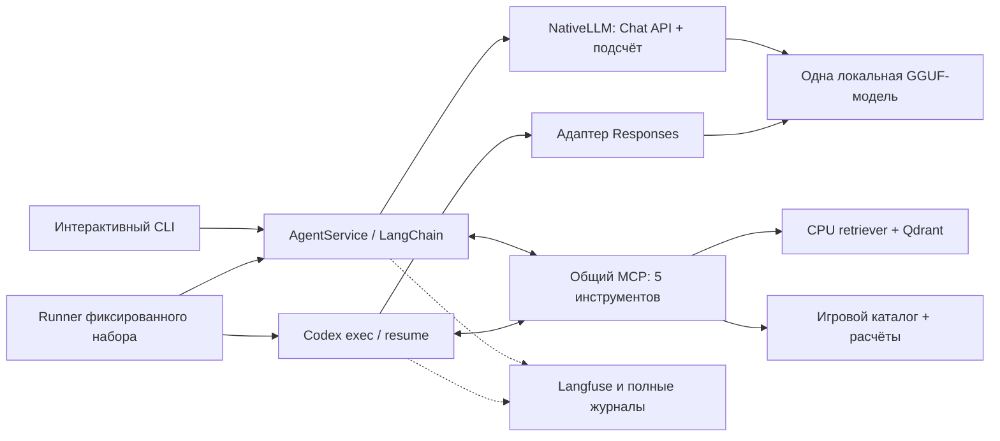
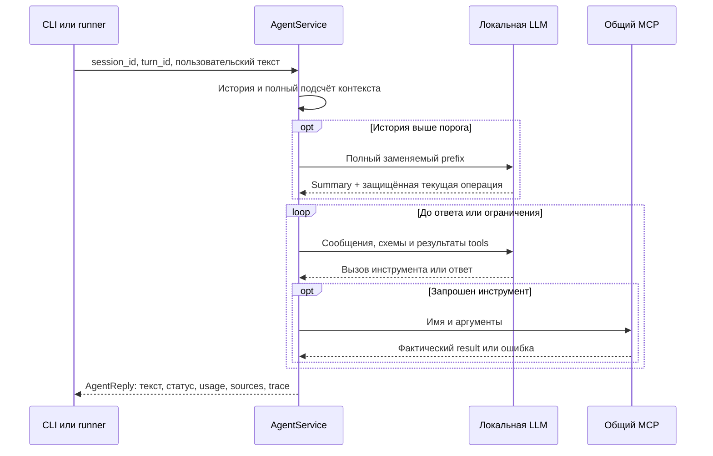

# Архитектура DM-помощника

Агент помогает Dungeon Master готовить сцены: выбирает инструменты, ищет правила D&D 2024/2025 и объясняет расчёты. XP и добычу вычисляет Python. Диалог сохраняет сообщения и результаты инструментов между репликами.

Команды — в [CLI](CLI.md), методика измерений — в [EVALUATION](EVALUATION.md), результаты — в [отчёте](../../report/LAB3_REPORT.md). Для изучения реализации начните с [карты кода](#карта-кода).

- [Общая схема](#общая-схема)
- [От книг к инструментам](#от-книг-к-инструментам)
- [Путь одной реплики](#путь-одной-реплики)
- [Контекст и память](#контекст-и-память)
- [Собственный агент и Codex](#собственный-агент-и-codex)
- [Трейсы и результаты](#трейсы-и-результаты)
- [Процессы и хранилища](#процессы-и-хранилища)
- [Карта кода](#карта-кода)

## Общая схема

CLI и runner используют общие контракты. Retrieval независим от LLM, эталонов и Langfuse. Streamlit отложен.

## От книг к инструментам

### Два независимых представления данных

| Ветка | Подготовка | Для чего используется |
| --- | --- | --- |
| RAG | Markdown XPHB/XDMG/XMM и `source_map` → чанки → EmbeddingGemma 2 → Qdrant. | Найти исходный текст правила и подтвердить его происхождение. |
| Игровой каталог | Закреплённые JSON 5etools → проверенный снимок существ, предметов и таблиц. | Получить stat block, рассчитать встречу или бросить добычу. |

Чанк хранит точный срез канонического текста книги (`body`), Unicode-диапазон `[start_char, end_char)`, строки, разделы и хэши. Атрибуция страниц сохраняет исходную точность. R3/R9 меняют обработку заголовков во входе эмбеддера, сохраняя текст цитаты и координаты; настройки входят в identity индекса.

Документные векторы строятся на GPU отдельным worker. После его завершения вопросы кодирует постоянный CPU `QueryEncoder`; найденные chunks возвращаются с rank, score и index/build IDs. Manifest содержит все chunks для независимой оценки retrieval.

Каталог содержит 503 существа, 2 297 предметов и 24 таблицы магических предметов. SHA upstream и хэши проверяются до запросов; внутри tool call компиляции нет.

### Пять общих MCP-инструментов

| Инструмент | Ответственность |
| --- | --- |
| `search_rules` | Поиск исходных правил с текстом и координатами. |
| `lookup_monsters` | Ограниченная выдача актуальных XMM stat blocks. |
| `evaluate_encounter` | XP и сложность точно заданного состава. |
| `build_encounter` | Подбор состава с сохранением обязательных существ и фильтров. |
| `generate_loot` | Фактические денежные броски и предметы по XDMG. |

Описания инструментов хранятся в [descriptions.yaml](../../src/dnd_rag/tools/descriptions.yaml), вычисления — в [game](../../src/dnd_rag/game/README.md). Ограниченный поиск различает `conflict` и `search_exhausted`; случайная добыча сохраняется как конкретный результат, а воспоминание о ней не требует нового броска.

## Путь одной реплики

`session_id` обозначает диалог, `turn_id` — запрос с полным циклом ответа. `InMemorySaver/thread_id` сохраняет сообщения и tool results. Ошибки tools доступны модели для исправления. Лимиты собственного агента: 12 вызовов LLM, 16 вызовов tools, 300 секунд на реплику.

CLI отображает `AgentEvent`; runner читает `AgentReply` и исходные записи. Оборванный ответ — `incomplete/generation_truncated`; неизвестный usage — `None`.

## Контекст и память

### Что считается и ограничивается

`NativeLLM` считает полный сериализованный запрос токенайзером GGUF: system, историю, схемы инструментов, вызовы/результаты и шаблон. HTTP-hook проверяет body перед отправкой и сверяет count с серверным usage.

| Настройка | Значение по умолчанию | Назначение |
| --- | ---: | --- |
| Физическое окно сервера | 16 384 | Максимальный полный запрос с резервом ответа. |
| Порог агента | 9 500 | Когда сокращать накопленную историю. |
| Общий резерв ответа | 2 048 | Включает доступный reasoning и финальный текст. |
| Safety margin | 256 | Запас физического окна. |
| Summary / недавняя история | 1 024 / 2 048 | Резерв генерации summary и ориентир сохраняемого suffix. |

Условие допуска: `input + output reserve + safety <= server window`. Профили [off/budgeted](../../configs/llm/README.md) выключают thinking либо задают 512 токенов на reasoning block при том же общем резерве.

### Как заменяется история

Старая часть истории заменяется сводкой (`summary`); текущая операция сохраняется целиком.

1. До порога передаётся вся история диалога.
2. `SummarizationMiddleware` выбирает завершённые взаимодействия; сводка получает всю заменяемую часть (`prefix`), включая предыдущее summary.
3. Последний запрос и его вызовы/результаты защищены как одна операция. Пары call/result не разрываются; уже полученные параллельные результаты сохраняются при восстановлении checkpoint.
4. После замены повторно проверяется полный следующий запрос. При нехватке места возвращается `context_budget`, без скрытого усечения середины.

[Промпт summary](../../src/dnd_rag/agent/prompts/summary.txt) задаёт разделы партии, ограничений, принятых составов, actual loot, источников и открытых вопросов. Пустое или оборванное summary не заменяет память; потреблённые токены всё равно учитываются. Отсутствующий результат прерванного tool call закрывается явной ошибкой, без утверждения об исполнении.

Защита полного входа не гарантирует смысловую полноту summary: потери фактов измерены в длинных диалогах. Исходный журнал сохраняется целиком.

## Собственный агент и Codex

| Свойство | Собственный агент | Готовый агент |
| --- | --- | --- |
| Цикл | LangChain `create_agent`. | Штатные `codex exec` и `exec resume`. |
| Память | Checkpointer и контролируемый summary. | Собственная native compaction Codex. |
| Контекст | Полный native count и HTTP-guard. | Внутренний счётчик Codex; отдельно сохраняется native wire count. |
| Общие условия | Одна GGUF, MCP, каталог, датасет и профиль генерации. | Те же общие условия. |

Codex запускается из пустого временного каталога с явной конфигурацией; resume использует точный native ID. Личные настройки не меняются. Адаптер `8081 → 8080` переводит `additional_tools/namespace` в Responses functions и обратно, сохраняя payloads и штатный агентный цикл.

Инструкции, schemas, compaction и счётчики различаются: сравниваются агентные системы. Настройки и установка экспортера — в [baseline](../../configs/baseline/README.md).

## Трейсы и результаты

| Уровень | Что записывается в Langfuse |
| --- | --- |
| Диалог / реплика | Session и trace с user, тегами, input/output и итоговым статусом. |
| Генерация | Полный доступный вход, ответ, параметры, usage и время. |
| Инструмент / retrieval | Аргументы, result, ошибка; вложенный поиск с chunks и scores. |
| Контекст | Измерения и отдельные события сокращения: размеры до/после и заменённая история. |

`ObservationRecorder` ведёт полный JSONL в `.runtime/sessions/<session>/turns.jsonl`. Raw response/reasoning сохраняется без повторного начисления usage. Codex экспортирует закрытый rollout; последняя реплика и дедупликация проверяются через API. Rollout/wire сохраняются до readback. Восстановленный exporter input может отличаться от wire после compaction.

Номера `[n]` выдаются только фактическим search hits текущей сессии. `CitationRegistry` сохраняет связь с `index_id/chunk_id` в `.runtime/citations/`; summary её не очищает, `/new` начинает независимую нумерацию. Неизвестные номера дают предупреждение. Проверка регистрации ссылки не доказывает поддержку утверждения источником.

Структура run-артефактов, критерии успеха и различие Trace/Experiment Scores описаны в [EVALUATION](EVALUATION.md). SDK 5 работает с events-only Langfuse 4 через observations/Experiments API.

## Процессы и хранилища

`application_stack`: инфраструктура → каталог → индекс/retriever → завершение GPU-worker → GGUF → MCP/proxy → интерфейс. Перед reuse проверяются владение коллекцией, identity, payloads и количество точек.

| Компонент | Локальный адрес / хранение |
| --- | --- |
| Qdrant | `6343/6344`, постоянные данные `data/qdrant/`. |
| LLM | `8080/v1`, GGUF вне репозитория. |
| MCP / Responses proxy | `8765/mcp` / `8081/v1`, принадлежат текущему запуску. |
| Langfuse | `3000`, постоянные Compose volumes. |

`RuntimeSession` удерживает проектный lock и завершает только свои process groups. SIGINT/SIGTERM проходят через cleanup, включая окно регистрации ребёнка. После SIGKILL живой ребёнок сохраняет унаследованный lock. Открытый FLOCK подтверждает владение группой даже после выхода лидера; совпадение PGID или имени lock-файла недостаточно.

Capture Codex/exporter ограничен по времени и сохраняет прочитанный вывод. Непроверенная группа не завершается. MCP/proxy останавливаются при выходе, Docker и данные остаются; детали — в [runtime](../../src/dnd_rag/runtime/README.md).

## Карта кода

| Зона | Точка входа | Ответственность |
| --- | --- | --- |
| Команды | [\_\_main\_\_.py](../../src/dnd_rag/__main__.py), [cli.py](../../src/dnd_rag/cli.py) | Аргументы запуска и интерактивный терминал. |
| Композиция | [runtime/application.py](../../src/dnd_rag/runtime/application.py): `application_stack` | Порядок запуска общих сервисов. |
| Агент | [agent/service.py](../../src/dnd_rag/agent/service.py): `AgentService.ainvoke` | История, цикл и ограничения. |
| Память | [agent/memory.py](../../src/dnd_rag/agent/memory.py), [prompts](../../src/dnd_rag/agent/prompts/README.md) | Подсчёт, summary и защищённые взаимодействия. |
| LLM | [runtime/llm.py](../../src/dnd_rag/runtime/llm.py): `NativeLLM`; [codex_proxy.py](../../src/dnd_rag/runtime/codex_proxy.py) | Native count, guard, Chat/Responses. |
| MCP и расчёты | [tools/server.py](../../src/dnd_rag/tools/server.py): `create_mcp_server`; [game](../../src/dnd_rag/game/README.md) | Общий API и игровая арифметика. |
| RAG | [runtime/index.py](../../src/dnd_rag/runtime/index.py): `prepare_retriever`; [retrieval.py](../../src/dnd_rag/retrieval.py) | Подготовка/reuse и поиск. |
| Корпус и индекс | [indexing](../../src/dnd_rag/indexing/README.md) | Чанки, эмбеддинги, identity и Qdrant. |
| Наблюдаемость | [observability.py](../../src/dnd_rag/agent/observability.py), [citations.py](../../src/dnd_rag/agent/citations.py) | Трейсы, журнал и реестр источников. |
| Сравнение | [runner.py](../../src/dnd_rag/experiments/runner.py), [codex.py](../../src/dnd_rag/experiments/codex.py) | Датасет, адаптер Codex, связи Experiments. |
| Оценка | [experiments](../../src/dnd_rag/experiments/README.md), [evaluation](../../src/dnd_rag/evaluation/README.md) | Формальные критерии, review и retrieval-метрики. |
| Процессы | [runtime](../../src/dnd_rag/runtime/README.md) | Блокировка, проверка готовности и завершение. |

Для первого чтения проследите `run → application_stack → run_cli → AgentService.ainvoke`. Затем изучите `memory.py` и один инструмент. Измерительная ветка начинается в `experiments/commands.py` и использует те же сервисы.
