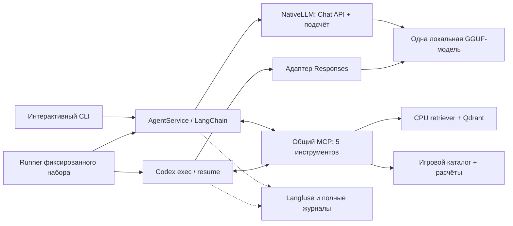
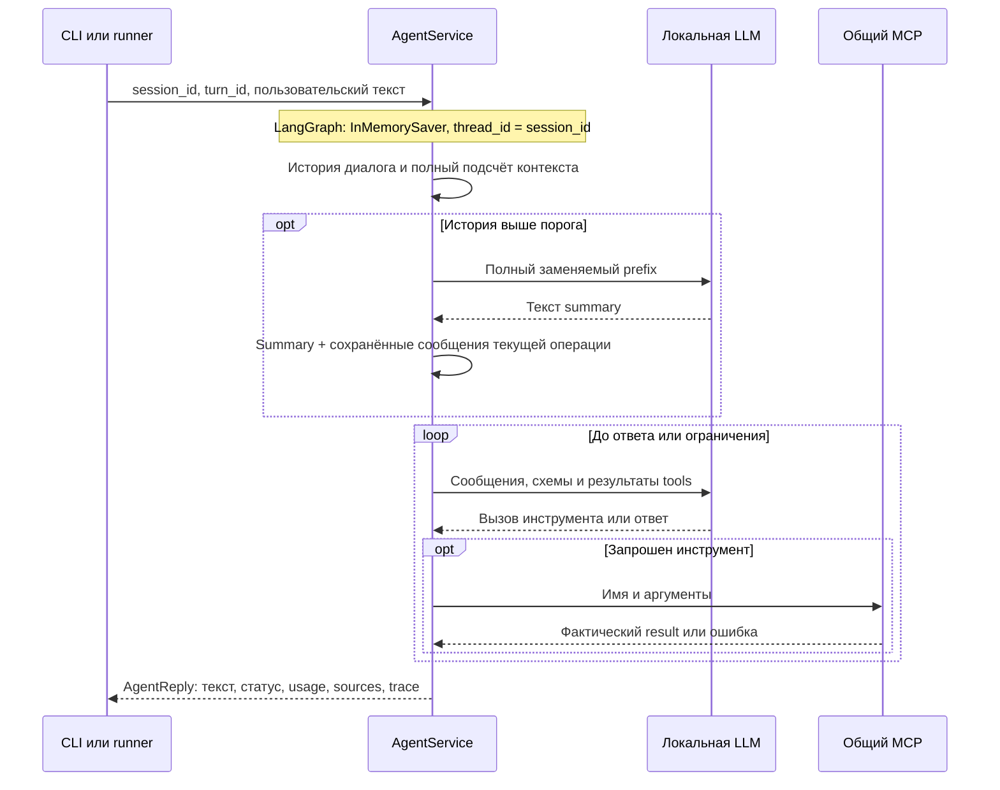

# Архитектура DM-помощника

Агент помогает Dungeon Master готовить сцены: выбирает инструменты, ищет правила D&D 2024/2025 и объясняет расчёты. XP и добычу вычисляет Python. Диалог сохраняет сообщения и результаты инструментов между репликами.

Команды — в [CLI](CLI.md), методика измерений — в [EVALUATION](EVALUATION.md), результаты — в [отчёте](../../report/LAB3_REPORT.md). Определения собраны в [глоссарии](GLOSSARY.md); для изучения реализации начните с [карты кода](#карта-кода).

- [Архитектура DM-помощника](#архитектура-dm-помощника)
  - [Общая схема](#общая-схема)
  - [От книг к инструментам](#от-книг-к-инструментам)
    - [Два независимых представления данных](#два-независимых-представления-данных)
    - [Пять общих MCP-инструментов](#пять-общих-mcp-инструментов)
  - [Путь одной реплики](#путь-одной-реплики)
  - [Контекст и память](#контекст-и-память)
    - [Что считается и ограничивается](#что-считается-и-ограничивается)
    - [Как заменяется история](#как-заменяется-история)
  - [Собственный агент и Codex](#собственный-агент-и-codex)
  - [Трейсы и результаты](#трейсы-и-результаты)
  - [Процессы и хранилища](#процессы-и-хранилища)
  - [Карта кода](#карта-кода)

## Общая схема

CLI и runner используют общие контракты. Retrieval независим от LLM, эталонов и Langfuse. Streamlit отложен.

## От книг к инструментам

### Два независимых представления данных

| Ветка | Подготовка | Для чего используется |
| --- | --- | --- |
| RAG | Markdown XPHB/XDMG/XMM и `source_map` → чанки → EmbeddingGemma 2 → Qdrant. | Найти исходный текст правила и подтвердить его происхождение. |
| Игровой каталог | Закреплённые JSON 5etools → проверенный снимок существ, предметов и таблиц. | Получить stat block, рассчитать встречу или бросить добычу. |

Чанк хранит точный срез канонического текста книги (`body`), Unicode-диапазон `[start_char, end_char)`, строки, разделы и хэши. Атрибуция страниц сохраняет исходную точность. R3/R9 меняют обработку заголовков во входе эмбеддера, сохраняя текст цитаты и координаты; настройки входят в identity индекса.

Документные векторы строятся на GPU отдельным worker. После его завершения вопросы кодирует постоянный CPU `QueryEncoder`; найденные chunks возвращаются с rank, score и index/build IDs. Manifest содержит все chunks для независимой оценки retrieval.

Каталог содержит 503 существа, 2 297 предметов и 24 таблицы магических предметов. SHA upstream и хэши проверяются до запросов; внутри tool call компиляции нет.

### Пять общих MCP-инструментов

| Инструмент | Ответственность |
| --- | --- |
| `search_rules` | Поиск исходных правил с текстом и координатами. |
| `lookup_monsters` | Ограниченная выдача актуальных XMM stat blocks. |
| `evaluate_encounter` | XP и сложность точно заданного состава. |
| `build_encounter` | Подбор состава с сохранением обязательных существ и фильтров. |
| `generate_loot` | Фактические денежные броски и предметы по XDMG. |

Описания инструментов хранятся в [descriptions.yaml](../../src/dnd_rag/tools/descriptions.yaml), вычисления — в [game](../../src/dnd_rag/game/README.md). `build_encounter` возвращает состав либо объясняет, почему подбор не завершён:

- [`conflict`](GLOSSARY.md#conflict) — обнаружено противоречие обязательных требований: например, обязательный монстр не проходит фильтр типа, его количество превышает total_count или его XP уже выше бюджета.
- [`search_exhausted`](GLOSSARY.md#search_exhausted) — ограниченный перебор не нашёл состав. Проверяется не более 256 форм с максимум тремя различными stat blocks, поэтому такой результат не доказывает, что решения вообще нет.

Это значения поля `status` результата инструмента; пояснение находится в `error`. Агент не должен называть их успешным подбором. `generate_loot` отдельно возвращает конкретный случайный результат, который сохраняется для последующего воспоминания.

## Путь одной реплики

`session_id` обозначает диалог, `turn_id` — один пользовательский запрос с полным циклом ответа. Внутри [AgentService](../../src/dnd_rag/agent/service.py) создан [`InMemorySaver`](GLOSSARY.md#inmemorysaver) — хранилище состояний LangGraph в памяти Python-процесса. Граф получает ключ [`thread_id`](GLOSSARY.md#thread_id), равный `session_id`, и по нему сохраняет сообщения и результаты tools между репликами. После перезапуска процесса это хранилище не восстанавливается автоматически из дискового журнала.

**Лимиты на обработку одной реплики (`AgentService.ainvoke`):** 12 обращений к генеративной LLM, 16 вызовов инструментов, 300 секунд выполнения агентного цикла. В счётчик LLM входят решения о следующем действии, генерация ответа и summary; поиск в Qdrant и подсчёт токенов не являются генерациями LLM. При следующем запросе счётчики обнуляются, а история той же session сохраняется. Ошибка tools возвращается модели для исправления в пределах этих лимитов. Очистка ресурсов и отправка журнала могут добавить время после остановки цикла.

CLI отображает `AgentEvent`; runner читает объект [`AgentReply`](../../src/dnd_rag/agent/contracts.py) и исходные записи. Если модель остановилась по лимиту длины ответа, частичный текст остаётся в `AgentReply.text`, поле `status` получает `"incomplete"`, а `error["code"]` — `"generation_truncated"`. Поле `usage` остаётся словарём измерений; неизвестные токеновые итоги внутри него получают `None` (`null` в JSON), а не ноль.

## Контекст и память

### Что считается и ограничивается

[runtime.llm.NativeLLM](../../src/dnd_rag/runtime/llm.py) — программная обёртка над локальным llama.cpp API. Она создаёт ChatOpenAI-клиент и считает полный сериализованный запрос токенайзером GGUF: system, историю, схемы инструментов, вызовы/результаты и шаблон. HTTP-hook проверяет тело запроса перед отправкой и сверяет count с серверным usage.

| Настройка | Значение по умолчанию | Назначение |
| --- | ---: | --- |
| Физическое окно сервера | 16 384 | Максимальный полный запрос с резервом ответа. |
| Порог агента | 9 500 | Когда сокращать накопленную историю. |
| Общий резерв ответа | 2 048 | Включает доступный reasoning и финальный текст. |
| Safety margin | 256 | Запас физического окна. |
| Summary / недавняя история | 1 024 / 2 048 | Резерв генерации summary и ориентир сохраняемого suffix. |

Условие допуска: `input + output reserve + safety <= server window`. Профили [off/budgeted](../../configs/llm/README.md) выключают thinking либо задают 512 токенов на reasoning block при том же общем резерве.

### Как заменяется история

Старая часть истории заменяется сводкой (`summary`); текущая операция сохраняется целиком.

1. До порога передаётся вся история диалога.
2. `SummarizationMiddleware` выбирает завершённые взаимодействия; сводка получает всю заменяемую часть (`prefix`), включая предыдущее summary.
3. Последний запрос и его вызовы/результаты защищены как одна операция. Пары call/result не разрываются; уже полученные параллельные результаты сохраняются при восстановлении checkpoint.
4. После замены повторно проверяется полный следующий запрос. Если он превышает порог агента, внутренняя проверка поднимает ошибку [`context_budget`](GLOSSARY.md#context_budget). `AgentService` перехватывает её и возвращает `AgentReply` с `status="context_budget"` и таким же `error["code"]`; скрытое удаление сообщений не выполняется.

Summary сокращает только старую историю. Следующий вход по-прежнему включает system, схемы tools, summary и все сообщения текущей операции. Поэтому он может не поместиться даже после сжатия: достаточно очень длинной текущей реплики или больших результатов инструментов, полученных в ответ на неё. Если старых завершённых взаимодействий ещё нет, сокращать нечего. Сама сводка тоже занимает место.

**Отдельного ограничения пользовательского текста в символах или байтах нет.** Приложение ограничивает полный вход токенами; доступная доля для текста пользователя меньше 9 500 из-за остальных частей запроса. Проверка физического окна дополнительно учитывает резерв ответа и safety; при её срабатывании возникает [`context_overflow`](GLOSSARY.md#context_overflow), который также отражается в `AgentReply.status` и `error["code"]`. Проверяется и вход самого суммаризатора. Новый диалог освобождает старую историю, но не исправляет одну слишком длинную реплику: её нужно сократить. Для больших tool results следует запрашивать меньшую выдачу.

[Промпт summary](../../src/dnd_rag/agent/prompts/summary.txt) задаёт разделы партии, ограничений, принятых составов, actual loot, источников и открытых вопросов. Пустое или оборванное summary не заменяет память; потреблённые токены всё равно учитываются. Отсутствующий результат прерванного tool call закрывается явной ошибкой, без утверждения об исполнении.

Пункты 2–4 обеспечивают передачу всей заменяемой истории суммаризатору и сохранение текущего запроса с его результатами. Эти проверки контролируют состав сообщений и размер, но LLM может пропустить или исказить факт в тексте summary. Такие смысловые потери измерены в длинных диалогах. Исходный журнал сохраняется целиком.

## Собственный агент и Codex

| Свойство | Собственный агент | Готовый агент |
| --- | --- | --- |
| Цикл | LangChain `create_agent`. | Штатные `codex exec` и `exec resume`. |
| Память | Checkpointer и контролируемый summary. | Собственная native compaction Codex. |
| Контекст | Полный native count и HTTP-guard. | Внутренний счётчик Codex; отдельно сохраняется native wire count. |
| Общие условия | Одна GGUF, MCP, каталог, датасет и профиль генерации. | Те же общие условия. |

Codex запускается из пустого временного каталога с явной конфигурацией; resume использует точный native ID. Личные настройки не меняются. Локальный HTTP-посредник, или [proxy](../../src/dnd_rag/runtime/codex_proxy.py), принимает запросы Codex на порту **8081** и обращается к llama.cpp на порту **8080**. Поэтому он обозначен `8081 → 8080`. Он переводит несовместимые описания `additional_tools/namespace` в Responses functions и обратно; штатный агентный цикл Codex остаётся внутри Codex.

Инструкции, schemas, compaction и счётчики различаются: сравниваются агентные системы. Для наблюдаемости используется [экспортер](GLOSSARY.md#exporter) — отдельный Node.js-скрипт observability-плагина Langfuse. Он читает собственный журнал Codex и переносит его события в Langfuse. Порядок работы и установка описаны в [baseline](../../configs/baseline/README.md#экспортер-что-он-переносит).

## Трейсы и результаты

| Уровень | Что записывается в Langfuse |
| --- | --- |
| Диалог / реплика | Session и trace с user, тегами, input/output и итоговым статусом. |
| Генерация | Полный доступный вход, ответ, параметры, usage и время. |
| Инструмент / retrieval | Аргументы, result, ошибка; вложенный поиск с chunks и scores. |
| Контекст | Измерения и отдельные события сокращения: размеры до/после и заменённая история. |

`ObservationRecorder` ведёт полный JSONL в `.runtime/sessions/<session>/turns.jsonl`. У собственного агента запись типа [generation](GLOSSARY.md#generation) содержит usage одного вызова LLM. Дополнительный span `raw-model-response` хранит полный исходный API-ответ, включая доступный `reasoning_content`. В нём повторно не заполняются поля учёта токенов и стоимости: иначе Langfuse мог бы сложить один расход дважды.

У Codex есть два источника данных: [rollout](GLOSSARY.md#rollout), его JSONL-журнал событий диалога, и [wire](GLOSSARY.md#wire), запись фактических HTTP-запросов/ответов модели. После завершения текущего `exec/resume` адаптер копирует журнал и запускает экспортер для отправки событий в Langfuse. Исходные записи сохраняются даже при последующей ошибке чтения Langfuse.

Затем `CodexRunner.verify_trace` читает observations через API Langfuse — это [readback](GLOSSARY.md#readback). Проверяются доступные generations/usage/tools и полный последний ответ ассистента на текущий пользовательский запрос. Защита от дубликатов проверена отдельной сквозной пробой: повторная отправка того же журнала не должна добавлять новые ID observations. После compaction экспортер восстанавливает вход генерации по журналу Codex, поэтому его версия входа может отличаться от JSON, действительно отправленного модели; последний сохраняется в wire.

Номера `[n]` получают фрагменты книг из массива `hits` фактического результата `search_rules` текущей сессии. Каждый такой [hit](GLOSSARY.md#hit) содержит текст, оценку поиска и координаты. `CitationRegistry` сохраняет связь с `index_id/chunk_id` в `.runtime/citations/`; summary её не очищает, `/new` начинает независимую нумерацию. Неизвестные номера дают предупреждение. Проверка регистрации ссылки не доказывает поддержку утверждения источником.

Структура run-артефактов, критерии успеха и различие Trace/Experiment Scores описаны в [EVALUATION](EVALUATION.md). SDK 5 работает с events-only Langfuse 4 через observations/Experiments API.

## Процессы и хранилища

`application_stack`: инфраструктура → каталог → индекс/retriever → завершение GPU-worker → GGUF → MCP/proxy → интерфейс. Перед reuse проверяются владение коллекцией, identity, payloads и количество точек.

| Компонент | Локальный адрес / хранение |
| --- | --- |
| Qdrant | `6343/6344`, постоянные данные `data/qdrant/`. |
| LLM | `8080/v1`, GGUF вне репозитория. |
| MCP / Responses proxy | `8765/mcp` / `8081/v1`, принадлежат текущему запуску. |
| Langfuse | `3000`, постоянные Compose volumes. |

[`RuntimeSession`](../../src/dnd_rag/runtime/processes.py) управляет одним запуском стека. Его [lock](GLOSSARY.md#lock), системная блокировка проекта, не допускает второй одновременный runtime. Дочерние процессы — отдельные запущенные программы: GPU-worker и llama.cpp; адаптер Codex отдельно запускает Codex CLI и Node.js-экспортер. Для их остановки используются [process groups](GLOSSARY.md#process-group), группы процессов Linux с общим PGID. MCP и proxy работают в потоках Python-процесса.

SIGINT (обычно Ctrl+C) и SIGTERM запускают [cleanup](GLOSSARY.md#cleanup): остановку собственных процессов/потоков и ожидание их завершения. SIGKILL нельзя перехватить, поэтому после принудительной смерти launcher живой потомок может удерживать блокировку. Владение оставшейся группой проверяется по унаследованному дескриптору той же [FLOCK-блокировки](GLOSSARY.md#flock); совпадения PGID или имени файла недостаточно. Подробности сигналов и блокировки — в [runtime](../../src/dnd_rag/runtime/README.md#остановка-и-блокировки).

Адаптер Codex собирает stdout/stderr Codex CLI и экспортера через [_capture_owned](../../src/dnd_rag/experiments/codex.py); такое чтение вывода называется [capture](GLOSSARY.md#capture). При таймауте уже прочитанные данные сохраняются, завершение подтверждённой собственной группы и ожидание каналов ограничены по времени. Группа с недоказанным владением не завершается. MCP/proxy останавливаются при выходе, Docker и данные остаются.

## Карта кода

| Зона | Точка входа | Ответственность |
| --- | --- | --- |
| Команды | [\_\_main\_\_.py](../../src/dnd_rag/__main__.py), [cli.py](../../src/dnd_rag/cli.py) | Аргументы запуска и интерактивный терминал. |
| Композиция | [runtime/application.py](../../src/dnd_rag/runtime/application.py): `application_stack` | Порядок запуска общих сервисов. |
| Агент | [agent/service.py](../../src/dnd_rag/agent/service.py): `AgentService.ainvoke` | История, цикл и ограничения. |
| Память | [agent/memory.py](../../src/dnd_rag/agent/memory.py), [prompts](../../src/dnd_rag/agent/prompts/README.md) | Подсчёт, summary и защищённые взаимодействия. |
| LLM | [runtime/llm.py](../../src/dnd_rag/runtime/llm.py): `NativeLLM`; [codex_proxy.py](../../src/dnd_rag/runtime/codex_proxy.py) | Native count, guard, Chat/Responses. |
| MCP и расчёты | [tools/server.py](../../src/dnd_rag/tools/server.py): `create_mcp_server`; [game](../../src/dnd_rag/game/README.md) | Общий API и игровая арифметика. |
| RAG | [runtime/index.py](../../src/dnd_rag/runtime/index.py): `prepare_retriever`; [retrieval.py](../../src/dnd_rag/retrieval.py) | Подготовка/reuse и поиск. |
| Корпус и индекс | [indexing](../../src/dnd_rag/indexing/README.md) | Чанки, эмбеддинги, identity и Qdrant. |
| Наблюдаемость | [observability.py](../../src/dnd_rag/agent/observability.py), [citations.py](../../src/dnd_rag/agent/citations.py) | Трейсы, журнал и реестр источников. |
| Сравнение | [runner.py](../../src/dnd_rag/experiments/runner.py), [codex.py](../../src/dnd_rag/experiments/codex.py) | Датасет, адаптер Codex, связи Experiments. |
| Оценка | [experiments](../../src/dnd_rag/experiments/README.md), [evaluation](../../src/dnd_rag/evaluation/README.md) | Формальные критерии, review и retrieval-метрики. |
| Процессы | [runtime](../../src/dnd_rag/runtime/README.md) | Блокировка, проверка готовности и завершение. |

Для первого чтения проследите `run → application_stack → run_cli → AgentService.ainvoke`. Затем изучите `memory.py` и один инструмент. Измерительная ветка начинается в `experiments/commands.py` и использует те же сервисы.
