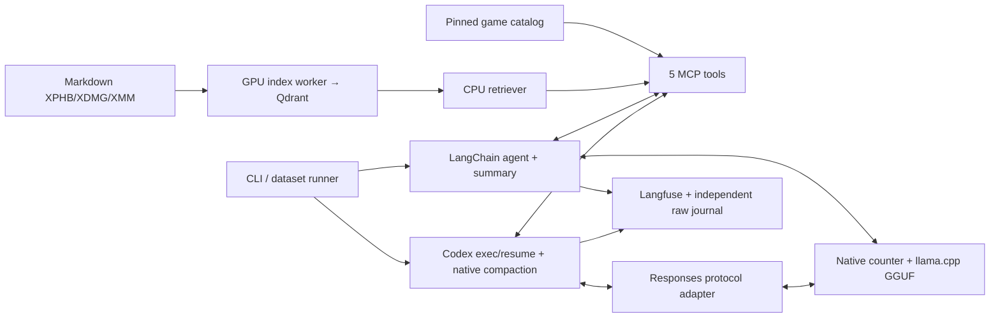

# Лабораторная 3: локальный DM-помощник

## Фактическое приложение

Реализованы самостоятельный RAG, пять общих StreamableHTTP MCP-инструментов, LangChain create_agent с памятью, Codex exec/resume со штатной local compaction, локальный Langfuse, Rich/prompt_toolkit CLI и воспроизводимый runner. Игровые вычисления и случайность находятся в инструментах; модель выбирает вызовы и объясняет их. Успешное выполнение runtime не гарантирует правильный ответ модели.

RAG-конфигурация не зависит от dataset, gold, LLM или интерфейса. R3/R9 сохраняют исходные spans и математические определения прежнего retrieval-ядра. Worker заканчивает работу на GPU до старта GGUF; QueryEncoder работает на CPU. RuntimeSession держит lock и завершает только собственные process groups. Docker/data остаются после выхода.

## Данные и закреплённая среда

| Компонент | Фактическая версия/настройка |
|---|---|
| Corpus/source | 5etools c3d53956346388b222aaaaf4637776f563e201b8; XPHB2024, XDMG2024, XMM2025 |
| Index | R3,5578chunks, EmbeddingGemma2 revision f9972ac22e696a105c482202646979e33e4b5a1e,768d; Qdrant1.20.0 |
| Game catalog |503monsters,2297concrete items,24magic tables; hashes7inputs/4outputs |
| Python stack |Python3.13, uv0.11.6, LangChain1.5/core1.8/openai1.7.4, MCP1.30/adapters0.3.2 |
| Model server |llama.cpp build11046/60081bb2b; RTX3060Laptop6GB; GPU layers99, KVq8_0 |
| Common weights |NVIDIA-Nemotron-3.5-Bolt-E4B-UD-Q4_K_XL.gguf |
| GGUF SHA256 |84ff34f5834b929043f5ae74799e8d562d4056998f6a5923ceb44831e8ad84d6 |
| Template SHA256 |a9729e306e331ab2f82789712b4f4ea8382ebf5df88052917c99d4abf79fd1a4 |
| Ready agent |Codex0.167.0-alpha.4.1; exact exec resume ID, empty work cwd, personal config ignored |
| Observability |Langfuse SDK5.2.0/Compose4.79.0; exporter e1d02be28e6bacbfe350a1bc1ccf861e54edee17; Node24.22.2 |

Источники игровых сущностей компилируются локально из pinned JSON, не из retrieval hits. Generic magic items и groups раскрыты до конкретных вариантов, ссылки и d100 ranges проверены. Продукт не обращается к сетевому игровому API. Подготовка не меняет исходный Markdown/source_map.

## Инструменты

search_rules возвращает исходный текст с точными spans/hash и stable IDs. lookup_monsters отдаёт текущие XMM stat blocks. evaluate_encounter считает суммуXP без множителей2014 и классифицирует точный заданный состав. build_encounter сохраняет required counts, фильтры и exact total; bounded search≤256forms/≤3statblocks не выдаёт search_exhausted за доказательство невозможности. generate_loot возвращает реальные деньги, имена/редкости предметов, rolls и source tables; one individual roll умножается на homogeneous count, hoard требует явных ownerCR/party level/theme.

Номера citations выдаются MCP по программному session header, сохраняются в registry и переживают summary. Валидатор допускает только фактически зарегистрированные source IDs этого диалога. Он не доказывает semantic support: модель может сослаться на реальный номер к неподходящему утверждению. Неизвестные номера не исправляются выдуманными ссылками.

## Контекст и reasoning

Физическое окно обеих конфигураций16384, общий output reserve2048 и safety256. Оба агента настроены на threshold9500. Sampling во всех четырёх actual argv: temperature0.0, top_p1.0, top_k40, min_p0.0, seed42, prompt cache выключен. Own повторяет параметры в body; Codex наследует их от своего сервера. Off: enable_thinking=false, effort=none, budget0. Budgeted: thinking=true,512tokens на reasoning block, общий output reserve остаётся2048. Это не обещание native low/minimal effort. Отдельный reasoning-token breakdown API не всегда предоставляет; отсутствующие значения не превращаются в0.

Own считает весь фактический serialized body, включая system/tools/calls/results, родным input_tokens endpoint и сверяет результат с usage. Summary использует весь заменяемый prefix, предыдущий summary и защищённый recent/current suffix; резерв summary1024. Текущий Human exchange и полные tool pairs не удаляются. Если protected exchange или полный summary input не помещается, возвращается явная ошибка. Установленный SDK умеет скрыто отрезать середину при overflow retry, поэтому этот путь заменён full-prefix summarizer без trim. Оборванный по output limit summary не принимается.

Summary+recent сохраняет контекст последних решений и сжимает более старые объяснения. Sliding deletion потеряла бы ранний случайный payout; отдельный fact store потребовал бы дополнительного извлечения/синхронизации. Стратегия не гарантирует сохранность каждого факта: потери ownerCR/theme и XP category обнаружены фактически. Полный исходный журнал остаётся независимо от активной памяти.

Codex использует собственный алгоритм compaction. Его служебный prefix и счётчик отличаются от own. Общие9500 задают номинальный threshold двух систем, но не гарантируют одинаковый фактический размер рабочего native input. При исходных8192 пилот обнаружил повторное сокращение до ответа; общий threshold сначала поднят до11000. Полный Orla на11000 затем выявил14686 input +2048 reserve >16384 после результата поиска. Диагностическая v1 остановлена с сохранением всех данных; все четыре итоговые клетки повторяются на9500 после живого девятиходового regression probe. Native wire count Codex сохраняется отдельно от внутренней статистики CLI.

## Совместимость и наблюдаемость

Codex0.167 передаёт additional_tools/namespaces, которые llama build11046 не принимает. Тонкий loopback adapter8081→8080 переносит схемы в Responses functions и обратимо преобразует имена; сообщения и tool results не сокращаются. Агентный цикл и compaction остаются внутри Codex. Доступны только общие пять MCP functions; stock base instructions Codex сохранены.

Фактический Codex binding удаляет min/max/default annotations JSON Schema, сохраняя names/descriptions/types/enums/required. Серверная валидация остаётся общей. Поэтому отдельно сохраняются полные wire-schema hashes и общий API-shape hash. Это сравнение агентных систем с разными внутренними инструкциями/сериализацией, а не изолированный эксперимент одного prompt.

SDK5 отправляет данные в events-only Langfuse4; legacy traces/DatasetRunItems API не используется. Per-turn dataset item связан с реальным trace отдельным Experiment observation, не заменяющим generations. API readback проверяет input/output/usage/tools и последний turn. Own raw chat response, включая доступный reasoning_content, сохраняется span без повторного начисления usage; Codex сохраняет original rollout и original/effective wire payload. Повторный closed-rollout export проверен на дедупликацию.

Официальный MinIO image endpoint оказался недоступен; локальный Compose использует сборку того же pinned official MinIO release из проверенного исходного архива. Сетевые порты внутренних БД не публикуются. [Воспроизводимое окружение](../infra/README.md).

Итоговая матрица измеряет commit7954685. После окончания матрицы в финальном приложении исправлены учёт usage/неполной генерации, захват/очистка процессов при timeout/cancellation/export failure, сохранение completed parallel-tool pending writes и совместимость Any-habitat с конкретной средой. Any может изменить будущие candidate pools; точные performance-числа относятся к7954685, а не к финальному релизу. Измеренные own summary все завершились finish=stop; их токены не требуют реконструкции. Последний Codex процесс исполняет уже загруженную frozen версию. Исходные ответы не переписаны; последующие запуски исправленного приложения получают новый fingerprint.

## Набор и оценивание

Фиксированный English dataset15items:8single,4short×3turns,3long×9turns, всего47turns. Четыре клетки дают60executions/188turns. SHA256 набора7346b4739aed8aadc247299c3d5d19480270b92309bb3c4ccb1f2383cda8d022. Агент получает только пользовательские реплики, не expected/gold.

Десять retrieval turns размечены по corpus body/hash/section/spans до запуска; аннотации не выводятся из actual hits. Opportunity Attack и Grappled повторяются в разных диалогах: это не10различных правил или статистически независимых вопросов. Метрики: P/R@1/5/10, MRR@10, пересечение≥50% меньшего span; full-manifest denominator и короткие выдачи сохранены. Несколько searches сначала усредняются внутри annotated turn. Отсутствующий обязательный поиск получает0 и отдельный missing-call marker; неразмеченный поиск — N/A.

Agent/tool/runtime source подтверждён48хэшами файлов из commit7954685 ([freeze audit](../results/lab3/source-freeze-audit.json)); offline evaluator имеет отдельный SHA provenance и не поступает агенту. Первоначальные raw scores являются диагностикой; окончательные scored_turns получены единым recompute.

Формальные проверки используют реальные tool outputs и первые фактические rolls. Смысловая worksheet заполнена координатором как **agent-assisted**, по каждому turn/criterion с trace evidence; human review не заявляется. Известный исходный факт, не созданный из-за раннего failure, выделяется отдельно от забывания после summary. Исправленные попытки и повторное использование уже полученных stat blocks не штрафуются как финальный провал. Исходные raw records не переписываются, единая финальная версия evaluator применяется офлайн ко всем клеткам с SHA provenance.

Task success требует всех обязательных критериев всех проверяемых turns; pending не является success. Completion требует присутствия всех turns, completed runtime status, trace и known native usage. Числа локального API-cost равны0; цена оборудования/энергии и труд оценки сюда не включены.

## Итоговая матрица

Все четыре клетки используют frozen commit7954685, один dataset и общий threshold9500. Полные raw/rollout/wire, native counters, Langfuse readbacks и review.csv сохранены локально. [Машинная сводка](../results/lab3/matrix.json), [CSV](../results/lab3/comparison.csv), [описание артефактов](../results/lab3/README.md).

| Agent/mode | Runtime executions | Task success | Input/output tokens | Adapter mean, s | Run wall, s | Compactions |
|---|---|---|---|---|---|---|
| own/off | 15/15 | 4/15 (26.7%) | 547203 / 21462 | 21.639 | 1057.359 | 8 |
| own/budgeted | 15/15 | 8/15 (53.3%) | 637303 / 63824 | 41.993 | 1976.623 | 9 |
| codex/off | 13/15 | 6/15 (40.0%) | unknown / unknown | 45.49 | 2085.215 | 38 |
| codex/budgeted | 13/15 | 9/15 (60.0%) | unknown / unknown | 85.134 | 3869.714 | 56 |

codex/off: наблюдаемая нижняя граница ≥1640638 input / ≥32552 output; usage ещё 2 генераций неизвестен, общая сумма остаётся null.
codex/budgeted: наблюдаемая нижняя граница ≥2108207 input / ≥97655 output; usage ещё 2 генераций неизвестен, общая сумма остаётся null.

Adapter latency включает расходы адаптера; Codex export/readback выполняются внутри adapter, дополнительный own readback выполняет runner. Для общего сравнения приведён run wall после readiness. API-cost всех локальных запусков0; энергия, оборудование и труд оценки не включены. Unknown usage остаётсяnull. Reasoning включён в доступный output usage; отдельный reasoning breakdown не подменяется догадкой.

| Agent/mode | Single | Short dialogue | Long dialogue | Easy | Medium | Hard |
|---|---|---|---|---|---|---|
| own/off | 12.5% | 75.0% | 0.0% | 50.0% | 50.0% | 0.0% |
| own/budgeted | 62.5% | 75.0% | 0.0% | 100.0% | 66.7% | 28.6% |
| codex/off | 37.5% | 75.0% | 0.0% | 0.0% | 50.0% | 42.9% |
| codex/budgeted | 75.0% | 75.0% | 0.0% | 50.0% | 100.0% | 28.6% |

| Agent/mode | History before | History after | Formal tool score | Tool results / error results | Max native input | Citation validity |
|---|---|---|---|---|---|---|
| own/off | 100.0% (n=11) | 73.3% (n=15) | 0.9371 | 75 / 8 | 9538 | 66.7%; unknown=21/63 |
| own/budgeted | 90.9% (n=11) | 93.3% (n=15) | 0.9822 | 81 / 6 | 9248 | 100.0%; unknown=0/28 |
| codex/off | 100.0% (n=8) | 72.2% (n=18) | 0.9719 | 107 / 12 | 13341 | 92.9%; unknown=1/14 |
| codex/budgeted | 100.0% (n=5) | 90.5% (n=21) | 0.9787 | 143 / 19 | 13133 | 100.0%; unknown=0/28 |

Tool counts здесь обозначают наблюдаемые завершённые результаты; начатый вызов без ответа остаётся в raw/status. Tool error results включают также ожидаемые structured constraint conflicts/search_exhausted и исправленные validation errors; это не число сломанных executions. Formal tool score — среднее формальных критериев внутри turn, затем по turns, не субъективная точность всего ответа. Citation validity считает уникальные номера внутри каждого turn и проверяет регистрацию, а не поддержку утверждения источником.

| Agent/mode | mrr@10 | precision@1 | precision@5 | precision@10 | recall@1 | recall@5 | recall@10 | evidence_coverage@1 | evidence_coverage@5 | evidence_coverage@10 | Missing required searches |
|---|---|---|---|---|---|---|---|---|---|---|---|
| own/off | 0.2833 | 0.0 | 0.14 | 0.07 | 0.0 | 0.7 | 0.7 | 0.0 | 0.7 | 0.7 | 3 |
| own/budgeted | 0.5917 | 0.3 | 0.2 | 0.1 | 0.3 | 1.0 | 1.0 | 0.3 | 1.0 | 1.0 | 0 |
| codex/off | 0.3333 | 0.1 | 0.12 | 0.06 | 0.1 | 0.6 | 0.6 | 0.1 | 0.6 | 0.6 | 3 |
| codex/budgeted | 0.5655 | 0.2667 | 0.1971 | 0.0986 | 0.2667 | 0.9857 | 0.9857 | 0.2667 | 0.9857 | 0.9857 | 0 |

Десять размеченных retrieval turns на клетку; missing required search получает0. Короткие выдачи используют прежние full-manifest denominators. Результат отражает также выбор запроса/инструмента агентом, не только качество embedding index.

## Наблюдаемый результат

На этом наборе budgeted повысил strict task success с4до8из15 у own и с6до9 у Codex. Среднее adapter time выросло21.64→41.99s и45.49→85.13s соответственно. Улучшение различается по группам сложности; все3длинных целиком провалены по строгому all-criteria правилу во всех4клетках, хотя отдельные финальные recall успешны. Два тайм-аута в каждой Codex-клетке — зафиксированный предел штатного поиска/compaction, а не причина подбирать новый успешный ответ.

Эти наблюдения показывают стоимость reasoning и чувствительность агентного цикла к памяти. Они не дают оценки дисперсии или универсального превосходства режима. Арифметика tools и качество объяснения/сохранения состояния оцениваются отдельно.

## Реальная компактизация и память

| Agent/mode | Scenario | Events | Recorded reductions/data | Final recall failed criteria | Last turn |
|---|---|---|---|---|---|
| own/off | 01_mothbridge_ledger | 3 | t3: 10777→6162 / t5: 13257→6188 / t7: 10160→1901 | pass | [trace](http://127.0.0.1:3000/project/7d8d3807-b938-4896-9289-8a28375b69b5/traces/74d0d23f76b66826f76059b6d59897b8) |
| own/off | 02_orla_chest | 3 | t3: 12457→6373 / t5: 11530→4570 / t7: 10573→6516 | rubric_2, history_correctness | [trace](http://127.0.0.1:3000/project/7d8d3807-b938-4896-9289-8a28375b69b5/traces/cb0cadfb38a4e346d1aa97c3796339f9) |
| own/off | 03_observatory_purse | 2 | t4: 10115→1862 / t6: 10702→3556 | rubric_0, history_correctness | [trace](http://127.0.0.1:3000/project/7d8d3807-b938-4896-9289-8a28375b69b5/traces/3e7669acb33744ba4fa3dfddac19afdc) |
| own/budgeted | 01_mothbridge_ledger | 3 | t3: 10847→6187 / t5: 13557→6255 / t7: 9628→1945 | pass | [trace](http://127.0.0.1:3000/project/7d8d3807-b938-4896-9289-8a28375b69b5/traces/a4844ce560d9072fa8ce9019239d8e3f) |
| own/budgeted | 02_orla_chest | 3 | t3: 10812→6093 / t5: 10065→2886 / t7: 11151→6141 | rubric_2, history_correctness | [trace](http://127.0.0.1:3000/project/7d8d3807-b938-4896-9289-8a28375b69b5/traces/09adc96dd32974d4f272158c7e4d1f28) |
| own/budgeted | 03_observatory_purse | 3 | t3: 9519→6189 / t5: 13442→6142 / t7: 9631→1866 | pass | [trace](http://127.0.0.1:3000/project/7d8d3807-b938-4896-9289-8a28375b69b5/traces/0d0a1a0d5be10f39338b1be3509c5d92) |
| codex/off | 01_mothbridge_ledger | 15 | t3 × 1 native events / t4 × 1 native events / t5 × 1 native events / t6 × 2 native events / t8 × 10 native events | rubric_1, history_correctness | [trace](http://127.0.0.1:3000/project/7d8d3807-b938-4896-9289-8a28375b69b5/traces/8dd82ebf3242fe505c7a1f5848493916) |
| codex/off | 02_orla_chest | 6 | t2 × 1 native events / t3 × 1 native events / t5 × 1 native events / t6 × 1 native events / t7 × 1 native events / t9 × 1 native events | rubric_2, history_correctness | [trace](http://127.0.0.1:3000/project/7d8d3807-b938-4896-9289-8a28375b69b5/traces/4e9e04f9791cc7730189576ac1160d84) |
| codex/off | 03_observatory_purse | 15 | t3 × 1 native events / t5 × 1 native events / t7 × 12 native events / t8 × 1 native events | rubric_0, history_correctness | [trace](http://127.0.0.1:3000/project/7d8d3807-b938-4896-9289-8a28375b69b5/traces/59f745012fa35fe195bb14f4f1430743) |
| codex/budgeted | 01_mothbridge_ledger | 15 | t1 × 1 native events / t2 × 1 native events / t4 × 8 native events / t5 × 1 native events / t7 × 3 native events / t9 × 1 native events | recalled_encounter_names, loot_amount_recalled, rubric_1, rubric_2, history_correctness | [trace](http://127.0.0.1:3000/project/7d8d3807-b938-4896-9289-8a28375b69b5/traces/faf6c2eab4b462f402bb5e98fb0e9d83) |
| codex/budgeted | 02_orla_chest | 17 | t1 × 1 native events / t3 × 1 native events / t5 × 6 native events / t8 × 9 native events | pass | [trace](http://127.0.0.1:3000/project/7d8d3807-b938-4896-9289-8a28375b69b5/traces/e974259ccc333ef7756fc1441a73ad55) |
| codex/budgeted | 03_observatory_purse | 10 | t3 × 1 native events / t4 × 1 native events / t5 × 3 native events / t6 × 1 native events / t7 × 1 native events / t8 × 1 native events / t9 × 2 native events | pass | [trace](http://127.0.0.1:3000/project/7d8d3807-b938-4896-9289-8a28375b69b5/traces/9aef35698f9f2d764091385e28e86230) |

События берутся из исходных middleware/native Codex rollouts. У прерванных Codex turns измеренной версии первоначальный capture не сохранил snapshot до ошибки readback; их реальные native events попали в следующий snapshot того же диалога. Номера t в таблице обозначают записанный snapshot, а не выдуманное время каждого события. Эти raw не переписаны. Программные проверки требуют минимум одно наблюдаемое событие в каждом из трёх длинных сценариев каждой клетки. Смысловые ошибки финального recall проверены отдельно по actual first rolls, party updates, accepted/proposed encounter и story facts. Большее число native events может означать повторяющийся loop, а не лучшую сохранность памяти. History before/after использует разные группы turns и не является причинной оценкой потерь: runtime failure и исходно неверный ledger также дают0. Полный журнал не сокращается вместе с активной памятью.

## Реальные неудачи и категории

| Agent/mode | Failed execution | Разбираемая реплика | Category | Failed criteria | Observed evidence | Trace |
|---|---|---|---|---|---|---|
| own/off | single_01_forest_fey | 1 | Ограничения | difficulty, build_status, rubric_1, rubric_2 | После ошибки build модель оценила четырёх Goblin Warriors:200XP/low, но назвала выполненным требование ровно одного обязательного goblin и Moderate. Генератор такого успеха не возвращал. | [trace](http://127.0.0.1:3000/project/7d8d3807-b938-4896-9289-8a28375b69b5/traces/bb25c3f470fd4d9a27ac40b2a8c89227) |
| own/off | single_03_forced_movement | 1 | Правила и доказательства | tool_search_rules, rubric_1 | Вердикт no Opportunity Attack совпал с правилом, но обязательного поиска не было; источник[1] придуман, исключение для внешнего перемещения объяснено неверно. | [trace](http://127.0.0.1:3000/project/7d8d3807-b938-4896-9289-8a28375b69b5/traces/d95ddab42c3e239e12d427de5c489a31) |
| own/off | single_06_required_filter_conflict | 1 | Ограничения | tool_build_encounter, expected_status, rubric_0, rubric_1 | Lookup с фильтром undead скрыл настоящий Owlbear forest/monstrosity. Ответ заметил только конфликт типа, пропустил urban/forest и не получил structured conflict от build. | [trace](http://127.0.0.1:3000/project/7d8d3807-b938-4896-9289-8a28375b69b5/traces/8bc0210f426ff2c8d94449b37d979f94) |
| own/off | single_07_unknown_and_separate_evaluation | 1 | Неполное выполнение | tool_evaluate_encounter, rubric_0, rubric_2 | Неизвестный Titan честно не найден, однако отдельная уже заданная оценка Wraith+2Skeleton для4×5 вообще не выполнена; агент повторно спрашивает заданные параметры. | [trace](http://127.0.0.1:3000/project/7d8d3807-b938-4896-9289-8a28375b69b5/traces/e149a0333cc66fce2c11e1df97611bd6) |
| own/off | long_02_orla_chest | 9 | Память | rubric_2, history_correctness | После трёх summary сохранены600gp, фактические предметы и3×4, но потеряны заданные ownerCR3/Relics. Ответ отрицает наличие этих фактов и ошибочно называет hoard individual. | [trace](http://127.0.0.1:3000/project/7d8d3807-b938-4896-9289-8a28375b69b5/traces/cb0cadfb38a4e346d1aa97c3796339f9) |
| own/off | long_03_observatory_purse | 6 | Вызов инструмента и состояние | total_xp, difficulty, exact_composition, rubric_0, history_correctness | Вместо2Troll агент оценил2Griffon+2Mage=5500. Затем перенёс5500 на принятых2Mage, хотя исходный XP4600; ошибка вызова загрязнила ledger. | [trace](http://127.0.0.1:3000/project/7d8d3807-b938-4896-9289-8a28375b69b5/traces/810729427c485dcf701bc20eea8533d3) |
| own/budgeted | short_02_actual_purses_recall | 1 | Лишний случайный roll | loot_count, loot_amount_reported, rubric_0 | Сначала вызван count1 с12gp, затем новый count3 с45gp. Запрошен один roll для трёх существ; дальнейшее сохранение45gp не исправляет потерю первого фактического результата. | [trace](http://127.0.0.1:3000/project/7d8d3807-b938-4896-9289-8a28375b69b5/traces/8d464143762c94a4ba64fdb994e0567e) |
| codex/off | single_02_mages_budget | 1 | Правила и доказательства | tool_search_rules, rubric_0, rubric_2 | 2Mage=4600/high вычислены верно, но нет обязательного search_rules и подтверждённого объяснения бюджета; в финале отсутствуют запрошенные CR/XP каждого Mage. | [trace](http://127.0.0.1:3000/project/7d8d3807-b938-4896-9289-8a28375b69b5/traces/c522844510d33b1caee47a5a7b42d2cf) |
| codex/off | single_03_forced_movement | 1 | Неполное выполнение | tool_lookup_monsters, tool_evaluate_encounter, tool_search_rules, rubric_0, rubric_1 | Готовый текст только обещает lookup/evaluate/search. Ни одного инструмента и фактического результата; runtime completed здесь не означает выполненную задачу. | [trace](http://127.0.0.1:3000/project/7d8d3807-b938-4896-9289-8a28375b69b5/traces/cf2764f567fd69aabd89ff788bbd4764) |
| codex/off | single_04_patrol_purses | 1 | Правила и доказательства | tool_search_rules, rubric_1 | Фактические54gp переданы верно, но запрошенные one3d6×6 и обоснование по книге отсутствуют; ссылка[1] не зарегистрирована. | [trace](http://127.0.0.1:3000/project/7d8d3807-b938-4896-9289-8a28375b69b5/traces/d5aa937a7fb10743832743e71afa1c33) |
| codex/off | single_05_dragon_hoard | 1 | Неполное выполнение | rubric_2 | Фактические4600gp и три common предмета названы верно, однако отсутствуют запрошенные источники каждого предмета из XDMG. | [trace](http://127.0.0.1:3000/project/7d8d3807-b938-4896-9289-8a28375b69b5/traces/5dbd701fbb4fe420525fcdd0ab2ab744) |
| codex/off | single_06_required_filter_conflict | 1 | Ограничения | rubric_0 | Настоящий structured conflict сохранён, обязательный монстр не удалён. Ответ объясняет только undead/type mismatch, пропуская конфликт urban/forest; предложенного изменения типа недостаточно. | [trace](http://127.0.0.1:3000/project/7d8d3807-b938-4896-9289-8a28375b69b5/traces/2cb4ad9aa176972c24445a986e289250) |
| codex/off | long_01_mothbridge_ledger | 7 | Штатный цикл компактизации | completed, rubric_0, history_correctness | После lookup повторяется native search/compaction при9500. Guard300s останавливает процесс, завершённого ответа нет; raw wire сохраняет реальные tool outputs, одна генерация без usage. | [trace](http://127.0.0.1:3000/project/7d8d3807-b938-4896-9289-8a28375b69b5/traces/4658ae303beb05fe5836159b4f136b1f) |
| codex/off | long_02_orla_chest | 9 | Память и полнота | rubric_2, history_correctness | Финал сохраняет700gp, Periapt of Health, ownerCR3/Relics и revised party, но пропускает rarityuncommon, необходимую для точного восстановления chest. Это неполный recall, не потеря суммы. | [trace](http://127.0.0.1:3000/project/7d8d3807-b938-4896-9289-8a28375b69b5/traces/4e9e04f9791cc7730189576ac1160d84) |
| codex/off | long_03_observatory_purse | 3 | Правила и доказательства | rubric_0 | Реальный поиск вернул исключение, но финал утверждает, что внешний push провоцирует Opportunity Attack. Игнорируется условие без собственного movement/action/BonusAction/Reaction. | [trace](http://127.0.0.1:3000/project/7d8d3807-b938-4896-9289-8a28375b69b5/traces/137b87eb48832f70cc42aa9d53543a4f) |
| codex/budgeted | single_04_patrol_purses | 1 | Лишний случайный roll | loot_amount_reported, rubric_1, rubric_2 | Первый реальный one3d6×6 дал102gp. После native compaction агент снова вызвал generate_loot с теми же параметрами и получил36gp, назвав36 итогом. Верная формула не компенсирует замену первого случайного результата. | [trace](http://127.0.0.1:3000/project/7d8d3807-b938-4896-9289-8a28375b69b5/traces/b7bd80eece3970a9241a0302eb59ddb9) |
| codex/budgeted | long_01_mothbridge_ledger | 9 | Память | recalled_encounter_names, loot_amount_recalled, rubric_1, rubric_2, history_correctness | Финал сохраняет5×4, forest/fey, Goblin1 и Миру, но не восстанавливает точный BlinkDog1/Stalker2 состав и прямо признаёт потерю реальных44gp. Нового броска или придуманной суммы нет; строгий recall всё равно failed. | [trace](http://127.0.0.1:3000/project/7d8d3807-b938-4896-9289-8a28375b69b5/traces/faf6c2eab4b462f402bb5e98fb0e9d83) |
| codex/budgeted | long_03_observatory_purse | 6 | Вызов инструмента и состояние | total_xp, difficulty, exact_composition, rubric_0 | После корректного lookup Troll агент оценивает принятых2Mage4600/high вместо запрошенных2Troll3600/moderate. Старые140gp/party4×6 сохранены, но сравнение не выполнено. Это ошибка выбора аргументов, не ошибка XP-сервиса. | [trace](http://127.0.0.1:3000/project/7d8d3807-b938-4896-9289-8a28375b69b5/traces/b64272883b4ce43de1e5f75836dcde6a) |

Повторяющиеся категории: проверка и объяснение retrieved rules; fidelity к точным tool outputs/ограничениям; создание и сохранение состояния диалога. Раннее отсутствие факта из-за невыполненного tool call отмечается отдельно от потери уже созданного факта после summary. Ошибки исходной модели, protocol/context guards и evaluator не смешиваются: исправления evaluator применены офлайн одинаково ко всем клеткам, исходные ответы сохранены.

## Проверки, демонстрация и ограничения

Финальная проверка:639 non-live Python tests passed,84 deselected за29.03s; saved-artifact test включён через DM_SAVED_RUNS и прошёл, Ruff clean; Node ingestion47/47; Python ingestion integration77 passed на существующем resolved build без пересборки книг. Полный saved-artifact audit прошёл60executions/188turns, профили/native counter parity/источники/recompute и47Experimentlinks на клетку. Все606generations завершённых turns сверены с native usage;83полученных generations частичных traces также сохранены,4прерванных ответа не имеют usage. Post-fix shared-stack probe прошёл: Any-habitat MCP, по2turns обоих клиентов, последний trace и exporter dedup (off/11000, вне матрицы). Актуальные финальные test/review gates — в [verification.json](../results/lab3/verification.json).

Реальные пробы проверили count↔usage parity Chat/Responses в off/budgeted, StreamableHTTP MCP, обе exec/resume ветки, последний turn и dedup exporter, repeated summary, PTY CLI/new/status/exit и error presentation. Ни результаты второй лабораторной, ни исследовательские заметки не используются как доказательство нового приложения.

Малый единичный набор не даёт оценки дисперсии или причинного эффекта reasoning. Случайные payouts различаются; оценивается fidelity к собственному actual roll. Semantic worksheet — agent-assisted, не human rating. Разные stock instructions/native bindings/compaction являются частью сравниваемых агентных систем. Bounded build не доказывает отсутствие решения. Citation validity не доказывает semantic support. Native low/minimal effort не обещается. Streamlit отложен как условная последняя задача; реализован и проверен CLI.

[Демонстрация](../docs/user_docs/DEMO.md), [полный CLI](../docs/user_docs/CLI.md), [методика](../docs/user_docs/EVALUATION.md).
