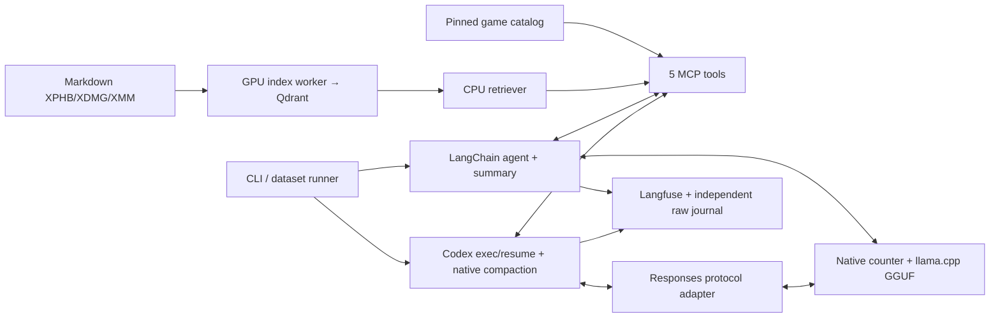
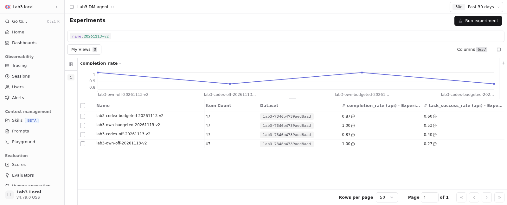
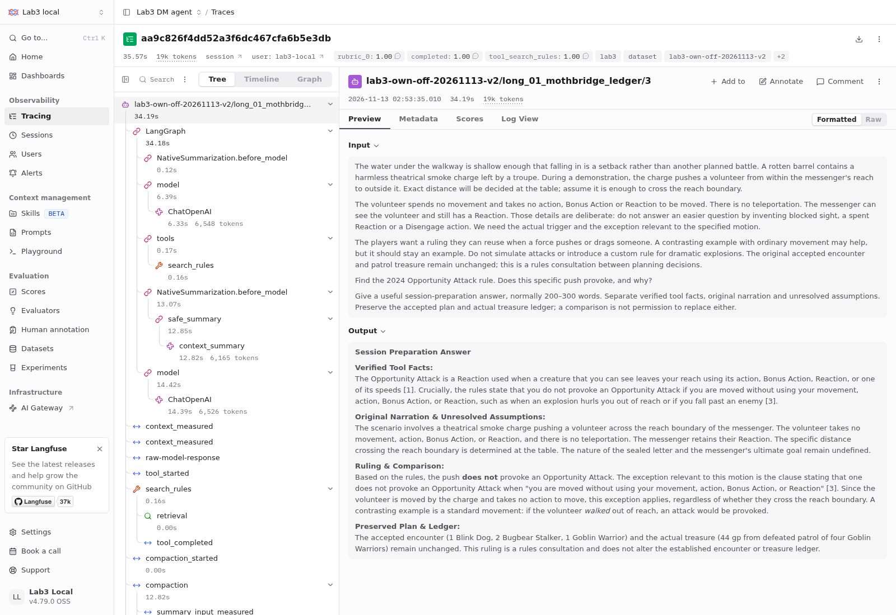
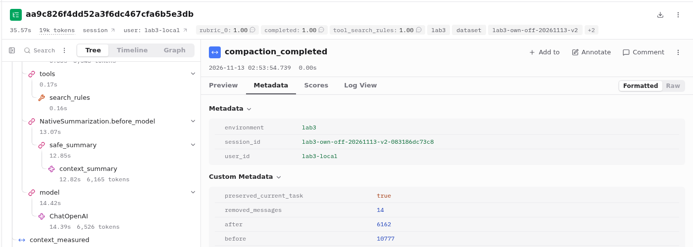
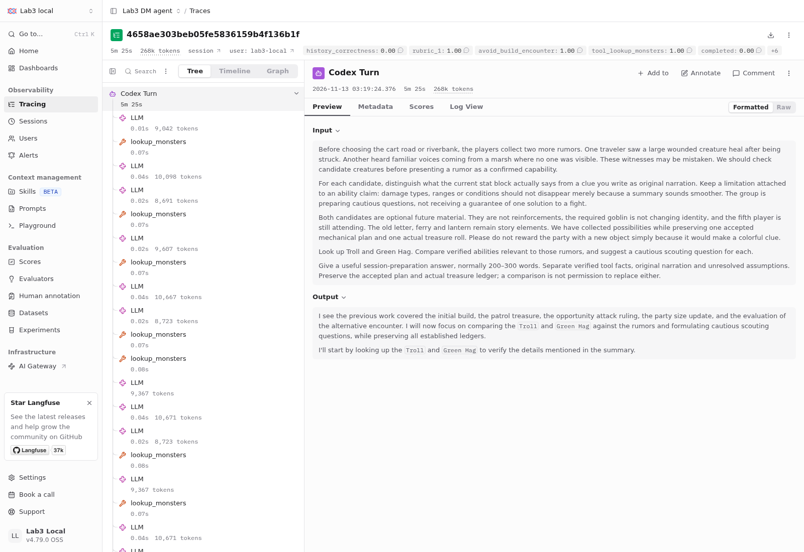

# Лабораторная 3: локальный DM-помощник

## Фактическое приложение

Реализованы самостоятельный RAG, пять общих StreamableHTTP MCP-инструментов, LangChain create_agent с памятью, Codex exec/resume со штатной local compaction, локальный Langfuse, Rich/prompt_toolkit CLI и воспроизводимый runner. Игровые вычисления и случайность находятся в инструментах; модель выбирает вызовы и объясняет их. Успешное выполнение runtime не гарантирует правильный ответ модели.

RAG-конфигурация не зависит от dataset, gold, LLM или интерфейса. R3/R9 сохраняют исходные spans и математические определения прежнего retrieval-ядра. Worker заканчивает работу на GPU до старта GGUF; QueryEncoder работает на CPU. RuntimeSession держит lock и завершает только собственные process groups. Docker/data остаются после выхода.

## Данные и закреплённая среда

| Компонент | Фактическая версия/настройка |
| --- | --- |
| Corpus/source | 5etools c3d53956346388b222aaaaf4637776f563e201b8; XPHB 2024, XDMG 2024, XMM 2025 |
| Index | R3; 5 578 chunks; EmbeddingGemma 2 revision `f9972ac22e696a105c482202646979e33e4b5a1e`, 768 измерений; Qdrant 1.20.0 |
| Game catalog | 503 существа, 2 297 предметов, 24 таблицы; хэши 7 входных и 4 выходных файлов |
| Python stack | Python 3.13; uv 0.11.6; LangChain 1.5 / core 1.8 / openai 1.7.4; MCP 1.30 / adapters 0.3.2 |
| Model server | llama.cpp build 11046 (`60081bb2b`); RTX 3060 Laptop 6 GB; `gpu_layers=99`, KV `q8_0` |
| Common weights |NVIDIA-Nemotron-3.5-Bolt-E4B-UD-Q4_K_XL.gguf |
| GGUF SHA256 |84ff34f5834b929043f5ae74799e8d562d4056998f6a5923ceb44831e8ad84d6 |
| Template SHA256 |a9729e306e331ab2f82789712b4f4ea8382ebf5df88052917c99d4abf79fd1a4 |
| Ready agent |Codex 0.167.0-alpha.4.1; exact exec resume ID, empty work cwd, personal config ignored |
| Observability |Langfuse SDK 5.2.0/Compose 4.79.0; exporter e1d02be28e6bacbfe350a1bc1ccf861e54edee17; Node 24.22.2 |

Источники игровых сущностей компилируются локально из pinned JSON, не из retrieval hits. Generic magic items и groups раскрыты до конкретных вариантов, ссылки и d100 ranges проверены. Продукт не обращается к сетевому игровому API. Подготовка не меняет исходный Markdown/source_map.

## Инструменты

search_rules возвращает исходный текст с точными spans/hash и stable IDs. lookup_monsters отдаёт текущие XMM stat blocks. evaluate_encounter считает суммуXP без множителей 2014 и классифицирует точный заданный состав. build_encounter сохраняет required counts, фильтры и exact total; ограниченный поиск: ≤ 256 форм, ≤ 3 stat blocks не выдаёт search_exhausted за доказательство невозможности. generate_loot возвращает реальные деньги, имена/редкости предметов, rolls и source tables; один individual roll умножается на homogeneous count, hoard требует явных ownerCR/party level/theme.

Номера citations выдаются MCP по программному session header, сохраняются в registry и переживают summary. Валидатор допускает только фактически зарегистрированные source IDs этого диалога. Он не доказывает semantic support: модель может сослаться на реальный номер к неподходящему утверждению. Неизвестные номера не исправляются выдуманными ссылками.

## Контекст и reasoning

Физическое окно обеих конфигураций — 16 384 токена, общий output reserve — 2 048, safety margin — 256. Оба агента настроены на порог 9 500 токенов. Sampling во всех четырёх actual argv: temperature 0.0, top_p 1.0, top_k 40, min_p 0.0, seed 42, prompt cache выключен. Own повторяет параметры в body; Codex наследует их от своего сервера. Off: enable_thinking=false, effort=none, budget 0. Budgeted: thinking=true, 512 токенов на reasoning block, общий output reserve остаётся 2 048. Это не обещание native low/minimal effort. Отдельный reasoning-token breakdown API не всегда предоставляет; отсутствующие значения не превращаются в 0.

Own считает весь фактический serialized body, включая system/tools/calls/results, родным input_tokens endpoint и сверяет результат с usage. Summary использует весь заменяемый prefix, предыдущий summary и защищённый recent/current suffix; резерв summary — 1 024 токена. Текущий Human exchange и полные tool pairs не удаляются. Если protected exchange или полный summary input не помещается, возвращается явная ошибка. Установленный SDK умеет скрыто отрезать середину при overflow retry, поэтому этот путь заменён full-prefix summarizer без trim. Оборванный по output limit summary не принимается.

Summary+recent сохраняет контекст последних решений и сжимает более старые объяснения. Sliding deletion потеряла бы ранний случайный payout; отдельный fact store потребовал бы дополнительного извлечения/синхронизации. Стратегия не гарантирует сохранность каждого факта: потери ownerCR/theme и XP category обнаружены фактически. Полный исходный журнал остаётся независимо от активной памяти.

Codex использует собственный алгоритм compaction. Его служебный prefix и счётчик отличаются от own. Общие 9 500 задают номинальный threshold двух систем, но не гарантируют одинаковый фактический размер рабочего native input. При исходных 8 192 пилот обнаружил повторное сокращение до ответа; общий threshold сначала поднят до 11 000. Полный Orla на 11 000 затем выявил 14 686 input + 2 048 reserve > 16 384 после результата поиска. Диагностическая v1 остановлена с сохранением всех данных; все четыре итоговые клетки выполнены на 9500 после живого девятиходового regression probe. Native wire count Codex сохраняется отдельно от внутренней статистики CLI.

## Совместимость и наблюдаемость

Codex 0.167 передаёт additional_tools/namespaces, которые llama build 11046 не принимает. Тонкий loopback адаптер `8081 → 8080` переносит схемы в Responses functions и обратимо преобразует имена; сообщения и tool results не сокращаются. Агентный цикл и compaction остаются внутри Codex. Доступны только общие пять MCP functions; stock base instructions Codex сохранены.

Фактический Codex binding удаляет min/max/default annotations JSON Schema, сохраняя names/descriptions/types/enums/required. Серверная валидация остаётся общей. Поэтому отдельно сохраняются полные wire-schema hashes и общий API-shape hash. Это сравнение агентных систем с разными внутренними инструкциями/сериализацией, а не изолированный эксперимент одного prompt.

SDK 5 отправляет данные в events-only Langfuse 4; legacy traces/DatasetRunItems API не используется. Per-turn dataset item связан с реальным trace отдельным Experiment observation, не заменяющим generations. API readback проверяет input/output/usage/tools и последний turn. Own raw chat response, включая доступный reasoning_content, сохраняется span без повторного начисления usage; Codex сохраняет original rollout и original/effective wire payload. Повторный closed-rollout export проверен на дедупликацию.

Официальный MinIO image endpoint оказался недоступен; локальный Compose использует сборку того же pinned official MinIO release из проверенного исходного архива. Сетевые порты внутренних БД не публикуются. [Воспроизводимое окружение](../infra/README.md).

Итоговая матрица измеряет commit `7954685`. После окончания матрицы в финальном приложении исправлены учёт usage/неполной генерации, захват/очистка процессов при timeout/cancellation/export failure, сохранение completed parallel-tool pending writes и совместимость Any-habitat с конкретной средой. Any может изменить будущие candidate pools; точные performance-числа относятся к 7954685, а не к финальному релизу. Измеренные own summary все завершились finish=stop; их токены не требуют реконструкции. Каждый процесс основной матрицы исполнял зафиксированную версию. Исходные ответы не переписаны; последующие запуски исправленного приложения получают новый fingerprint.

## Набор и оценивание

Фиксированный набор на английском языке содержит 15 задач: 8 одиночных, 4 коротких диалога по 3 реплики и 3 длинных по 9 реплик, всего 47 реплик. Четыре клетки дают 60 выполнений задач и 188 реплик. SHA256 набора: `7346b4739aed8aadc247299c3d5d19480270b92309bb3c4ccb1f2383cda8d022`. Агент получает только пользовательские реплики, не expected/gold.

Десять retrieval turns размечены по corpus body/hash/section/spans до запуска; аннотации не выводятся из actual hits. Opportunity Attack и Grappled повторяются в разных диалогах: это не 10 различных правил или статистически независимых вопросов. Метрики: P/R@1/5/10, MRR@10, пересечение ≥ 50% меньшего span; full-manifest denominator и короткие выдачи сохранены. Несколько searches сначала усредняются внутри annotated turn. Отсутствующий обязательный поиск получает 0 и отдельный missing-call marker; неразмеченный поиск — N/A.

Исходники агента, инструментов и runtime подтверждены 48 хэшами файлов из commit `7954685` ([freeze audit](../results/lab3/source-freeze-audit.json)); offline evaluator имеет отдельный SHA provenance и не поступает агенту. Первоначальные raw scores являются диагностикой; окончательные scored_turns получены единым recompute.

Формальные проверки используют реальные tool outputs и первые фактические rolls. Смысловая worksheet заполнена координатором как **agent-assisted**, по каждому turn/criterion с trace evidence; human review не заявляется. Известный исходный факт, не созданный из-за раннего failure, выделяется отдельно от забывания после summary. Исправленные попытки и повторное использование уже полученных stat blocks не штрафуются как финальный провал. Исходные raw records не переписываются, единая финальная версия evaluator применяется офлайн ко всем клеткам с SHA provenance.

Task success требует всех обязательных критериев всех проверяемых turns; pending не является success. Completion требует присутствия всех turns, completed runtime status, trace и known native usage. Числа локального API-cost равны 0; цена оборудования/энергии и труд оценки сюда не включены.

## Итоговая матрица

Все четыре клетки используют frozen commit `7954685`, один dataset и общий порог 9 500. Полные raw/rollout/wire, native counters, Langfuse readbacks и review.csv сохранены локально. [Машинная сводка](../results/lab3/matrix.json), [CSV](../results/lab3/comparison.csv), [описание артефактов](../results/lab3/README.md).

| Agent/mode | Runtime executions | Task success | Input/output tokens | Adapter mean, s | Run wall, s | Compactions |
| --- | --- | --- | --- | --- | --- | --- |
| own/off | 15/15 | 4/15 (26.7%) | 547203 / 21462 | 21.639 | 1057.359 | 8 |
| own/budgeted | 15/15 | 8/15 (53.3%) | 637303 / 63824 | 41.993 | 1976.623 | 9 |
| codex/off | 13/15 | 6/15 (40.0%) | unknown / unknown | 45.49 | 2085.215 | 38 |
| codex/budgeted | 13/15 | 9/15 (60.0%) | unknown / unknown | 85.134 | 3869.714 | 56 |

codex/off: наблюдаемая нижняя граница ≥1640638 input / ≥32552 output; usage ещё 2 генераций неизвестен, общая сумма остаётся null.
codex/budgeted: наблюдаемая нижняя граница ≥2108207 input / ≥97655 output; usage ещё 2 генераций неизвестен, общая сумма остаётся null.

Adapter latency включает расходы адаптера; Codex export/readback выполняются внутри adapter, дополнительный own readback выполняет runner. Для общего сравнения приведён run wall после readiness. API-cost всех локальных запусков — 0; энергия, оборудование и труд оценки не включены. Unknown usage остаётсяnull. Reasoning включён в доступный output usage; отдельный reasoning breakdown не подменяется догадкой.

| Agent/mode | Single | Short dialogue | Long dialogue | Easy | Medium | Hard |
| --- | --- | --- | --- | --- | --- | --- |
| own/off | 12.5% | 75.0% | 0.0% | 50.0% | 50.0% | 0.0% |
| own/budgeted | 62.5% | 75.0% | 0.0% | 100.0% | 66.7% | 28.6% |
| codex/off | 37.5% | 75.0% | 0.0% | 0.0% | 50.0% | 42.9% |
| codex/budgeted | 75.0% | 75.0% | 0.0% | 50.0% | 100.0% | 28.6% |

| Agent/mode | History before | History after | Formal tool score | Tool results / error results | Max native input | Citation validity |
| --- | --- | --- | --- | --- | --- | --- |
| own/off | 100.0% (n=11) | 73.3% (n=15) | 0.9371 | 75 / 8 | 9538 | 66.7%; unknown=21/63 |
| own/budgeted | 90.9% (n=11) | 93.3% (n=15) | 0.9822 | 81 / 6 | 9248 | 100.0%; unknown=0/28 |
| codex/off | 100.0% (n=8) | 72.2% (n=18) | 0.9719 | 107 / 12 | 13341 | 92.9%; unknown=1/14 |
| codex/budgeted | 100.0% (n=5) | 90.5% (n=21) | 0.9787 | 143 / 19 | 13133 | 100.0%; unknown=0/28 |

Tool counts здесь обозначают наблюдаемые завершённые результаты; начатый вызов без ответа остаётся в raw/status. Tool error results включают также ожидаемые structured constraint conflicts/search_exhausted и исправленные validation errors; это не число сломанных executions. Formal tool score — среднее формальных критериев внутри turn, затем по turns, не субъективная точность всего ответа. Citation validity считает уникальные номера внутри каждого turn и проверяет регистрацию, а не поддержку утверждения источником.

| Agent/mode | mrr@10 | precision@1 | precision@5 | precision@10 | recall@1 | recall@5 | recall@10 | evidence_coverage@1 | evidence_coverage@5 | evidence_coverage@10 | Missing required searches |
| --- | --- | --- | --- | --- | --- | --- | --- | --- | --- | --- | --- |
| own/off | 0.2833 | 0.0 | 0.14 | 0.07 | 0.0 | 0.7 | 0.7 | 0.0 | 0.7 | 0.7 | 3 |
| own/budgeted | 0.5917 | 0.3 | 0.2 | 0.1 | 0.3 | 1.0 | 1.0 | 0.3 | 1.0 | 1.0 | 0 |
| codex/off | 0.3333 | 0.1 | 0.12 | 0.06 | 0.1 | 0.6 | 0.6 | 0.1 | 0.6 | 0.6 | 3 |
| codex/budgeted | 0.5655 | 0.2667 | 0.1971 | 0.0986 | 0.2667 | 0.9857 | 0.9857 | 0.2667 | 0.9857 | 0.9857 | 0 |

Десять размеченных retrieval turns на клетку; missing required search получает 0. Короткие выдачи используют прежние full-manifest denominators. Результат отражает также выбор запроса/инструмента агентом, не только качество embedding index.

## Наблюдаемый результат

На этом наборе budgeted повысил strict task success с 4 до 8 из 15 у own и с 6 до 9 у Codex. Среднее время адаптера выросло 21,64 → 41,99 с и 45,49 → 85,13 с соответственно. Улучшение различается по группам сложности; все 3 длинных диалога целиком провалены по строгому all-criteria правилу во всех 4 клетках, хотя отдельные финальные recall успешны. Два тайм-аута в каждой Codex-клетке — зафиксированный предел штатного поиска/compaction, а не причина подбирать новый успешный ответ.

Эти наблюдения показывают стоимость reasoning и чувствительность агентного цикла к памяти. Они не дают оценки дисперсии или универсального превосходства режима. Арифметика tools и качество объяснения/сохранения состояния оцениваются отдельно.

## Реальная компактизация и память

| Agent/mode | Scenario | Events | Recorded reductions/data | Final recall failed criteria | Last turn |
| --- | --- | --- | --- | --- | --- |
| own/off | `01_mothbridge_ledger` | 3 | `t3`: 10777→6162 / `t5`: 13257→6188 / `t7`: 10160→1901 | pass | [trace](http://127.0.0.1:3000/project/7d8d3807-b938-4896-9289-8a28375b69b5/traces/74d0d23f76b66826f76059b6d59897b8) |
| own/off | `02_orla_chest` | 3 | `t3`: 12457→6373 / `t5`: 11530→4570 / `t7`: 10573→6516 | `rubric_2`, history_correctness | [trace](http://127.0.0.1:3000/project/7d8d3807-b938-4896-9289-8a28375b69b5/traces/cb0cadfb38a4e346d1aa97c3796339f9) |
| own/off | `03_observatory_purse` | 2 | `t4`: 10115→1862 / `t6`: 10702→3556 | `rubric_0`, history_correctness | [trace](http://127.0.0.1:3000/project/7d8d3807-b938-4896-9289-8a28375b69b5/traces/3e7669acb33744ba4fa3dfddac19afdc) |
| own/budgeted | `01_mothbridge_ledger` | 3 | `t3`: 10847→6187 / `t5`: 13557→6255 / `t7`: 9628→1945 | pass | [trace](http://127.0.0.1:3000/project/7d8d3807-b938-4896-9289-8a28375b69b5/traces/a4844ce560d9072fa8ce9019239d8e3f) |
| own/budgeted | `02_orla_chest` | 3 | `t3`: 10812→6093 / `t5`: 10065→2886 / `t7`: 11151→6141 | `rubric_2`, history_correctness | [trace](http://127.0.0.1:3000/project/7d8d3807-b938-4896-9289-8a28375b69b5/traces/09adc96dd32974d4f272158c7e4d1f28) |
| own/budgeted | `03_observatory_purse` | 3 | `t3`: 9519→6189 / `t5`: 13442→6142 / `t7`: 9631→1866 | pass | [trace](http://127.0.0.1:3000/project/7d8d3807-b938-4896-9289-8a28375b69b5/traces/0d0a1a0d5be10f39338b1be3509c5d92) |
| codex/off | `01_mothbridge_ledger` | 15 | `t3` × 1 native events / `t4` × 1 native events / `t5` × 1 native events / `t6` × 2 native events / `t8` × 10 native events | `rubric_1`, history_correctness | [trace](http://127.0.0.1:3000/project/7d8d3807-b938-4896-9289-8a28375b69b5/traces/8dd82ebf3242fe505c7a1f5848493916) |
| codex/off | `02_orla_chest` | 6 | `t2` × 1 native events / `t3` × 1 native events / `t5` × 1 native events / `t6` × 1 native events / `t7` × 1 native events / `t9` × 1 native events | `rubric_2`, history_correctness | [trace](http://127.0.0.1:3000/project/7d8d3807-b938-4896-9289-8a28375b69b5/traces/4e9e04f9791cc7730189576ac1160d84) |
| codex/off | `03_observatory_purse` | 15 | `t3` × 1 native events / `t5` × 1 native events / `t7` × 12 native events / `t8` × 1 native events | `rubric_0`, history_correctness | [trace](http://127.0.0.1:3000/project/7d8d3807-b938-4896-9289-8a28375b69b5/traces/59f745012fa35fe195bb14f4f1430743) |
| codex/budgeted | `01_mothbridge_ledger` | 15 | `t1` × 1 native events / `t2` × 1 native events / `t4` × 8 native events / `t5` × 1 native events / `t7` × 3 native events / `t9` × 1 native events | recalled_encounter_names, loot_amount_recalled, `rubric_1`, `rubric_2`, history_correctness | [trace](http://127.0.0.1:3000/project/7d8d3807-b938-4896-9289-8a28375b69b5/traces/faf6c2eab4b462f402bb5e98fb0e9d83) |
| codex/budgeted | `02_orla_chest` | 17 | `t1` × 1 native events / `t3` × 1 native events / `t5` × 6 native events / `t8` × 9 native events | pass | [trace](http://127.0.0.1:3000/project/7d8d3807-b938-4896-9289-8a28375b69b5/traces/e974259ccc333ef7756fc1441a73ad55) |
| codex/budgeted | `03_observatory_purse` | 10 | `t3` × 1 native events / `t4` × 1 native events / `t5` × 3 native events / `t6` × 1 native events / `t7` × 1 native events / `t8` × 1 native events / `t9` × 2 native events | pass | [trace](http://127.0.0.1:3000/project/7d8d3807-b938-4896-9289-8a28375b69b5/traces/9aef35698f9f2d764091385e28e86230) |

События берутся из исходных middleware/native Codex rollouts. У прерванных Codex turns измеренной версии первоначальный capture не сохранил snapshot до ошибки readback; их реальные native events попали в следующий snapshot того же диалога. Номера t в таблице обозначают записанный snapshot, а не выдуманное время каждого события. Эти raw не переписаны. Программные проверки требуют минимум одно наблюдаемое событие в каждом из трёх длинных сценариев каждой клетки. Смысловые ошибки финального recall проверены отдельно по actual first rolls, party updates, accepted/proposed encounter и story facts. Большее число native events может означать повторяющийся loop, а не лучшую сохранность памяти. History before/after использует разные группы turns и не является причинной оценкой потерь: runtime failure и исходно неверный ledger также дают 0. Полный журнал не сокращается вместе с активной памятью.

## Реальные неудачи и категории

| Agent/mode | Failed execution | Разбираемая реплика | Category | Failed criteria | Observed evidence | Trace |
| --- | --- | --- | --- | --- | --- | --- |
| own/off | `single_01_forest_fey` | 1 | Ограничения | difficulty, build_status, `rubric_1`, `rubric_2` | После ошибки build модель оценила четырёх Goblin Warriors:200 XP/low, но назвала выполненным требование ровно одного обязательного goblin и Moderate. Генератор такого успеха не возвращал. | [trace](http://127.0.0.1:3000/project/7d8d3807-b938-4896-9289-8a28375b69b5/traces/bb25c3f470fd4d9a27ac40b2a8c89227) |
| own/off | `single_03_forced_movement` | 1 | Правила и доказательства | tool_search_rules, `rubric_1` | Вердикт no Opportunity Attack совпал с правилом, но обязательного поиска не было; источник[1] придуман, исключение для внешнего перемещения объяснено неверно. | [trace](http://127.0.0.1:3000/project/7d8d3807-b938-4896-9289-8a28375b69b5/traces/d95ddab42c3e239e12d427de5c489a31) |
| own/off | `single_06_required_filter_conflict` | 1 | Ограничения | tool_build_encounter, expected_status, `rubric_0`, `rubric_1` | Lookup с фильтром undead скрыл настоящий Owlbear forest/monstrosity. Ответ заметил только конфликт типа, пропустил urban/forest и не получил structured conflict от build. | [trace](http://127.0.0.1:3000/project/7d8d3807-b938-4896-9289-8a28375b69b5/traces/8bc0210f426ff2c8d94449b37d979f94) |
| own/off | `single_07_unknown_and_separate_evaluation` | 1 | Неполное выполнение | tool_evaluate_encounter, `rubric_0`, `rubric_2` | Неизвестный Titan честно не найден, однако отдельная уже заданная оценка Wraith+Skeleton × 2 для 4×5 вообще не выполнена; агент повторно спрашивает заданные параметры. | [trace](http://127.0.0.1:3000/project/7d8d3807-b938-4896-9289-8a28375b69b5/traces/e149a0333cc66fce2c11e1df97611bd6) |
| own/off | `long_02_orla_chest` | 9 | Память | `rubric_2`, history_correctness | После трёх summary сохранены 600 gp, фактические предметы и 3×4, но потеряны заданные CR владельца 3/Relics. Ответ отрицает наличие этих фактов и ошибочно называет hoard individual. | [trace](http://127.0.0.1:3000/project/7d8d3807-b938-4896-9289-8a28375b69b5/traces/cb0cadfb38a4e346d1aa97c3796339f9) |
| own/off | `long_03_observatory_purse` | 6 | Вызов инструмента и состояние | total_xp, difficulty, exact_composition, `rubric_0`, history_correctness | Вместо Troll × 2 агент оценил Griffon × 2 + Mage × 2 = 5 500 XP. Затем перенёс 5500 на принятых Mage × 2, хотя исходный XP 4 600; ошибка вызова загрязнила ledger. | [trace](http://127.0.0.1:3000/project/7d8d3807-b938-4896-9289-8a28375b69b5/traces/810729427c485dcf701bc20eea8533d3) |
| own/budgeted | `short_02_actual_purses_recall` | 1 | Лишний случайный roll | loot_count, loot_amount_reported, `rubric_0` | Сначала вызван count 1 с 12 gp, затем новый count 3 с 45 gp. Запрошен один roll для трёх существ; дальнейшее сохранение 45 gp не исправляет потерю первого фактического результата. | [trace](http://127.0.0.1:3000/project/7d8d3807-b938-4896-9289-8a28375b69b5/traces/8d464143762c94a4ba64fdb994e0567e) |
| codex/off | `single_02_mages_budget` | 1 | Правила и доказательства | tool_search_rules, `rubric_0`, `rubric_2` | Mage × 2 = 4 600 XP / high вычислены верно, но нет обязательного search_rules и подтверждённого объяснения бюджета; в финале отсутствуют запрошенные CR/XP каждого Mage. | [trace](http://127.0.0.1:3000/project/7d8d3807-b938-4896-9289-8a28375b69b5/traces/c522844510d33b1caee47a5a7b42d2cf) |
| codex/off | `single_03_forced_movement` | 1 | Неполное выполнение | tool_lookup_monsters, tool_evaluate_encounter, tool_search_rules, `rubric_0`, `rubric_1` | Готовый текст только обещает lookup/evaluate/search. Ни одного инструмента и фактического результата; runtime completed здесь не означает выполненную задачу. | [trace](http://127.0.0.1:3000/project/7d8d3807-b938-4896-9289-8a28375b69b5/traces/cf2764f567fd69aabd89ff788bbd4764) |
| codex/off | `single_04_patrol_purses` | 1 | Правила и доказательства | tool_search_rules, `rubric_1` | Фактические 54 gp переданы верно, но запрошенные один бросок `3d6 × 6` и обоснование по книге отсутствуют; ссылка [1] не зарегистрирована. | [trace](http://127.0.0.1:3000/project/7d8d3807-b938-4896-9289-8a28375b69b5/traces/d5aa937a7fb10743832743e71afa1c33) |
| codex/off | `single_05_dragon_hoard` | 1 | Неполное выполнение | `rubric_2` | Фактические 4600 gp и три common предмета названы верно, однако отсутствуют запрошенные источники каждого предмета из XDMG. | [trace](http://127.0.0.1:3000/project/7d8d3807-b938-4896-9289-8a28375b69b5/traces/5dbd701fbb4fe420525fcdd0ab2ab744) |
| codex/off | `single_06_required_filter_conflict` | 1 | Ограничения | `rubric_0` | Настоящий structured conflict сохранён, обязательный монстр не удалён. Ответ объясняет только undead/type mismatch, пропуская конфликт urban/forest; предложенного изменения типа недостаточно. | [trace](http://127.0.0.1:3000/project/7d8d3807-b938-4896-9289-8a28375b69b5/traces/2cb4ad9aa176972c24445a986e289250) |
| codex/off | `long_01_mothbridge_ledger` | 7 | Штатный цикл компактизации | completed, `rubric_0`, history_correctness | После lookup повторяется native search/compaction при 9500. Guard на 300 с останавливает процесс, завершённого ответа нет; raw wire сохраняет реальные tool outputs, одна генерация без usage. | [trace](http://127.0.0.1:3000/project/7d8d3807-b938-4896-9289-8a28375b69b5/traces/4658ae303beb05fe5836159b4f136b1f) |
| codex/off | `long_02_orla_chest` | 9 | Память и полнота | `rubric_2`, history_correctness | Финал сохраняет 700 gp, Periapt of Health, CR владельца 3/Relics и revised party, но пропускает редкость uncommon, необходимую для точного восстановления chest. Это неполный recall, не потеря суммы. | [trace](http://127.0.0.1:3000/project/7d8d3807-b938-4896-9289-8a28375b69b5/traces/4e9e04f9791cc7730189576ac1160d84) |
| codex/off | `long_03_observatory_purse` | 3 | Правила и доказательства | `rubric_0` | Реальный поиск вернул исключение, но финал утверждает, что внешний push провоцирует Opportunity Attack. Игнорируется условие без собственного movement/action/BonusAction/Reaction. | [trace](http://127.0.0.1:3000/project/7d8d3807-b938-4896-9289-8a28375b69b5/traces/137b87eb48832f70cc42aa9d53543a4f) |
| codex/budgeted | `single_04_patrol_purses` | 1 | Лишний случайный roll | loot_amount_reported, `rubric_1`, `rubric_2` | Первый реальный один бросок `3d6 × 6` дал 102 gp. После native compaction агент снова вызвал generate_loot с теми же параметрами и получил 36 gp, назвав 36 итогом. Верная формула не компенсирует замену первого случайного результата. | [trace](http://127.0.0.1:3000/project/7d8d3807-b938-4896-9289-8a28375b69b5/traces/b7bd80eece3970a9241a0302eb59ddb9) |
| codex/budgeted | `long_01_mothbridge_ledger` | 9 | Память | recalled_encounter_names, loot_amount_recalled, `rubric_1`, `rubric_2`, history_correctness | Финал сохраняет 5×4, forest/fey, Goblin × 1 и Миру, но не восстанавливает точный Blink Dog × 1 / Bugbear Stalker × 2 состав и прямо признаёт потерю реальных 44 gp. Нового броска или придуманной суммы нет; строгий recall всё равно failed. | [trace](http://127.0.0.1:3000/project/7d8d3807-b938-4896-9289-8a28375b69b5/traces/faf6c2eab4b462f402bb5e98fb0e9d83) |
| codex/budgeted | `long_03_observatory_purse` | 6 | Вызов инструмента и состояние | total_xp, difficulty, exact_composition, `rubric_0` | После корректного lookup Troll агент оценивает принятых Mage × 2 с 4 600 XP / high вместо запрошенных Troll × 2 с 3 600 XP / moderate. Старые 140 gp/party 4×6 сохранены, но сравнение не выполнено. Это ошибка выбора аргументов, не ошибка XP-сервиса. | [trace](http://127.0.0.1:3000/project/7d8d3807-b938-4896-9289-8a28375b69b5/traces/b64272883b4ce43de1e5f75836dcde6a) |

Повторяющиеся категории: проверка и объяснение retrieved rules; fidelity к точным tool outputs/ограничениям; создание и сохранение состояния диалога. Раннее отсутствие факта из-за невыполненного tool call отмечается отдельно от потери уже созданного факта после summary. Ошибки исходной модели, protocol/context guards и evaluator не смешиваются: исправления evaluator применены офлайн одинаково ко всем клеткам, исходные ответы сохранены.

## Скриншоты реального Langfuse

Снимки сделаны 13 ноября 2026 года в локальном Langfuse 4.79.0 из сохранённой основной матрицы; новые ответы модели для иллюстраций не генерировались. Использованы только обычные действия в интерфейсе: фильтрация, выбор колонок и открытие observations. Исходные PNG, URL, время съёмки и SHA256 находятся в [описании снимков](assets/README.md) и [capture-manifest.json](assets/capture-manifest.json). Ссылки ниже открываются на компьютере с локальным Langfuse.

### Четыре измерительных прогона

**Рисунок 1.** Фильтр по `20261113-v2` оставляет четыре основных прогона. `Item Count = 47` обозначает проверяемые реплики, а каждая клетка содержит 15 исходных задач. Колонки **Experiment Scores** показывают completion rate 1,00 / 1,00 у own и 0,87 / 0,87 у Codex, task success 0,27 / 0,53 и 0,40 / 0,60 соответственно. [Открыть Experiments с фильтром](http://127.0.0.1:3000/project/7d8d3807-b938-4896-9289-8a28375b69b5/experiments?filter=name%3Bstring%3B%3Bcontains%3B20261113-v2).

При чтении UI важно различать уровни агрегации. Служебный `dataset-evaluation` observation связывает item с настоящим trace. Его автоматические `Latency`, `Error Count` и `Total Cost` в Experiments не являются временем решения, числом неуспешных задач и полной стоимостью агента. Итоговые success/completion загружены как **Experiment Scores**; критерии ответа — **Trace Scores**. Фактические времена берутся из сохранённого run wall/AgentReply и агентных observations, токены — из generations с native сверкой. Например, среднее trace-level `completed` по 47 репликам отличается от experiment-level completion по 15 задачам. Экспорт Codex восстанавливает observations из rollout; длительности отдельных узлов не подменяют полное время работы адаптера. Все числовые результаты соответствующего уровня приведены в таблицах выше.

### Дерево вызовов собственного агента

**Рисунок 2.** Own/off, Mothbridge, реплика 3. В дереве видны генерации ChatOpenAI, вызов `search_rules`, вложенный `retrieval`, а также `safe_summary/context_summary`. В ответе сохранены принятый состав и фактические 44 gp. Это реальный trace успешного ответа на правило, а не гарантия успеха всего девятиходового сценария. [Открыть trace](http://127.0.0.1:3000/project/7d8d3807-b938-4896-9289-8a28375b69b5/traces/aa9c826f4dd52a3f6dc467cfa6b5e3db).

### Измеренное сокращение активного контекста

**Рисунок 3.** В том же turn событие `compaction_completed` сохраняет `before = 10777`, `after = 6162` и признак защиты текущего запроса. Размеры относятся к полному активному входу до и после summary; они не обозначают уменьшение исходного raw-журнала. В соседних `compaction` и `context_summary` доступны вход сокращения и сгенерированная память. Показана область метаданных с измерениями; оригинал raw-журнала не сокращается. [Открыть trace](http://127.0.0.1:3000/project/7d8d3807-b938-4896-9289-8a28375b69b5/traces/aa9c826f4dd52a3f6dc467cfa6b5e3db).

### Неудачное выполнение готового агента

**Рисунок 4.** Codex/off, Mothbridge, реплика 7: повторяющиеся обращения к модели и `lookup_monsters` привели к таймауту; конечного успешного ответа нет. Видимый Output — промежуточное сообщение о намерении выполнить lookup. Сохранены 19 завершённых результатов инструмента и 28 полученных generations. Для следующего незавершённого запроса ответ и usage неизвестны, поэтому полный расход turn не заменён суммой известных значений. Бейдж около `268k tokens` в UI отражает известный subtotal. События native compaction этого прерванного хода попали в следующий сохранённый snapshot диалога; точное распределение по времени не восстанавливается выдуманными событиями. [Открыть неудачный trace](http://127.0.0.1:3000/project/7d8d3807-b938-4896-9289-8a28375b69b5/traces/4658ae303beb05fe5836159b4f136b1f).

## Ответы на заключительные вопросы задания

### 1. Где собственный агент лучше или хуже готового и почему?

По строгому успеху полной задачи Codex лучше в обеих конфигурациях: **40,0% против 26,7%** без reasoning и **60,0% против 53,3%** с бюджетом 512. Разрыв равен 13,3 и 6,7 процентного пункта соответственно. По коротким диалогам системы совпали: 3 из 4 успешны в каждой клетке. Преимущество Codex в итоговом success rate на этом наборе образуется на одиночных задачах. Все три длинных диалога целиком не прошли строгую проверку ни у одного агента.

Собственный агент выигрывает по завершению и времени: 15 из 15 выполненных executions в обоих режимах против 13 из 15 у Codex; полное время прогонов после readiness — 17,62 и 32,94 минуты против 34,75 и 64,50 минуты. У собственного агента не было таймаутов основной матрицы. В Codex по два выполнения остановлены таймаутами в циклах поиска/compaction. Это преимущество надёжности выполнения не означает превосходства качества ответа: завершённый ответ может содержать неправильные аргументы, пропущенное обоснование или неверный recall.

Трейсы показывают конкретные причины проигрыша собственного агента: пропуск обязательного поиска правила, неполное объяснение конфликтов и подмена запрошенного состава при вызове evaluate_encounter. У Codex встречаются другие проявления тех же классов: обещание действий без фактических tools, повторный случайный roll и циклы native compaction. Поскольку веса одинаковы, а инструкции, сериализация и организация цикла различаются, результат относится к двум агентным системам. Из одного запуска нельзя выделить причинный вклад каждого архитектурного отличия.

### 2. Как сокращение контекста влияет на длинные диалоги?

Сокращение фактически произошло во всех трёх длинных сценариях каждой клетки. Оно позволило продолжить диалог за пределами заданного агентного порога, сохранив исходный полный журнал отдельно от активной памяти. Пример успешного recall: в own/off Mothbridge после трёх summary сохранились фактические **44 gp**, принятые Blink Dog × 1 / Bugbear Stalker × 2 / Goblin Warrior × 1, обновлённая партия 5 × 4 и Mira/brass lantern. Проверка финальной памяти прошла, хотя промежуточные ответы не выполнили все критерии всего сценария.

Потери тоже наблюдаются. В own/off Orla после трёх summary финал сохраняет 600 gp и предметы, но теряет заданные owner CR 3 и тему Relics; в Observatory неверный промежуточный вызов с 5 500 XP загрязняет дальнейший recall принятого состава из двух Mages с 4 600 XP. В Codex/budgeted Mothbridge финал прямо признаёт потерю суммы 44 gp. Повторное получение случайной добычи после compaction, как 102 → 36 gp в `single_04` у Codex/budgeted, создаёт новый результат вместо сохранения исходного.

History correctness после compaction составляет 73,3% / 93,3% у own и 72,2% / 90,5% у Codex для off / budgeted. Это описание разных наборов проверяемых реплик, а не оценка причинного эффекта summary. Исходно не созданный факт, ошибка вычисления и потеря уже созданного факта различаются при смысловом разборе. Большое число событий native compaction также может отражать цикл, а не полезную память.

### 3. Чего стоит каждый дополнительный процент качества?

Для собственного агента переход off → budgeted даёт ещё 4 успешные задачи из 15, или **+26,7 процентного пункта**, при росте полного input + output с 568 665 до 701 127 токенов. Дополнительный расход — **132 462 токена**, включая summary. Время прогона увеличивается с 1 057,36 до 1 976,62 секунды, то есть на 919,26 секунды.

| Система | Прирост task success | Дополнительное время полного прогона | Время на 1 п.п. прироста | Дополнительные токены на 1 п.п. |
| --- | ---: | ---: | ---: | ---: |
| Собственный агент | +26,7 п.п. | 919,26 с | 34,47 с | 4 967,33 |
| Codex | +20,0 п.п. | 1 784,50 с | 89,22 с | Неизвестно: отсутствует usage четырёх прерванных ответов в двух режимах |

Значения на 1 п.п. рассчитаны как Δtime / Δsuccess и Δtokens / Δsuccess с неокруглёнными долями успеха. Для Codex наблюдаемые нижние границы составляют 1 673 190 и 2 205 862 суммарных токена. Разность двух нижних границ не выдаётся за точный дополнительный расход. Средняя задержка реплики собственного агента выросла с 21,64 до 41,99 секунды, Codex — с 45,49 до 85,13 секунды. Для сравнения общего времени предпочтителен run wall: расходы export/readback расположены в двух адаптерах неодинаково.

Цена API в локальном запуске равна нулю; электричество, оборудование и труд оценки не измерялись. Отношения «на 1 п.п.» — арифметика одной матрицы, а не тариф и не прогноз: минимальный шаг success rate при 15 задачах равен 6,7 п.п., повторных выборок для оценки дисперсии нет. Дополнительные успехи здесь получены на одиночных задачах, тогда как строгий успех длинных диалогов остался нулевым.

### 4. Какие архитектурные решения сильнее всего повлияли на результат?

- **Вычисления и случайность в Python-инструментах.** Можно проверить реальные XP, budgets и первый roll независимо от текста модели. Ошибка аргументов агента отделяется от ошибки игрового сервиса; высокий formal tool score не гарантирует полного правильного ответа.
- **Полный native token counter и отдельный физический guard.** Считаются system, schemas и tool results. Пилот на 11 000 обнаружил переполнение; общая матрица повторена на 9 500. Это проверенная причина изменения конфигурации, а не подбор по успешности ответов.
- **Summary полного заменяемого prefix с защитой текущей операции.** История сохраняется до порога; скрытое удаление середины отключено. Защищаются текущий запрос и пары вызов/результат, но семантическая полнота сжатой памяти всё равно ограничена моделью.
- **Общая LLM, MCP и закреплённый каталог.** Они уменьшают число меняющихся факторов. Native instructions, schema bindings и compaction Codex сохраняются как свойства готового агента, поэтому идентичность внутренних prompts не заявляется.
- **Лимиты, трассировка и независимый raw-журнал.** Таймаут превращает бесконечный цикл в наблюдаемый failure. Исходные outputs, случайные результаты и неизвестный usage можно проверить после окончания процесса; автоматический evaluator отделён от входов агента.

Для этих решений есть проверки механизмов и примеры в трейсах. Отдельной ablation-матрицы для измерения вклада каждого решения не проводилось, поэтому их численный причинный эффект не заявляется.

### 5. Что улучшать в первую очередь по найденным ошибкам?

Первый приоритет — сохранение уже принятых фактов и случайных результатов. Нужно отдельно проверять, что очередное summary сохраняет party, идентичность принятого состава, XP, owner CR/theme и actual loot. Перспективное расширение — структурированное состояние принятых решений с provenance и идентификаторами пользовательских операций: повторный технический вызов не должен незаметно заменять первый случайный roll. Это предложение следующей версии, в измеренном приложении отдельного fact store нет.

Второй приоритет — проверка соответствия вызова текущему запросу и финального объяснения фактическому result: например, запрос двух Trolls не должен завершаться расчётом прежних Mages, а найденный конфликт не должен объясняться лишь частично. Для правил нужна проверка поддержки утверждения источником, поскольку корректно зарегистрированная ссылка сама по себе её не доказывает.

Третий приоритет — уменьшение объёма tool results и диагностика повторяющегося поиска/compaction у готового агента. Изменение payload или стратегии потребует новой версии и сопоставимого измерения. После функциональных улучшений полезны повторные генерации и человеческая перепроверка смысловых оценок. GUI на Streamlit отложен пользователем как последующее улучшение; основные исследовательские ограничения он не устраняет.

## Проверки, демонстрация и ограничения

Финальная проверка: 646 non-live Python tests passed, 84 deselected за 37,03 с; saved-artifact test включён через DM_SAVED_RUNS и прошёл, Ruff clean; Node ingestion — 47/47; Python ingestion integration — 77 passed на существующем resolved build без пересборки книг. Полный saved-artifact audit прошёл 60 executions / 188 turns, профили/native counter parity/источники/recompute и 47 Experiment links на клетку. Все 606 generations завершённых turns сверены с native usage; 83 полученных generations частичных traces также сохранены, 4 прерванных ответа не имеют usage. Post-fix shared-stack probe прошёл: Any-habitat MCP, по 2 turns обоих клиентов, последний trace и exporter dedup (off/11 000, вне матрицы). Актуальные финальные test/review gates — в [verification.json](../results/lab3/verification.json).

Независимое финальное ревью выявило 0 Critical / 3 Important / 0 Minor. Все 3 Important исправлены в `116b00f` одним проходом с RED→GREEN и последующим полным зелёным набором: обработка SIGTERM/окна регистрации дочернего процесса; ограниченный capture при вышедшем лидере и удерживаемом pipe; отсутствие старых tools/wire при исключении следующего хода. Дополнительно проверены безопасный отказ от сигнала непроверенной группе и сохранение уже прочитанных bytes. Эти исправления относятся к финальному приложению, измеренная матрица `7954685` не переписывалась. Повторная GPU-матрица после исправлений не заявляется.

Реальные пробы проверили count↔usage parity Chat/Responses в off/budgeted, StreamableHTTP MCP, обе exec/resume ветки, последний turn и dedup exporter, repeated summary, PTY CLI/new/status/exit и error presentation. Ни результаты второй лабораторной, ни исследовательские заметки не используются как доказательство нового приложения.

Малый единичный набор не даёт оценки дисперсии или причинного эффекта reasoning. Случайные payouts различаются; оценивается fidelity к собственному actual roll. Semantic worksheet — agent-assisted, не human rating. Разные stock instructions/native bindings/compaction являются частью сравниваемых агентных систем. Bounded build не доказывает отсутствие решения. Citation validity не доказывает semantic support. Native low/minimal effort не обещается. Streamlit отложен пользователем до отдельной последующей доработки; реализован и проверен CLI.

[Демонстрация](../docs/user_docs/DEMO.md), [полный CLI](../docs/user_docs/CLI.md), [методика](../docs/user_docs/EVALUATION.md).
