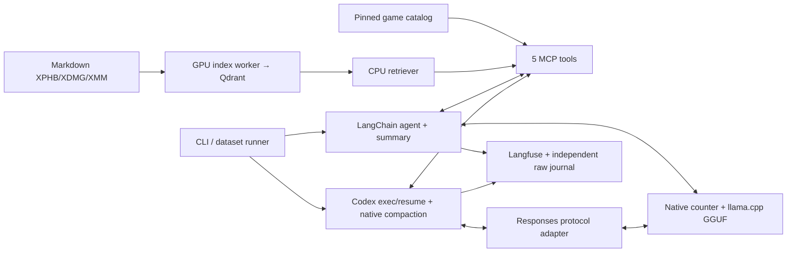

# Лабораторная 3: локальный DM-помощник

DM-помощник ищет правила D&D, подбирает противников, рассчитывает сложность встреч и получает случайную добычу. В лабораторной сравниваются собственный агент на LangChain и готовый Codex CLI с одной локальной моделью и общими инструментами.

**Основной результат:** с бюджетом рассуждений (`reasoning`) обе системы решили больше задач. Сокращение истории позволило продолжать длинные диалоги, но не сохранило все факты. Точные выводы о скорости ограничены ошибкой измерения времени.

Команды запуска — в [CLI](../docs/user_docs/CLI.md), карта кода — в [ARCHITECTURE](../docs/user_docs/ARCHITECTURE.md), термины — в [глоссарии](../docs/user_docs/GLOSSARY.md).

- [Приложение и инструменты](#фактическое-приложение)
- [Контекст и reasoning](#контекст-и-reasoning)
- [Данные и среда](#данные-и-закреплённая-среда)
- [Совместимость и наблюдаемость](#совместимость-и-наблюдаемость)
- [Датасет и оценивание](#набор-и-оценивание)
- [Итоговая матрица](#итоговая-матрица)
- [Основные наблюдения](#наблюдаемый-результат)
- [Компактизация и память](#реальная-компактизация-и-память)
- [Разбор неудач](#реальные-неудачи-и-категории)
- [Скриншоты Langfuse](#скриншоты-реального-langfuse)
- [Ответы на пять вопросов задания](#ответы-на-заключительные-вопросы-задания)
- [Проверки и ограничения](#проверки-демонстрация-и-ограничения)

## Фактическое приложение

**Собственный агент (`own`)** построен на LangChain `create_agent` с native tool calling и управляемой памятью. **Готовый агент (`codex`)** использует штатные `exec/resume`, цикл и компактизацию Codex. Runner — программа измерительного запуска — последовательно передаёт агенту реплики датасета и сохраняет результаты.

Модель выбирает действия и объясняет результат. XP и случайные броски вычисляют Python-инструменты: их результат проверяется отдельно от текста ответа.

### Схема пайплайна

Поиск правил независим от генеративной модели. GPU-процесс строит индекс книг в Qdrant и завершается до загрузки GGUF; запросы кодируются на CPU. Конфигурации R3/R9 сохраняют исходный текст, координаты и определения retrieval-метрик.

### Путь одной реплики

1. Агент получает пользовательский запрос и историю этого диалога.
2. Перед очередным обращением к LLM проверяет размер входа; при необходимости сокращает старую историю.
3. Модель выбирает инструмент или формирует ответ. Результат инструмента возвращается в тот же цикл.
4. Обработка заканчивается ответом, ошибкой либо достижением лимита; сообщения и результаты сохраняются для следующей реплики.

Лимиты собственного агента **на реплику**: 12 обращений к LLM, включая summary, 16 вызовов tools, 300 секунд цикла. Ошибку инструмента можно исправить в этих пределах. У Codex действует внешний таймаут 300 секунд; такого же лимита шагов у него нет.

Интерфейс — чат на Rich/prompt_toolkit. Выход завершает собственные модель, MCP и proxy; Docker и данные остаются. Streamlit отложен.

### Инструменты

Общий MCP-сервер предоставляет пять функций:

- **`search_rules`** возвращает текст правил с координатами и идентификаторами источника.
- **`lookup_monsters`** находит характеристики существ: CR, XP и способности.
- **`evaluate_encounter`** считает XP и сложность заданного состава по правилам 2024 года, без множителей 2014 года.
- **`build_encounter`** подбирает состав с обязательными существами, количествами и фильтрами: до 256 форм, максимум три разных stat blocks. `conflict` означает противоречие требований, `search_exhausted` — отсутствие решения в пределах перебора.
- **`generate_loot`** возвращает фактическую добычу, броски и источники таблиц. Individual умножает один денежный бросок на число одинаковых существ. Hoard требует CR владельца, уровень партии и тему; CR встречи не суммируется.

Номера `[n]` получают только найденные фрагменты текущего диалога; реестр сохраняется отдельно от summary. Регистрация источника не доказывает, что он поддерживает утверждение модели.

## Контекст и reasoning

### Лимиты и режимы генерации

Обе системы используют физическое окно **16 384 токена**, порог сокращения истории **9 500**, резерв ответа **2 048** и запас безопасности **256** токенов. Условие допуска полного запроса: `input + output reserve + safety <= server window`.

Сравниваются два профиля:

- **`off`:** thinking выключен, effort `none`, бюджет reasoning равен 0.
- **`budgeted`:** thinking включён, бюджет составляет 512 токенов на распознанный reasoning block. Reasoning и финальный текст вместе ограничены общим резервом 2 048 токенов; бюджет блока не является отдельной квотой сверх него.

Общие параметры: `temperature=0.0`, `top_p=1.0`, `top_k=40`, `min_p=0.0`, `seed=42`; prompt cache выключен. Own передаёт их в запросе, Codex наследует от сервера. Native effort `low/minimal` не поддерживается. Отдельный расход reasoning известен не всегда; неизвестное не заменяется нулём.

### Как сокращается история собственного агента

Класс [runtime.llm.NativeLLM](../src/dnd_rag/runtime/llm.py) оборачивает API llama.cpp и считает полный вход токенайзером GGUF: инструкции, историю, схемы и результаты tools. Подсчёт сверяется с usage сервера — данными о расходе токенов.

До порога модель получает всю историю. При его достижении применяется следующая стратегия:

1. Суммаризатор получает всю заменяемую старую часть, включая предыдущую сводку.
2. Последний пользовательский запрос и связанные вызовы/результаты инструментов сохраняются целиком. Пары вызов–результат не разрываются.
3. Старая часть заменяется текстовой сводкой с резервом генерации 1 024 токена. Пустая или оборванная сводка не принимается.
4. Полный следующий запрос проверяется повторно; при нехватке места возвращается ошибка. Скрытое удаление середины, включая overflow retry SDK, отключено.

Summary выбрано для переноса ранних фактов: простое удаление старых сообщений убрало бы прежнюю добычу. Однако сводка тоже теряет факты — в экспериментах пропадали CR владельца, тема и категория сложности. Полный исходный журнал хранится отдельно.

### Чем отличается память Codex

Codex выполняет собственную компактизацию истории. Из-за других инструкций и счётчика общий порог 9 500 не гарантирует одинакового фактического входа. HTTP-запросы и native count сохраняются отдельно от статистики CLI.

Порог выбран после проверки совместимости: при 8 192 наблюдался цикл повторного сокращения, а при 11 000 запрос с 14 686 входными токенами и резервом 2 048 превышал окно 16 384. Диагностическая версия v1 остановлена с сохранением данных. Все четыре итоговых прогона выполнены на 9 500 после сквозной девятиходовой проверки; диагностика не включена в итоговую матрицу.

## Данные и закреплённая среда

Источники — Player's Handbook 2024 (XPHB), Dungeon Master's Guide 2024 (XDMG), Monster Manual 2025 (XMM). Markdown образует поисковый индекс, закреплённые JSON 5etools — отдельный игровой каталог. Проверены конкретные варианты предметов, ссылки и диапазоны d100; Markdown и карта происхождения `source_map` не менялись.

| Компонент | Фактическая версия/настройка |
| --- | --- |
| Corpus/source | 5etools c3d53956346388b222aaaaf4637776f563e201b8; XPHB 2024, XDMG 2024, XMM 2025 |
| Index | R3; 5 578 chunks; EmbeddingGemma 2 revision `f9972ac22e696a105c482202646979e33e4b5a1e`, 768 измерений; Qdrant 1.20.0 |
| Game catalog | 503 существа, 2 297 предметов, 24 таблицы; хэши 7 входных и 4 выходных файлов |
| Python stack | Python 3.13; uv 0.11.6; LangChain 1.5 / core 1.8 / openai 1.7.4; MCP 1.30 / adapters 0.3.2 |
| Model server | llama.cpp build 11046 (`60081bb2b`); RTX 3060 Laptop 6 GB; `gpu_layers=99`, KV `q8_0` |
| Common weights |NVIDIA-Nemotron-3.5-Bolt-E4B-UD-Q4_K_XL.gguf |
| GGUF SHA256 |84ff34f5834b929043f5ae74799e8d562d4056998f6a5923ceb44831e8ad84d6 |
| Template SHA256 |a9729e306e331ab2f82789712b4f4ea8382ebf5df88052917c99d4abf79fd1a4 |
| Ready agent |Codex 0.167.0-alpha.4.1; exact exec resume ID, empty work cwd, personal config ignored |
| Observability |Langfuse SDK 5.2.0/Compose 4.79.0; exporter e1d02be28e6bacbfe350a1bc1ccf861e54edee17; Node 24.22.2 |

### Какие условия общие, а какие различаются

Веса, данные, инструменты и профиль генерации общие; инструкции, память и сериализация схем различаются. Ограничения аргументов проверяет общий MCP. Схемы и их хэши сохранены для проверки совместимости.

Сравниваются **две агентные системы на одной LLM**. Влияние отдельного промпта или алгоритма памяти не изолировано.

## Совместимость и наблюдаемость

### Как подключён Codex

llama build 11046 не поддерживает формат `additional_tools/namespace` Codex 0.167. [HTTP-посредник](../src/dnd_rag/runtime/codex_proxy.py) принимает запросы на порту 8081, переводит схемы в Responses functions и обращается к llama.cpp на порту 8080. Имена преобразуются обратимо, сообщения сохраняются; цикл и компактизацию выполняет Codex.

### Что сохраняется в Langfuse

- **Session** объединяет диалог, **trace** содержит обработку одной пользовательской реплики.
- **Generation** хранит вход и ответ вызова LLM, параметры и доступный usage. Для инструментов и retrieval сохраняются аргументы, результаты, источники и ошибки.
- **Compaction** показывает сокращаемую историю и размеры до/после; исходный журнал диалога остаётся целиком.

Собственный агент пишет через Langfuse SDK 5. Исходный API-ответ, включая доступный `reasoning_content`, сохраняется дополнительным span без повторного начисления тех же токенов.

Официальный [экспортер](../configs/baseline/README.md#экспортер-что-он-переносит) переносит JSONL-журнал Codex в Langfuse. Wire хранит реальные HTTP-запросы/ответы до и после преобразования. После экспорта readback проверяет через API генерации, usage, tools и последний ответ ассистента. Повторный экспорт проверен на отсутствие дубликатов.

SDK 5 использует событийную модель Langfuse 4; служебные записи Experiments связывают задания с трейсами. Compose и закреплённая сборка MinIO описаны в [infra](../infra/README.md).

### Измеренная и текущая версии

**Основная матрица измеряет commit `7954685`.** Совпадение исходников четырёх прогонов подтверждено 48 хэшами в [аудите заморозки](../results/lab3/source-freeze-audit.json).

Позже исправлены учёт неполных генераций, вывод/очистка процессов при прерывании, сохранение параллельных результатов и совместимость `Any` с конкретной средой. Последнее меняет будущие варианты состава. Исходные ответы сохранены; обрывов измеренных own summary не было.

В `7594da0` исправлены пробелы/переносы `summary.txt` и `descriptions.yaml`; сохранение непробельного текста и `{messages}` проверено статически. Возможное влияние на модель заново не измерялось; тесты по поручению пользователя не повторялись. Новые прогоны получают новые контрольные суммы условий и run IDs.

## Набор и оценивание

### Какие задачи проверялись

[Датасет](../data/tasks/lab3.yaml) на английском языке содержит **15 задач и 47 пользовательских реплик**:

- 8 одиночных задач;
- 4 коротких диалога по 3 реплики;
- 3 длинных диалога по 9 реплик.

Проверяются правила, встречи, конфликты ограничений, добыча и воспоминание фактов при изменении условий. Каждая задача получает отдельную сессию. Матрица own/Codex × off/budgeted содержит 60 выполнений и 188 реплик.

SHA256 датасета: `7346b4739aed8aadc247299c3d5d19480270b92309bb3c4ccb1f2383cda8d022`. Агент получает текущую реплику пользователя, но не эталонный ответ и критерии проверки.

### Как определяется успех

- **Task success:** выполнены все обязательные критерии всех проверяемых реплик задачи. Успешный финальный ответ не отменяет ошибку в промежуточной реплике.
- **Completion:** присутствуют все реплики, обработка завершена, есть настоящий trace и известен input/output usage. Это техническая полнота, а не оценка правильности.
- **History correctness:** верно ли восстановлены факты в специально размеченных репликах, зависящих от истории. Результаты до и после сокращения считаются отдельно.

Формальные проверки используют результаты tools и первые фактические броски. Смысловые критерии оценивал координатор по ответам, результатам инструментов и трейсам. Метод — **agent-assisted**; независимой человеческой оценки не было.

Исправленные попытки и повторное использование проверенных характеристик допускаются. Итоговая офлайн-оценка одинаково применена ко всем прогонам и имеет отдельные хэши; исходные записи сохранены. Неоценённый критерий (`pending`) не считается успехом.

### Как оценивается поиск правил

Для 10 реплик каждого прогона цитаты и координаты размечены до запуска, независимо от выдачи агента. Opportunity Attack и Grappled повторяются: темы не независимы.

Используются Precision/Recall@1/5/10, MRR@10 и покрытие эталонных фрагментов. Совпадение требует одинакового файла/хэша и пересечения не менее 50% меньшего диапазона текста. Короткая выдача не уменьшает знаменатель Precision; несколько поисков сначала усредняются внутри реплики. Обязательный пропущенный поиск получает 0, а неразмеченный случай — N/A. Определения метрик — в [EVALUATION](../docs/user_docs/EVALUATION.md).

## Итоговая матрица

Каждая строка — прогон 15 задач / 47 реплик. `own/codex` обозначает агента, `off/budgeted` — режим reasoning; версия `7954685`, порог 9 500.

[Машинная сводка](../results/lab3/matrix.json), [CSV](../results/lab3/comparison.csv) и [описание локальных исходных артефактов](../results/lab3/README.md) позволяют проверить приведённые значения.

### Завершение, успех и ресурсы

| Agent/mode | Runtime executions | Task success | Input/output tokens | Adapter mean, s | Run wall, s | Compactions |
| --- | --- | --- | --- | --- | --- | --- |
| own/off | 15/15 | 4/15 (26.7%) | 547203 / 21462 | 21.639 | 1057.359 | 8 |
| own/budgeted | 15/15 | 8/15 (53.3%) | 637303 / 63824 | 41.993 | 1976.623 | 9 |
| codex/off | 13/15 | 6/15 (40.0%) | unknown / unknown | 45.49 | 2085.215 | 38 |
| codex/budgeted | 13/15 | 9/15 (60.0%) | unknown / unknown | 85.134 | 3869.714 | 56 |

`Runtime executions` показывает техническое завершение, `Task success` — выполнение всех критериев задачи: 15/15 завершений здесь дают лишь 4/15 успехов.

Адаптер — интерфейс runner к агенту (`AgentService` или `CodexRunner`). `Adapter mean` усредняет длительности реплик; `Run wall` вычислен по началу/концу прогона после готовности сервисов. Оба показателя требуют оговорок:

> **Известная проблема: разные границы `Adapter mean`; исправление отложено.** Столбец усредняет время обработки 47 реплик, включая работу LLM, tools и summary. У Codex в измерение входят экспорт и проверка трейса через API Langfuse; у собственного агента финальный flush и дополнительная проверка Langfuse выполняются после фиксации `latency_ms`. Это смещает сравнение времени в пользу собственного агента. Значения не являются сопоставимым измерением чистой скорости агентов или LLM.
>
> **Обнаружена также несогласованность таймеров.** В Codex/off сумма длительностей реплик составляет 2 138,018 с при `Run wall` 2 085,215 с; в Codex/budgeted — 4 001,285 с при 3 869,714 с. Сумма вложенных последовательных интервалов превышает длительность всего прогона. Реплики измеряются через `perf_counter`, а `Run wall` вычислен по календарным timestamps. Причина расхождения пока не установлена; использование разных часов само по себе не доказывает её. До диагностики точные сравнения скорости и цены reasoning во времени следует считать ограничением эксперимента. Исходные измерения сохранены, исправление и новые прогоны сейчас не выполнялись.

Полный расход Codex остаётся неизвестным: в каждом режиме есть по два прерванных ответа без usage. Известные нижние границы составляют:

- **codex/off:** ≥1 640 638 входных и ≥32 552 выходных токенов;
- **codex/budgeted:** ≥2 108 207 входных и ≥97 655 выходных токенов.

Полный расход остаётся неизвестным. API-стоимость равна 0; оборудование, энергия и труд оценки не включены. Output usage включает доступный reasoning.

### Результаты по типу и сложности задач

| Agent/mode | Single | Short dialogue | Long dialogue | Easy | Medium | Hard |
| --- | --- | --- | --- | --- | --- | --- |
| own/off | 12.5% | 75.0% | 0.0% | 50.0% | 50.0% | 0.0% |
| own/budgeted | 62.5% | 75.0% | 0.0% | 100.0% | 66.7% | 28.6% |
| codex/off | 37.5% | 75.0% | 0.0% | 0.0% | 50.0% | 42.9% |
| codex/budgeted | 75.0% | 75.0% | 0.0% | 50.0% | 100.0% | 28.6% |

### Память, инструменты и ссылки

| Agent/mode | History before | History after | Formal tool score | Tool results / error results | Max native input | Citation validity |
| --- | --- | --- | --- | --- | --- | --- |
| own/off | 100.0% (n=11) | 73.3% (n=15) | 0.9371 | 75 / 8 | 9538 | 66.7%; unknown=21/63 |
| own/budgeted | 90.9% (n=11) | 93.3% (n=15) | 0.9822 | 81 / 6 | 9248 | 100.0%; unknown=0/28 |
| codex/off | 100.0% (n=8) | 72.2% (n=18) | 0.9719 | 107 / 12 | 13341 | 92.9%; unknown=1/14 |
| codex/budgeted | 100.0% (n=5) | 90.5% (n=21) | 0.9787 | 143 / 19 | 13133 | 100.0%; unknown=0/28 |

- **History before/after:** правильность ответов до/после сокращения; `n` — размер группы.
- **Formal tool score:** среднее формальных критериев внутри реплики, затем между репликами; не оценка всего ответа.
- **Tool results / error results:** завершённые результаты, включая ожидаемые конфликты и исправленные ошибки аргументов. Вызов без ответа записан отдельно.
- **Citation validity:** регистрация уникальных `[n]` внутри реплики; поддержку утверждения проверяют смысловые критерии.

### Поиск правил

| Agent/mode | mrr@10 | precision@1 | precision@5 | precision@10 | recall@1 | recall@5 | recall@10 | evidence_coverage@1 | evidence_coverage@5 | evidence_coverage@10 | Missing required searches |
| --- | --- | --- | --- | --- | --- | --- | --- | --- | --- | --- | --- |
| own/off | 0.2833 | 0.0 | 0.14 | 0.07 | 0.0 | 0.7 | 0.7 | 0.0 | 0.7 | 0.7 | 3 |
| own/budgeted | 0.5917 | 0.3 | 0.2 | 0.1 | 0.3 | 1.0 | 1.0 | 0.3 | 1.0 | 1.0 | 0 |
| codex/off | 0.3333 | 0.1 | 0.12 | 0.06 | 0.1 | 0.6 | 0.6 | 0.1 | 0.6 | 0.6 | 3 |
| codex/budgeted | 0.5655 | 0.2667 | 0.1971 | 0.0986 | 0.2667 | 0.9857 | 0.9857 | 0.2667 | 0.9857 | 0.9857 | 0 |

Метрики относятся к 10 размеченным репликам каждого прогона. В обоих режимах `off` пропущены три обязательных поиска; в `budgeted` таких пропусков нет. Результат отражает и качество индекса, и выбор запроса/инструмента агентом.

## Наблюдаемый результат

Основные наблюдения на этом наборе:

- **Больше строгих успехов с reasoning:** 4 → 8 из 15 у собственного агента и 6 → 9 у Codex. Итоговое преимущество Codex образуется на одиночных задачах.
- **Факты сохраняются частично:** часть финальных воспоминаний верна после нескольких сокращений, однако ни один длинный сценарий не выполнен целиком по всем критериям.
- **Завершение не равно правильности:** у собственного агента завершены все 15 задач, у Codex — 13 в каждом режиме. По два таймаута Codex возникли в циклах поиска/компактизации и сохранены как результаты эксперимента.

## Реальная компактизация и память

Сокращение наблюдалось во всех длинных сценариях каждой конфигурации. `pass` в таблице относится только к финальному воспоминанию, а не ко всему сценарию.

| Agent/mode | Scenario | Events | Recorded reductions/data | Final recall failed criteria | Last turn |
| --- | --- | --- | --- | --- | --- |
| own/off | `01_mothbridge_ledger` | 3 | `t3`: 10777→6162 / `t5`: 13257→6188 / `t7`: 10160→1901 | pass | [trace](http://127.0.0.1:3000/project/7d8d3807-b938-4896-9289-8a28375b69b5/traces/74d0d23f76b66826f76059b6d59897b8) |
| own/off | `02_orla_chest` | 3 | `t3`: 12457→6373 / `t5`: 11530→4570 / `t7`: 10573→6516 | `rubric_2`, history_correctness | [trace](http://127.0.0.1:3000/project/7d8d3807-b938-4896-9289-8a28375b69b5/traces/cb0cadfb38a4e346d1aa97c3796339f9) |
| own/off | `03_observatory_purse` | 2 | `t4`: 10115→1862 / `t6`: 10702→3556 | `rubric_0`, history_correctness | [trace](http://127.0.0.1:3000/project/7d8d3807-b938-4896-9289-8a28375b69b5/traces/3e7669acb33744ba4fa3dfddac19afdc) |
| own/budgeted | `01_mothbridge_ledger` | 3 | `t3`: 10847→6187 / `t5`: 13557→6255 / `t7`: 9628→1945 | pass | [trace](http://127.0.0.1:3000/project/7d8d3807-b938-4896-9289-8a28375b69b5/traces/a4844ce560d9072fa8ce9019239d8e3f) |
| own/budgeted | `02_orla_chest` | 3 | `t3`: 10812→6093 / `t5`: 10065→2886 / `t7`: 11151→6141 | `rubric_2`, history_correctness | [trace](http://127.0.0.1:3000/project/7d8d3807-b938-4896-9289-8a28375b69b5/traces/09adc96dd32974d4f272158c7e4d1f28) |
| own/budgeted | `03_observatory_purse` | 3 | `t3`: 9519→6189 / `t5`: 13442→6142 / `t7`: 9631→1866 | pass | [trace](http://127.0.0.1:3000/project/7d8d3807-b938-4896-9289-8a28375b69b5/traces/0d0a1a0d5be10f39338b1be3509c5d92) |
| codex/off | `01_mothbridge_ledger` | 15 | `t3` × 1 native events / `t4` × 1 native events / `t5` × 1 native events / `t6` × 2 native events / `t8` × 10 native events | `rubric_1`, history_correctness | [trace](http://127.0.0.1:3000/project/7d8d3807-b938-4896-9289-8a28375b69b5/traces/8dd82ebf3242fe505c7a1f5848493916) |
| codex/off | `02_orla_chest` | 6 | `t2` × 1 native events / `t3` × 1 native events / `t5` × 1 native events / `t6` × 1 native events / `t7` × 1 native events / `t9` × 1 native events | `rubric_2`, history_correctness | [trace](http://127.0.0.1:3000/project/7d8d3807-b938-4896-9289-8a28375b69b5/traces/4e9e04f9791cc7730189576ac1160d84) |
| codex/off | `03_observatory_purse` | 15 | `t3` × 1 native events / `t5` × 1 native events / `t7` × 12 native events / `t8` × 1 native events | `rubric_0`, history_correctness | [trace](http://127.0.0.1:3000/project/7d8d3807-b938-4896-9289-8a28375b69b5/traces/59f745012fa35fe195bb14f4f1430743) |
| codex/budgeted | `01_mothbridge_ledger` | 15 | `t1` × 1 native events / `t2` × 1 native events / `t4` × 8 native events / `t5` × 1 native events / `t7` × 3 native events / `t9` × 1 native events | recalled_encounter_names, loot_amount_recalled, `rubric_1`, `rubric_2`, history_correctness | [trace](http://127.0.0.1:3000/project/7d8d3807-b938-4896-9289-8a28375b69b5/traces/faf6c2eab4b462f402bb5e98fb0e9d83) |
| codex/budgeted | `02_orla_chest` | 17 | `t1` × 1 native events / `t3` × 1 native events / `t5` × 6 native events / `t8` × 9 native events | pass | [trace](http://127.0.0.1:3000/project/7d8d3807-b938-4896-9289-8a28375b69b5/traces/e974259ccc333ef7756fc1441a73ad55) |
| codex/budgeted | `03_observatory_purse` | 10 | `t3` × 1 native events / `t4` × 1 native events / `t5` × 3 native events / `t6` × 1 native events / `t7` × 1 native events / `t8` × 1 native events / `t9` × 2 native events | pass | [trace](http://127.0.0.1:3000/project/7d8d3807-b938-4896-9289-8a28375b69b5/traces/9aef35698f9f2d764091385e28e86230) |

### Как читать события

У собственного агента указаны размеры полного входа до/после summary. У Codex перечислены штатные события из журнала сессии. Большое число событий может отражать повторяющийся цикл сокращения, а не хорошую сохранность памяти.

В измеренной версии захват вывода прерванных Codex-реплик не всегда сохранял снимок до ошибки проверки Langfuse. Их события обнаружены в следующем сохранённом снимке того же диалога. Поэтому `t` в таблице обозначает снимок, в котором событие записано; точное время каждого такого события не восстанавливается предположениями. Исходные журналы сохранены без переписывания.

### Что проверялось в памяти

Финалы сверены с первым броском, изменениями партии, принятым составом и сюжетными фактами. Предложение нового состава не заменяет принятый.

History before/after содержит разные группы реплик. Разница процентов не измеряет потери от summary: 0 может означать также сбой выполнения или исходно неверный факт. Полный журнал остаётся доступен.

## Реальные неудачи и категории

Разобраны **7 случаев собственного агента и 11 случаев Codex**. `Failed criteria` — нарушенные проверки, `Observed evidence` — фактическое объяснение. Ссылки открывают локальные трейсы. Неудачи не заменялись новыми ответами.

| Agent/mode | Failed execution | Разбираемая реплика | Category | Failed criteria | Observed evidence | Trace |
| --- | --- | --- | --- | --- | --- | --- |
| own/off | `single_01_forest_fey` | 1 | Ограничения | difficulty, build_status, `rubric_1`, `rubric_2` | После ошибки build модель оценила четырёх Goblin Warriors:200 XP/low, но назвала выполненным требование ровно одного обязательного goblin и Moderate. Генератор такого успеха не возвращал. | [trace](http://127.0.0.1:3000/project/7d8d3807-b938-4896-9289-8a28375b69b5/traces/bb25c3f470fd4d9a27ac40b2a8c89227) |
| own/off | `single_03_forced_movement` | 1 | Правила и доказательства | tool_search_rules, `rubric_1` | Вердикт no Opportunity Attack совпал с правилом, но обязательного поиска не было; источник[1] придуман, исключение для внешнего перемещения объяснено неверно. | [trace](http://127.0.0.1:3000/project/7d8d3807-b938-4896-9289-8a28375b69b5/traces/d95ddab42c3e239e12d427de5c489a31) |
| own/off | `single_06_required_filter_conflict` | 1 | Ограничения | tool_build_encounter, expected_status, `rubric_0`, `rubric_1` | Lookup с фильтром undead скрыл настоящий Owlbear forest/monstrosity. Ответ заметил только конфликт типа, пропустил urban/forest и не получил structured conflict от build. | [trace](http://127.0.0.1:3000/project/7d8d3807-b938-4896-9289-8a28375b69b5/traces/8bc0210f426ff2c8d94449b37d979f94) |
| own/off | `single_07_unknown_and_separate_evaluation` | 1 | Неполное выполнение | tool_evaluate_encounter, `rubric_0`, `rubric_2` | Неизвестный Titan честно не найден, однако отдельная уже заданная оценка Wraith+Skeleton × 2 для 4×5 вообще не выполнена; агент повторно спрашивает заданные параметры. | [trace](http://127.0.0.1:3000/project/7d8d3807-b938-4896-9289-8a28375b69b5/traces/e149a0333cc66fce2c11e1df97611bd6) |
| own/off | `long_02_orla_chest` | 9 | Память | `rubric_2`, history_correctness | После трёх summary сохранены 600 gp, фактические предметы и 3×4, но потеряны заданные CR владельца 3/Relics. Ответ отрицает наличие этих фактов и ошибочно называет hoard individual. | [trace](http://127.0.0.1:3000/project/7d8d3807-b938-4896-9289-8a28375b69b5/traces/cb0cadfb38a4e346d1aa97c3796339f9) |
| own/off | `long_03_observatory_purse` | 6 | Вызов инструмента и состояние | total_xp, difficulty, exact_composition, `rubric_0`, history_correctness | Вместо Troll × 2 агент оценил Griffon × 2 + Mage × 2 = 5 500 XP. Затем перенёс 5500 на принятых Mage × 2, хотя исходный XP 4 600; ошибка вызова загрязнила ledger. | [trace](http://127.0.0.1:3000/project/7d8d3807-b938-4896-9289-8a28375b69b5/traces/810729427c485dcf701bc20eea8533d3) |
| own/budgeted | `short_02_actual_purses_recall` | 1 | Лишний случайный roll | loot_count, loot_amount_reported, `rubric_0` | Сначала вызван count 1 с 12 gp, затем новый count 3 с 45 gp. Запрошен один roll для трёх существ; дальнейшее сохранение 45 gp не исправляет потерю первого фактического результата. | [trace](http://127.0.0.1:3000/project/7d8d3807-b938-4896-9289-8a28375b69b5/traces/8d464143762c94a4ba64fdb994e0567e) |
| codex/off | `single_02_mages_budget` | 1 | Правила и доказательства | tool_search_rules, `rubric_0`, `rubric_2` | Mage × 2 = 4 600 XP / high вычислены верно, но нет обязательного search_rules и подтверждённого объяснения бюджета; в финале отсутствуют запрошенные CR/XP каждого Mage. | [trace](http://127.0.0.1:3000/project/7d8d3807-b938-4896-9289-8a28375b69b5/traces/c522844510d33b1caee47a5a7b42d2cf) |
| codex/off | `single_03_forced_movement` | 1 | Неполное выполнение | tool_lookup_monsters, tool_evaluate_encounter, tool_search_rules, `rubric_0`, `rubric_1` | Готовый текст только обещает lookup/evaluate/search. Ни одного инструмента и фактического результата; runtime completed здесь не означает выполненную задачу. | [trace](http://127.0.0.1:3000/project/7d8d3807-b938-4896-9289-8a28375b69b5/traces/cf2764f567fd69aabd89ff788bbd4764) |
| codex/off | `single_04_patrol_purses` | 1 | Правила и доказательства | tool_search_rules, `rubric_1` | Фактические 54 gp переданы верно, но запрошенные один бросок `3d6 × 6` и обоснование по книге отсутствуют; ссылка [1] не зарегистрирована. | [trace](http://127.0.0.1:3000/project/7d8d3807-b938-4896-9289-8a28375b69b5/traces/d5aa937a7fb10743832743e71afa1c33) |
| codex/off | `single_05_dragon_hoard` | 1 | Неполное выполнение | `rubric_2` | Фактические 4600 gp и три common предмета названы верно, однако отсутствуют запрошенные источники каждого предмета из XDMG. | [trace](http://127.0.0.1:3000/project/7d8d3807-b938-4896-9289-8a28375b69b5/traces/5dbd701fbb4fe420525fcdd0ab2ab744) |
| codex/off | `single_06_required_filter_conflict` | 1 | Ограничения | `rubric_0` | Настоящий structured conflict сохранён, обязательный монстр не удалён. Ответ объясняет только undead/type mismatch, пропуская конфликт urban/forest; предложенного изменения типа недостаточно. | [trace](http://127.0.0.1:3000/project/7d8d3807-b938-4896-9289-8a28375b69b5/traces/2cb4ad9aa176972c24445a986e289250) |
| codex/off | `long_01_mothbridge_ledger` | 7 | Штатный цикл компактизации | completed, `rubric_0`, history_correctness | После lookup повторяется native search/compaction при 9500. Guard на 300 с останавливает процесс, завершённого ответа нет; raw wire сохраняет реальные tool outputs, одна генерация без usage. | [trace](http://127.0.0.1:3000/project/7d8d3807-b938-4896-9289-8a28375b69b5/traces/4658ae303beb05fe5836159b4f136b1f) |
| codex/off | `long_02_orla_chest` | 9 | Память и полнота | `rubric_2`, history_correctness | Финал сохраняет 700 gp, Periapt of Health, CR владельца 3/Relics и revised party, но пропускает редкость uncommon, необходимую для точного восстановления chest. Это неполный recall, не потеря суммы. | [trace](http://127.0.0.1:3000/project/7d8d3807-b938-4896-9289-8a28375b69b5/traces/4e9e04f9791cc7730189576ac1160d84) |
| codex/off | `long_03_observatory_purse` | 3 | Правила и доказательства | `rubric_0` | Реальный поиск вернул исключение, но финал утверждает, что внешний push провоцирует Opportunity Attack. Игнорируется условие без собственного movement/action/BonusAction/Reaction. | [trace](http://127.0.0.1:3000/project/7d8d3807-b938-4896-9289-8a28375b69b5/traces/137b87eb48832f70cc42aa9d53543a4f) |
| codex/budgeted | `single_04_patrol_purses` | 1 | Лишний случайный roll | loot_amount_reported, `rubric_1`, `rubric_2` | Первый реальный один бросок `3d6 × 6` дал 102 gp. После native compaction агент снова вызвал generate_loot с теми же параметрами и получил 36 gp, назвав 36 итогом. Верная формула не компенсирует замену первого случайного результата. | [trace](http://127.0.0.1:3000/project/7d8d3807-b938-4896-9289-8a28375b69b5/traces/b7bd80eece3970a9241a0302eb59ddb9) |
| codex/budgeted | `long_01_mothbridge_ledger` | 9 | Память | recalled_encounter_names, loot_amount_recalled, `rubric_1`, `rubric_2`, history_correctness | Финал сохраняет 5×4, forest/fey, Goblin × 1 и Миру, но не восстанавливает точный Blink Dog × 1 / Bugbear Stalker × 2 состав и прямо признаёт потерю реальных 44 gp. Нового броска или придуманной суммы нет; строгий recall всё равно failed. | [trace](http://127.0.0.1:3000/project/7d8d3807-b938-4896-9289-8a28375b69b5/traces/faf6c2eab4b462f402bb5e98fb0e9d83) |
| codex/budgeted | `long_03_observatory_purse` | 6 | Вызов инструмента и состояние | total_xp, difficulty, exact_composition, `rubric_0` | После корректного lookup Troll агент оценивает принятых Mage × 2 с 4 600 XP / high вместо запрошенных Troll × 2 с 3 600 XP / moderate. Старые 140 gp/party 4×6 сохранены, но сравнение не выполнено. Это ошибка выбора аргументов, не ошибка XP-сервиса. | [trace](http://127.0.0.1:3000/project/7d8d3807-b938-4896-9289-8a28375b69b5/traces/b64272883b4ce43de1e5f75836dcde6a) |

Разбор выделяет четыре группы проблем:

- **Правила и доказательства:** поиск пропущен либо найденное правило объяснено неверно. Правильный короткий вердикт не компенсирует выдуманную ссылку.
- **Инструменты и ограничения:** агент выбирает неверные аргументы, подменяет состав или объясняет только часть конфликта. Это отделяется от ошибки арифметического сервиса.
- **Память и случайные результаты:** забывается уже принятый факт либо новый бросок подменяет первый результат. Эти случаи отличаются от исходного невыполнения нужного действия.
- **Завершение цикла:** вместо результата остаётся обещание действий или повторяющийся поиск заканчивается таймаутом.

## Скриншоты реального Langfuse

Снимки сделаны 13 ноября 2026 года в локальном Langfuse 4.79.0 из сохранённой основной матрицы; новые ответы модели для иллюстраций не генерировались. Использованы только обычные действия в интерфейсе: фильтрация, выбор колонок и открытие observations. Исходные PNG, URL, время съёмки и SHA256 находятся в [описании снимков](assets/README.md) и [capture-manifest.json](assets/capture-manifest.json). Ссылки ниже открываются на компьютере с локальным Langfuse.

### Четыре измерительных прогона

**Рисунок 1.** Фильтр по `20261113-v2` оставляет четыре основных прогона. `Item Count = 47` обозначает проверяемые реплики, а каждая клетка содержит 15 исходных задач. Колонки **Experiment Scores** показывают completion rate 1,00 / 1,00 у own и 0,87 / 0,87 у Codex, task success 0,27 / 0,53 и 0,40 / 0,60 соответственно. [Открыть Experiments с фильтром](http://127.0.0.1:3000/project/7d8d3807-b938-4896-9289-8a28375b69b5/experiments?filter=name%3Bstring%3B%3Bcontains%3B20261113-v2).

При чтении UI важно различать уровни агрегации. Служебный `dataset-evaluation` observation связывает item с настоящим trace. Его автоматические `Latency`, `Error Count` и `Total Cost` в Experiments не являются временем решения, числом неуспешных задач и полной стоимостью агента. Итоговые success/completion загружены как **Experiment Scores**; критерии ответа — **Trace Scores**. Фактические времена берутся из сохранённого run wall/AgentReply и агентных observations, токены — из generations с native сверкой. Например, среднее trace-level `completed` по 47 репликам отличается от experiment-level completion по 15 задачам. Экспорт Codex восстанавливает observations из rollout; длительности отдельных узлов не подменяют полное время работы адаптера. Все числовые результаты соответствующего уровня приведены в таблицах выше.

### Дерево вызовов собственного агента

**Рисунок 2.** Own/off, Mothbridge, реплика 3. В дереве видны генерации ChatOpenAI, вызов `search_rules`, вложенный `retrieval`, а также `safe_summary/context_summary`. В ответе сохранены принятый состав и фактические 44 gp. Это реальный trace успешного ответа на правило, а не гарантия успеха всего девятиходового сценария. [Открыть trace](http://127.0.0.1:3000/project/7d8d3807-b938-4896-9289-8a28375b69b5/traces/aa9c826f4dd52a3f6dc467cfa6b5e3db).

### Измеренное сокращение активного контекста

**Рисунок 3.** В том же turn событие `compaction_completed` сохраняет `before = 10777`, `after = 6162` и признак защиты текущего запроса. Размеры относятся к полному активному входу до и после summary; они не обозначают уменьшение исходного raw-журнала. В соседних `compaction` и `context_summary` доступны вход сокращения и сгенерированная память. Показана область метаданных с измерениями; оригинал raw-журнала не сокращается. [Открыть trace](http://127.0.0.1:3000/project/7d8d3807-b938-4896-9289-8a28375b69b5/traces/aa9c826f4dd52a3f6dc467cfa6b5e3db).

### Неудачное выполнение готового агента

**Рисунок 4.** Codex/off, Mothbridge, реплика 7: повторяющиеся обращения к модели и `lookup_monsters` привели к таймауту; конечного успешного ответа нет. Видимый Output — промежуточное сообщение о намерении выполнить lookup. Сохранены 19 завершённых результатов инструмента и 28 полученных generations. Для следующего незавершённого запроса ответ и usage неизвестны, поэтому полный расход turn не заменён суммой известных значений. Бейдж около `268k tokens` в UI отражает известный subtotal. События native compaction этого прерванного хода попали в следующий сохранённый snapshot диалога; точное распределение по времени не восстанавливается выдуманными событиями. [Открыть неудачный trace](http://127.0.0.1:3000/project/7d8d3807-b938-4896-9289-8a28375b69b5/traces/4658ae303beb05fe5836159b4f136b1f).

## Ответы на заключительные вопросы задания

### 1. Где собственный агент лучше или хуже готового и почему?

**По строгому успеху задачи Codex лучше в обеих конфигурациях:** 40,0% против 26,7% без reasoning и 60,0% против 53,3% с бюджетом 512. Преимущество возникает на одиночных задачах; короткие диалоги дают по 3 успеха из 4, а длинные целиком не проходят ни у одного агента.

**Собственный агент чаще доводит задачи до конца:** 15 из 15 задач в обоих режимах против 13 из 15 у Codex. В основной матрице у собственного агента нет таймаутов, у Codex по два. Это преимущество полноты выполнения, а не гарантия правильного ответа. Точное преимущество по скорости не заявляется из-за [ограничений измерения времени](#итоговая-матрица).

В разобранных случаях собственный агент пропускает поиск, неполно объясняет конфликты и подменяет аргументы. Codex оставляет обещания без действий, повторяет броски и зацикливается. Эти наблюдения объясняют провал конкретных задач, но не устанавливают вклад каждого архитектурного отличия.

### 2. Как сокращение контекста влияет на длинные диалоги?

**Оно позволяет продолжать диалог после достижения порога, но не гарантирует смысловую сохранность памяти.** Это видно на примерах:

- В own/off Mothbridge после трёх summary сохранены **44 gp**, Blink Dog × 1 / Bugbear Stalker × 2 / Goblin Warrior × 1, обновлённая партия 5 × 4 и Mira/brass lantern. Финальное воспоминание прошло проверку, хотя весь сценарий провалил другие критерии.
- В own/off Orla после трёх summary остались 600 gp и предметы, но потеряны CR владельца 3 и тема Relics. В Codex/budgeted Mothbridge финал прямо признаёт потерю суммы 44 gp.

Другие ошибки нельзя автоматически объяснять сокращением. В Observatory неверный вызов с 5 500 XP затем загрязнил воспоминание о двух Mages с 4 600 XP. А повторный бросок после компактизации, как 102 → 36 gp у Codex/budgeted, создал новый результат вместо сохранения прежнего.

### 3. Чего стоит каждый дополнительный процент качества?

Для собственного агента переход `off → budgeted` дал ещё 4 успешные задачи из 15 — **+26,7 процентного пункта**. Расход input + output вырос с 568 665 до 701 127 токенов: дополнительно **132 462 токена**, включая summary.

Записанное полное время выросло с 1 057,36 до 1 976,62 секунды, на 919,26 секунды. Временные значения ниже сохранены для проверки арифметики; их достоверность ограничена дефектом таймеров.

| Система | Прирост task success | Дополнительное время полного прогона | Время на 1 п.п. прироста | Дополнительные токены на 1 п.п. |
| --- | ---: | ---: | ---: | ---: |
| Собственный агент | +26,7 п.п. | 919,26 с | 34,47 с | 4 967,33 |
| Codex | +20,0 п.п. | 1 784,50 с | 89,22 с | Неизвестно: отсутствует usage четырёх прерванных ответов в двух режимах |

> **Оговорка для защиты: временная цена качества требует исправления измерений.** Числа 34,47 и 89,22 с на 1 п.п. — арифметика сохранённых значений `Run wall`, а не подтверждённая точная цена повышения качества. На них распространяется описанная выше несогласованность таймеров; `Adapter mean` дополнительно имеет разные границы для двух агентов. По этим столбцам нельзя делать точный вывод, во сколько раз один агент быстрее другого. Ошибка измерения времени сама по себе не меняет оценки правильности ответов, памяти, инструментов или подсчёт доступных токенов.

Расчёт на 1 п.п.: Δtime / Δsuccess и Δtokens / Δsuccess с неокруглёнными долями. Нижние границы Codex равны 1 673 190 и 2 205 862 токенам; их разность не даёт достоверного дополнительного расхода.

Отношение «на 1 п.п.» описывает эту матрицу, а не тариф или прогноз: одна задача здесь даёт шаг 6,7 п.п. Дополнительные успехи получены на одиночных задачах; строгий успех длинных диалогов остался нулевым.

### 4. Какие архитектурные решения сильнее всего повлияли на результат?

- **Расчёты и случайность в инструментах:** результат можно проверить независимо от текста модели и выявить подмену аргументов.
- **Полный подсчёт входа:** переполнение обнаруживается с учётом инструкций, схем и результатов tools.
- **Summary с защитой текущей операции:** заменяется старая история, сохраняются текущий запрос и пары вызов–результат. Смысловая полнота зависит от модели.
- **Общие LLM, MCP и каталог:** уменьшается число различающихся условий, сохраняются штатные механизмы Codex.
- **Лимиты и полные журналы:** цикл останавливается, а ответы, ошибки и случайные результаты доступны для разбора.

Механизмы проверены, но эксперимента с их поочерёдным отключением не было. Поэтому численный причинный вклад каждого решения не установлен.

### 5. Что улучшать в первую очередь по найденным ошибкам?

1. **Сохранение принятых фактов и случайной добычи.** Проверять, что summary сохраняет партию, состав, XP, CR владельца, тему и первый фактический результат. Возможное развитие — отдельное структурированное хранилище принятых решений с происхождением фактов; в измеренной версии его нет.
2. **Соответствие вызова и ответа текущему запросу.** Запрос двух Trolls не должен приводить к расчёту прежних Mages. Финальное объяснение должно совпадать с результатом инструмента и раскрывать весь конфликт. Для правил нужна проверка поддержки утверждения источником.
3. **Объём выдачи и повторяющиеся циклы.** Уменьшить избыточные результаты tools и разобраться с повторным поиском/компактизацией Codex. Изменение входов или стратегии требует новой версии и сопоставимого измерения.

Перед следующим сравнением скорости требуется исправить таймеры; сейчас это отложено. Устойчивость выводов следует проверить повторными генерациями и человеческой оценкой. Streamlit остаётся улучшением интерфейса.

## Проверки, демонстрация и ограничения

### Что было проверено

Исторические проверки зафиксированы в [verification.json](../results/lab3/verification.json):

- **Код `116b00f`:** 646 Python-тестов прошли за 37,03 с, 84 opt-in проверки исключены; Ruff без замечаний. Аудит сохранённых прогонов выполнен через `DM_SAVED_RUNS`.
- **Данные:** 47/47 Node-тестов и 77 Python integration-проверок существующей сборки книг.
- **Матрица:** 60 выполнений / 188 реплик, профили, источники, переоценка и по 47 связей Experiments. Проверены 606 генераций завершённых реплик и 83 полученные генерации частичных трейсов; у четырёх прерванных ответов usage неизвестен.
- **Совместимость:** подсчёт токенов Chat/Responses, MCP, resume Codex, последний ответ в Langfuse, дедупликация, повторные summary и CLI. Диагностическая проба после исправления `Any` на off/11 000 исключена из матрицы.

Ревью выявило 0 Critical / 3 Important / 0 Minor; три замечания закрыты в `116b00f`. Позже обнаруженный дефект таймеров остаётся открытым. Повторная полная GPU-матрица финального кода не заявляется.

### Что ограничивает выводы

- **Выборка:** один набор и один прогон конфигурации, без оценки разброса. Метод agent-assisted не заменяет независимую человеческую оценку.
- **Сравнимость:** общая LLM не делает одинаковыми инструкции и память; вклад каждого отличия не выделен.
- **Случайность:** добыча различается, проверяется сохранение собственного первого результата.
- **Границы проверок:** ограниченный подбор не доказывает невозможность решения; регистрация цитаты не доказывает поддержку утверждения.
- **Измерения:** неизвестный usage остаётся неизвестным, таймеры требуют исправления. Матрица относится к `7954685`, последующие изменения раскрыты отдельно.

### Как показать результат

Маршрут показа — в [DEMO](../docs/user_docs/DEMO.md). Нужны локальные Langfuse и volumes. Полные журналы исключены из Git; перенос и подготовка после клонирования описаны в [results](../results/lab3/README.md).
